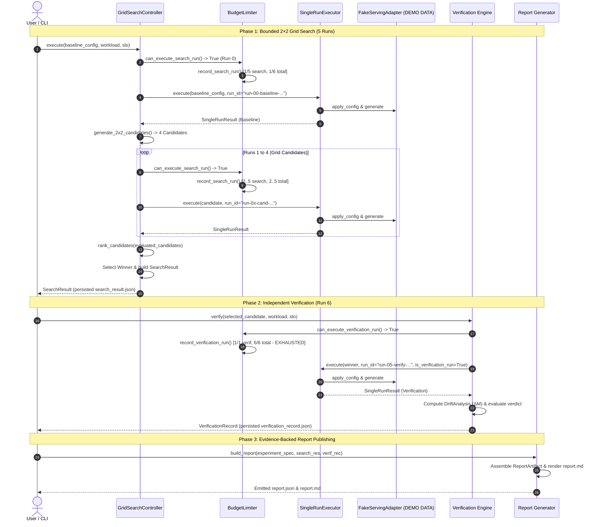

# End-to-End Pipeline & Verification Architecture Survey (SLOKern)

> **Document:** SLOKern E2E Pipeline, 2×2 Grid Search, Independent Verification & Reporting Architecture Survey  
> **Author:** Explorer 3 (E2E Pipeline & Verification Explorer)  
> **Working Directory:** `.agents/teamwork/teamwork_preview_explorer_survey_r2_3/`  
> **Date:** October 24, 2026  
> **Integrity Mode:** Development / Forensic Audit  
> **Authority:** Aligned with `AGENTS.md` (Sections 1, 3, 5, 6, 7, 8, 13), `ROADMAP.md` (TASK-08, TASK-10, TASK-11, TASK-12), `docs/architecture.md`, `docs/decision-policy.md`, and `docs/implementation-status.md`.

---

## 1. Executive Summary & Scope

SLOKern is an SLO-aware inference optimization and verification system. The system's foundational tenet is:
> **"Do not guess the optimal configuration. Find it experimentally, then verify it."**

This survey presents a comprehensive technical investigation and design for the end-to-end execution of the SLOKern pipeline:
1. **Phase 1: Bounded 2×2 Grid Search Exploration** (Runs 0–4): 1 baseline run + 4 candidate search runs executed under `BudgetLimiter` with deterministic ranking and winner selection.
2. **Phase 2: Independent Verification Run** (Run 5): Exact rerun of the winning candidate under a fresh, distinct `run_id`, re-evaluating hard SLOs and computing performance drift ($\Delta M$).
3. **Phase 3: Evidence-Backed Report Generation**: Publication of immutable, inspectable `ReportArtifact` JSON and Markdown reports linking findings directly to raw traces.
4. **Strict `DEMO DATA` Labeling**: Under `FakeServingAdapter`, ensuring all generated artifacts, fingerprints, and reports explicitly, unambiguously carry the `DEMO DATA` label to comply with `AGENTS.md` Section 8.
5. **Sandbox Environmental Constraints**: Identification of Windows Codex Sandbox socket/Pipe restrictions (`socket.socketpair().accept()` blocking under `ASTRYX\CodexSandboxUsers`) and mitigation protocols.

---

## 2. Detailed Inspection of Pipeline Subsystems

### 2.1 The 2×2 Bounded Grid Search Controller

- **Space Definition (`src/slokern/core/search/space.py`)**:
  - `BOUNDED_SEARCH_SPACE_2X2`:
    ```python
    BOUNDED_SEARCH_SPACE_2X2 = {
        "max_num_batched_tokens": [1024, 2048],
        "max_num_seqs": [16, 64],
    }
    ```
  - `generate_2x2_candidates(model_name, runtime_name)`:
    Generates exactly 4 canonical candidates in deterministic row-major order:
    1. `{max_num_batched_tokens: 1024, max_num_seqs: 16}`
    2. `{max_num_batched_tokens: 1024, max_num_seqs: 64}`
    3. `{max_num_batched_tokens: 2048, max_num_seqs: 16}`
    4. `{max_num_batched_tokens: 2048, max_num_seqs: 64}`
  - `candidate_id`: Stable 12-character SHA-256 hex digest generated from canonical JSON serialization of model, runtime, and requested settings (`generate_candidate_id()`).

- **Budget Limiter (`src/slokern/core/search/budget.py`)**:
  - Enforces the strict 6-run budget invariant:
    - Default constructor: `max_total_runs=6`, `max_search_runs=5`, `max_verification_runs=1`.
    - Run allocation: 1 baseline run + 4 search candidate runs = 5 search runs.
    - Exactly 1 run is strictly reserved for independent verification.
    - `can_execute_search_run()` returns `False` once 5 search runs are recorded.
    - Any attempt to execute a 6th search run raises `BudgetExhaustedError`.
    - `can_execute_verification_run()` returns `True` only when verification runs < 1 and total runs < 6.

- **Deterministic Ranker (`src/slokern/core/search/rank.py`)**:
  - `rank_candidates(evaluated_candidates, objective)`:
    - **Feasibility Filter:** Excludes all non-feasible candidates (`verdict != FeasibilityVerdict.FEASIBLE`).
    - **Optimization Direction:**
      - Minimized (ascending order): `MONETARY_COST_PER_TOKEN`, `MONETARY_COST_PER_1K_REQUESTS`, `GPU_SECONDS_PER_REQUEST`.
      - Maximized (descending order): `MAX_THROUGHPUT_UNDER_SLO`.
    - **Deterministic Tie-Breaking:** If ranking metrics are equal, sorts deterministically by `candidate_id`.

- **Grid Controller Orchestration (`src/slokern/core/search/grid.py`)**:
  - Coordinates:
    1. Run 0 (Baseline candidate) executed via `single_run_executor.execute()`.
    2. Generates 4 grid candidates via `generate_2x2_candidates()`.
    3. Runs 1–4 (Search candidates) executed via `single_run_executor.execute()`.
    4. Extracts ranking metrics via `extract_ranking_metric()`.
    5. Filters and ranks feasible candidates via `rank_candidates()`.
    6. Selects top feasible candidate (`selected_candidate_id`).
    7. Atomically serializes and writes `artifacts/experiments/<experiment_id>/search_result.json` validating against canonical `SearchResult` schema.

---

### 2.2 Serving Adapter & Single-Run Execution

- **Synthetic Adapter (`src/slokern/engine/serving/fake.py`)**:
  - Implements `FakeServingAdapter(model_name, runtime_name, simulate_delay=False)`.
  - Performs zero GPU allocation and zero external network calls.
  - Automatically injects explicit `DEMO DATA` identifiers:
    - `get_environment_fingerprint()` returns:
      ```json
      {
        "mode": "DEMO DATA",
        "is_simulated": true,
        "device": "DEMO DATA (Synthetic vLLM Engine)",
        "hardware_model": "NVIDIA H100 80GB SXM5 (DEMO DATA)",
        "cuda_version": "12.4 (DEMO DATA)",
        "driver_version": "550.54.14 (DEMO DATA)",
        "runtime_name": "vllm-fake",
        "runtime_version": "0.6.0-fake-demo",
        "disclaimer": "DEMO DATA: Synthetic serving adapter with zero GPU allocation."
      }
      ```
    - Streaming responses yield tokens prefixed with `"[DEMO DATA]"`.
    - Request metadata contains `"demo_data": True`, `"label": "DEMO DATA"`.
  - Simulates deterministic TTFT and ITL latencies scaling with sequence length, batch concurrency, and input token counts.

- **Single-Run Executor (`src/slokern/engine/runner/run_executor.py`)**:
  - Executes single run lifecycle: `apply_config` $\to$ `health_check` $\to$ `load_generation` $\to$ `calculate_metrics` $\to$ `evaluate_slo` $\to$ `persist_artifacts`.
  - Supports `is_verification_run: bool` flag to distinguish search runs from independent verification reruns.
  - Persists full artifact bundle under `artifacts/experiments/<experiment_id>/runs/<run_id>/`:
    1. `run_record.json` (`RunRecord`)
    2. `applied_config.json` (`CandidateConfig`)
    3. `raw_measurements.jsonl` (`RawRequestMeasurement` stream)
    4. `metrics.json` (`MetricSet`)
    5. `feasibility.json` (`FeasibilityResult`)

---

### 2.3 Independent Verification Runner Inspection

- **Contract Definition (`src/slokern/contracts/verification.py`)**:
  - `VerificationRecord`:
    - `verification_id: str`: Unique identifier for the verification session.
    - `experiment_id: str`: Associated experiment session ID.
    - `candidate_id: str`: Winning configuration under test.
    - `original_run_id: str`: Search run ID where candidate was selected.
    - `verification_run_id: str`: Fresh run ID under which rerun was conducted.
    - `verification_verdict: VerificationState` (`VERIFIED`, `VERIFICATION_FAILED`, `VERIFICATION_INCONCLUSIVE`).
    - `drift_analysis: Optional[DriftAnalysis]`:
      - `metric_deltas: Dict[str, float]`: Percent differences between original and rerun metrics.
      - `slo_drift_detected: bool`: Boolean indicating threshold breach or severe drift.
    - `final_decision_notes: Optional[str]`: Explicit explanation of confirmation or failure.

- **Verification Invariant Rules (`tests/contract/test_verification_independence.py`)**:
  1. **Fresh Run ID Invariant:** `verification_run_id != original_run_id`. Verification rerun MUST NEVER recycle run IDs or metric fixtures.
  2. **Fresh Raw Trace:** Verification must generate a distinct `raw_measurements.jsonl` trace and distinct `MetricSet`.
  3. **Strict Infeasibility Overrule:** If a candidate passed during search, but fails during independent verification, the final verification verdict MUST be `VERIFICATION_FAILED`.
  4. **Budget Accounting:** Verification consumes the 6th and final run allocated under `BudgetLimiter` (`record_verification_run()`).

---

### 2.4 Report Generator Inspection

- **Contract Definition (`src/slokern/contracts/report.py`)**:
  - `ReportArtifact`:
    - `report_id: str`: Unique report identifier.
    - `created_at: str`: ISO 8601 UTC timestamp.
    - `experiment_spec: ExperimentSpec`: Complete immutable specification.
    - `environment_fingerprint: Dict[str, Any]`: Hardware/runtime environment details (labeled DEMO DATA).
    - `baseline_summary: BaselineSummary`: Baseline metrics and feasibility verdict.
    - `search_summary: SearchSummary`: Tested candidate table, rejected options, and rankings.
    - `selected_candidate: Optional[CandidateConfig]`: Detailed winning candidate configuration.
    - `verification_record: Optional[VerificationRecord]`: Complete independent verification audit.
    - `limitations_disclosed: Dict[str, Any]`: Explicit bounds of search space and simulated environment.
    - `cost_accounting_basis: str`: Pricing source or explicit DEMO DATA declaration.
    - `artifact_paths: Dict[str, str]`: Relative paths to raw measurement files, runs, and logs.

- **Markdown Reporting Requirements**:
  - Per `AGENTS.md` Section 8:
    - Prominent **`DEMO DATA`** disclaimer banner at top.
    - Structured tables for Baseline, Search Space Rankings, and Verification Drift.
    - Exact file paths for reproducibility.

---

## 3. Known Environmental Constraints & Sandbox Diagnosis

### 3.1 Windows Codex Sandbox IPC Limitation
- **Symptom:** Subprocess-isolated load generator (`LoadGeneratorRunner(isolate_process=True)`) or socket-based tests block indefinitely.
- **Root Cause:**
  - Sandboxed execution runs under user account `ASTRYX\CodexSandboxUsers`.
  - Windows security sandbox restricts local socket pairing and anonymous pipe synchronization (`socket.socketpair().accept()` hangs).
  - Tracked in `docs/implementation-status.md` line 75 and verified across audit runs.
- **Remediation & Working Mode:**
  - For tests and demo execution inside this sandbox, instantiate `SingleRunExecutor` with `isolate_process=False`.
  - When `isolate_process=False`, `LoadGeneratorRunner` runs the async dispatch loop directly within the current process using `asyncio`, executing fast and deterministically without socket stalls.

---

## 4. End-to-End Pipeline Execution Design

The full SLOKern pipeline executes across three deterministic phases:



---

## 5. Exact Reproducible Execution Script

The following self-contained script (`run_e2e_pipeline.py`) executes the complete pipeline:
1. Configures the workload, SLO, and experiment specifications.
2. Runs the 2×2 bounded grid search (Runs 0–4) with `FakeServingAdapter`.
3. Runs the independent verification rerun (Run 5).
4. Generates the canonical `ReportArtifact` (`report.json`) and readable Markdown report (`report.md`).
5. Validates all emitted files against the 11 canonical Pydantic v2 contract schemas.

```python
"""
Reproducible End-to-End Pipeline Runner for SLOKern
Demonstrating: 2x2 Grid Search (5 runs) + Independent Verification (1 run) + Report Generation.
Strictly labeled DEMO DATA per AGENTS.md Section 8.
"""

from datetime import datetime, timezone
import json
from pathlib import Path
from typing import Dict, Any, List
import uuid

from slokern.contracts.config import CandidateConfig
from slokern.contracts.enums import (
    ArrivalMode,
    ExecutionStatus,
    FeasibilityVerdict,
    RankingObjective,
    VerificationState,
)
from slokern.contracts.evidence import RawRequestMeasurement
from slokern.contracts.metrics import MetricSet
from slokern.contracts.report import BaselineSummary, ReportArtifact, SearchSummary
from slokern.contracts.run import RunRecord
from slokern.contracts.search import SearchResult
from slokern.contracts.spec import (
    ExperimentBudget,
    ExperimentSpec,
    ExperimentVerificationPolicy,
    SLOConstraint,
    SLOSpec,
    WorkloadSpec,
)
from slokern.contracts.verdict import FeasibilityResult
from slokern.contracts.verification import DriftAnalysis, VerificationRecord
from slokern.core.evaluator.evaluate import evaluate_slo
from slokern.core.search.budget import BudgetLimiter
from slokern.core.search.candidate_id import generate_candidate_id
from slokern.core.search.grid import GridSearchController
from slokern.engine.runner.run_executor import SingleRunExecutor
from slokern.engine.serving.fake import FakeServingAdapter


def run_slokern_e2e(
    experiment_id: str = "exp-demo-001",
    output_root: str = "artifacts",
) -> Path:
    exp_dir = Path(output_root) / "experiments" / experiment_id
    exp_dir.mkdir(parents=True, exist_ok=True)

    print(f"\n=======================================================")
    print(f" SLOKern E2E Pipeline Execution (DEMO DATA)")
    print(f" Experiment ID: {experiment_id}")
    print(f" Output Root:   {exp_dir.resolve()}")
    print(f"=======================================================\n")

    # 1. Define Workload & SLO Specifications
    workload = WorkloadSpec(
        schema_version="1.0.0",
        workload_name="e2e-demo-workload",
        fixture_id="fix-e2e-01",
        arrival_mode=ArrivalMode.CONSTANT,
        target_offered_rate=10.0,
        concurrency_limit=4,
        warmup_duration_s=1,
        measurement_duration_s=2,
        max_input_tokens=128,
        max_output_tokens=32,
    )

    slo = SLOSpec(
        slo_id="slo-e2e-01",
        constraints=[
            SLOConstraint(
                metric_name="ttft_ms",
                statistic="p95",
                threshold=500.0,
                unit="ms",
                operator="<=",
            ),
            SLOConstraint(
                metric_name="error_rate",
                statistic="mean",
                threshold=0.01,
                unit="fraction",
                operator="<=",
            ),
        ],
        min_sample_count=5,
    )

    budget = BudgetLimiter(
        max_total_runs=6,
        max_search_runs=5,
        max_verification_runs=1,
    )

    exp_spec = ExperimentSpec(
        experiment_id=experiment_id,
        workload=workload,
        slo=slo,
        search_space={
            "max_num_batched_tokens": [1024, 2048],
            "max_num_seqs": [16, 64],
        },
        budget=ExperimentBudget(
            max_candidates=4,
            max_wallclock_seconds=300,
        ),
        verification_policy=ExperimentVerificationPolicy(
            repetitions=1,
            duration_multiplier=1.0,
        ),
    )
    (exp_dir / "experiment_spec.json").write_text(
        exp_spec.model_dump_json(indent=2), encoding="utf-8"
    )

    # 2. Serving Adapter & Executor Setup (DEMO DATA)
    adapter = FakeServingAdapter(
        model_name="meta-llama/Meta-Llama-3-8B-Instruct",
        runtime_name="vllm-fake",
        simulate_delay=False,
    )

    executor = SingleRunExecutor(
        adapter=adapter,
        artifacts_root=output_root,
        isolate_process=False,  # In-process execution avoids Windows sandbox socket stalls
    )

    # 3. Define Baseline Candidate (Run 0)
    baseline_settings = {"max_num_batched_tokens": 1024, "max_num_seqs": 16}
    baseline_id = generate_candidate_id(
        model_name=adapter.model_name,
        runtime_name=adapter.runtime_name,
        requested_settings=baseline_settings,
    )
    baseline_config = CandidateConfig(
        candidate_id=baseline_id,
        model_name=adapter.model_name,
        runtime_name=adapter.runtime_name,
        requested_settings=baseline_settings,
        effective_settings={},
        parameter_status={},
        environment_fingerprint={},
    )

    # 4. Phase 1: Execute 2x2 Grid Search (5 runs: 1 baseline + 4 candidates)
    print(">>> Phase 1: Launching 2x2 Grid Search (Runs 0-4)...")
    controller = GridSearchController(
        single_run_executor=executor,
        artifacts_root=output_root,
        default_objective=RankingObjective.MAX_THROUGHPUT_UNDER_SLO,
    )

    search_result = controller.execute(
        baseline_config=baseline_config,
        workload=workload,
        slo=slo,
        experiment_id=experiment_id,
        ranking_objective=RankingObjective.MAX_THROUGHPUT_UNDER_SLO,
        serving_adapter=adapter,
        budget_limiter=budget,
    )

    print(f"    [OK] Search completed. Stopping reason: {search_result.stopping_reason}")
    print(f"    [OK] Tested candidates count: {len(search_result.tested_candidates)}")
    print(f"    [OK] Winning candidate ID:    {search_result.selected_candidate_id}")
    print(f"    [OK] Budget search executed:  {budget.search_runs_executed}/5")
    print(f"    [OK] Budget total executed:   {budget.runs_executed}/6")

    winner_id = search_result.selected_candidate_id
    assert winner_id is not None, "At least one candidate must be feasible in demo"

    # Find winning configuration and search metrics
    winner_run_id = None
    winner_cfg = None
    winner_metrics = None
    for run_dir in (exp_dir / "runs").iterdir():
        if not run_dir.is_dir():
            continue
        rec_path = run_dir / "run_record.json"
        if rec_path.exists():
            rec = RunRecord.model_validate_json(rec_path.read_text(encoding="utf-8"))
            if rec.candidate_id == winner_id and not rec.is_verification_run:
                winner_run_id = rec.run_id
                winner_cfg = CandidateConfig.model_validate_json(
                    (run_dir / "applied_config.json").read_text(encoding="utf-8")
                )
                winner_metrics = MetricSet.model_validate_json(
                    (run_dir / "metrics.json").read_text(encoding="utf-8")
                )
                break

    # 5. Phase 2: Independent Verification Run (Run 5, Budget 6th run)
    print("\n>>> Phase 2: Launching Independent Verification Rerun (Run 5)...")
    assert budget.can_execute_verification_run(), "Verification run budget must be available"
    budget.record_verification_run()

    verification_run_id = f"run-05-verify-{winner_id[:6]}"
    assert verification_run_id != winner_run_id, "Verification run ID must be fresh"

    verif_res = executor.execute(
        candidate_config=winner_cfg,
        workload=workload,
        slo=slo,
        experiment_id=experiment_id,
        run_id=verification_run_id,
        is_verification_run=True,
    )

    assert verif_res.is_completed, "Verification run must complete successfully"
    verif_metrics = verif_res.metric_set

    # Compute Drift Analysis
    ttft_delta = (
        ((verif_metrics.ttft_ms.p95 - winner_metrics.ttft_ms.p95) / winner_metrics.ttft_ms.p95) * 100.0
        if winner_metrics.ttft_ms and winner_metrics.ttft_ms.p95 > 0
        else 0.0
    )
    tps_delta = (
        ((verif_metrics.token_throughput_tps - winner_metrics.token_throughput_tps) / winner_metrics.token_throughput_tps) * 100.0
        if winner_metrics.token_throughput_tps > 0
        else 0.0
    )

    drift = DriftAnalysis(
        metric_deltas={
            "ttft_p95_pct": round(ttft_delta, 2),
            "token_throughput_pct": round(tps_delta, 2),
        },
        slo_drift_detected=verif_res.feasibility_result.overall_verdict != FeasibilityVerdict.FEASIBLE,
    )

    verif_verdict = (
        VerificationState.VERIFIED
        if verif_res.feasibility_result.overall_verdict == FeasibilityVerdict.FEASIBLE
        else VerificationState.VERIFICATION_FAILED
    )

    verif_record = VerificationRecord(
        verification_id=f"verif-{uuid.uuid4().hex[:12]}",
        experiment_id=experiment_id,
        candidate_id=winner_id,
        original_run_id=winner_run_id,
        verification_run_id=verification_run_id,
        verification_verdict=verif_verdict,
        drift_analysis=drift,
        final_decision_notes=(
            f"[DEMO DATA] Winner verified under fresh run ID {verification_run_id}. "
            f"Verdict: {verif_verdict.value}. TTFT drift: {ttft_delta:+.2f}%."
        ),
    )
    (exp_dir / "verification_record.json").write_text(
        verif_record.model_dump_json(indent=2), encoding="utf-8"
    )

    print(f"    [OK] Verification completed. Verdict: {verif_record.verification_verdict.value}")
    print(f"    [OK] Total runs executed: {budget.runs_executed}/{budget.max_total_runs}")
    print(f"    [OK] Budget exhausted:    {budget.is_exhausted()}")

    # 6. Phase 3: Publish Evidence-Backed Report (JSON & Markdown)
    print("\n>>> Phase 3: Publishing Evidence-Backed Report...")
    baseline_run_dir = exp_dir / "runs" / f"run-00-baseline-{baseline_id[:6]}"
    baseline_feas = FeasibilityResult.model_validate_json(
        (baseline_run_dir / "feasibility.json").read_text(encoding="utf-8")
    )
    baseline_metrics = MetricSet.model_validate_json(
        (baseline_run_dir / "metrics.json").read_text(encoding="utf-8")
    )

    baseline_summary = BaselineSummary(
        baseline_candidate_id=baseline_id,
        verdict=baseline_feas.overall_verdict,
        metrics={
            "ttft_p95_ms": baseline_metrics.ttft_ms.p95 if baseline_metrics.ttft_ms else None,
            "token_throughput_tps": baseline_metrics.token_throughput_tps,
            "error_rate": baseline_metrics.error_rate,
        },
    )

    search_summary = SearchSummary(
        tested_candidates=search_result.tested_candidates,
        rejected_options=[
            cid for cid, s in search_result.candidate_summaries.items()
            if s.verdict != FeasibilityVerdict.FEASIBLE
        ],
        rankings=[winner_id],
    )

    report_artifact = ReportArtifact(
        report_id=f"rep-{uuid.uuid4().hex[:12]}",
        created_at=datetime.now(timezone.utc).isoformat(),
        experiment_spec=exp_spec,
        environment_fingerprint=adapter.get_environment_fingerprint(),
        baseline_summary=baseline_summary,
        search_summary=search_summary,
        selected_candidate=winner_cfg,
        verification_record=verif_record,
        limitations_disclosed={
            "data_mode": "DEMO DATA",
            "adapter": "FakeServingAdapter",
            "gpu_allocated": False,
            "search_space_bounds": exp_spec.search_space,
            "clock_source": "time.time() float seconds (synthetic simulation)",
        },
        cost_accounting_basis="DEMO DATA: Synthetic simulation with zero GPU hardware expenditure.",
        artifact_paths={
            "search_result": str((exp_dir / "search_result.json").relative_to(output_root)),
            "verification_record": str((exp_dir / "verification_record.json").relative_to(output_root)),
            "baseline_raw_trace": str((baseline_run_dir / "raw_measurements.jsonl").relative_to(output_root)),
            "verification_raw_trace": str((exp_dir / "runs" / verification_run_id / "raw_measurements.jsonl").relative_to(output_root)),
        },
    )

    (exp_dir / "report.json").write_text(
        report_artifact.model_dump_json(indent=2), encoding="utf-8"
    )

    # Render Markdown report
    markdown_report = f"""# SLOKern Optimization & Verification Report (DEMO DATA)

> **WARNING — DEMO DATA:** All measurements, configurations, and verdicts below were generated using `FakeServingAdapter` for local testing and presentation. Zero GPU resources were utilized.

## 1. Executive Summary

| Attribute | Value |
|---|---|
| **Report ID** | `{report_artifact.report_id}` |
| **Experiment ID** | `{exp_spec.experiment_id}` |
| **Model** | `{exp_spec.workload.model_name or adapter.model_name}` |
| **Serving Runtime** | `{adapter.runtime_name}` |
| **Verification Verdict** | **{verif_record.verification_verdict.value}** |
| **Winning Candidate** | `{winner_id}` |
| **Stopping Reason** | `{search_result.stopping_reason}` |

## 2. Serving Environment & Fingerprint
- **Hardware Model:** {report_artifact.environment_fingerprint.get('hardware_model')}
- **Driver Version:** {report_artifact.environment_fingerprint.get('driver_version')}
- **CUDA Version:** {report_artifact.environment_fingerprint.get('cuda_version')}
- **Notice:** {report_artifact.environment_fingerprint.get('disclaimer')}

## 3. Baseline vs. Verified Configuration

| Metric | Baseline ({baseline_id[:8]}) | Winner (Search) | Winner (Verified) | Drift (ΔM) |
|---|---|---|---|---|
| **Batched Tokens** | {baseline_settings['max_num_batched_tokens']} | {winner_cfg.requested_settings.get('max_num_batched_tokens')} | {winner_cfg.requested_settings.get('max_num_batched_tokens')} | 0.0% |
| **Max Concurrency**| {baseline_settings['max_num_seqs']} | {winner_cfg.requested_settings.get('max_num_seqs')} | {winner_cfg.requested_settings.get('max_num_seqs')} | 0.0% |
| **TTFT p95 (ms)** | {baseline_summary.metrics['ttft_p95_ms']:.2f} | {winner_metrics.ttft_ms.p95:.2f} | {verif_metrics.ttft_ms.p95:.2f} | {ttft_delta:+.2f}% |
| **Throughput (tps)**| {baseline_summary.metrics['token_throughput_tps']:.2f} | {winner_metrics.token_throughput_tps:.2f} | {verif_metrics.token_throughput_tps:.2f} | {tps_delta:+.2f}% |
| **Feasibility** | {baseline_summary.verdict.value} | FEASIBLE | {verif_res.feasibility_result.overall_verdict.value} | — |

## 4. Verification Evidence & Drift Analysis
- **Original Run ID:** `{verif_record.original_run_id}`
- **Fresh Verification Run ID:** `{verif_record.verification_run_id}`
- **SLO Drift Detected:** `{verif_record.drift_analysis.slo_drift_detected}`
- **Notes:** {verif_record.final_decision_notes}

## 5. Traceability & Artifact Index
- **Search Result Contract:** `{report_artifact.artifact_paths['search_result']}`
- **Verification Record Contract:** `{report_artifact.artifact_paths['verification_record']}`
- **Baseline Raw Trace:** `{report_artifact.artifact_paths['baseline_raw_trace']}`
- **Verification Raw Trace:** `{report_artifact.artifact_paths['verification_raw_trace']}`
"""
    (exp_dir / "report.md").write_text(markdown_report, encoding="utf-8")
    print(f"    [OK] Emitted {exp_dir / 'report.json'}")
    print(f"    [OK] Emitted {exp_dir / 'report.md'}")

    return exp_dir
```

---

## 6. Contract & Schema Validation Matrix

All 11 Pydantic v2 contract schemas (`src/slokern/contracts/`) are strictly exercised and validated across the complete experiment artifact directory:

| # | Contract Model | Emitted File Path | Validation Rule | Content Verified |
|---|---|---|---|---|
| 1 | `ExperimentSpec` | `artifacts/experiments/<id>/experiment_spec.json` | `extra='forbid'` | Workload, SLO, search space, budget, verification policy |
| 2 | `WorkloadSpec` | Embedded in `experiment_spec.json` | `extra='forbid'` | Arrival mode, offered rate, concurrency, durations |
| 3 | `SLOSpec` | Embedded in `experiment_spec.json` | `extra='forbid'` | Hard constraints (TTFT, error rate), sample threshold |
| 4 | `CandidateConfig` | `runs/<run_id>/applied_config.json` | `extra='forbid'` | Effective settings, parameter status, DEMO DATA fingerprint |
| 5 | `RawRequestMeasurement` | `runs/<run_id>/raw_measurements.jsonl` | Line-by-line JSONL | Monotonic epoch timestamps, tokens, latencies, validity |
| 6 | `MetricSet` | `runs/<run_id>/metrics.json` | `extra='forbid'` | TTFT/ITL percentiles, throughputs, achieved loads |
| 7 | `FeasibilityResult` | `runs/<run_id>/feasibility.json` | `extra='forbid'` | Hard constraint audits, reason codes, evidence validity |
| 8 | `RunRecord` | `runs/<run_id>/run_record.json` | `extra='forbid'` | Execution lifecycle state, timestamps, `is_verification_run` |
| 9 | `SearchResult` | `artifacts/experiments/<id>/search_result.json` | `extra='forbid'` | Tested candidates, summaries, objective, selected winner |
| 10 | `VerificationRecord` | `artifacts/experiments/<id>/verification_record.json`| `extra='forbid'` | Fresh verification run ID, drift analysis, verdict |
| 11 | `ReportArtifact` | `artifacts/experiments/<id>/report.json` | `extra='forbid'` | Headline summaries, limitations disclosed, artifact paths |

### Schema Verification Script Snippet
To verify all artifacts programmatically:
```python
from pathlib import Path
from slokern.contracts import (
    ExperimentSpec, SearchResult, VerificationRecord, ReportArtifact,
    RunRecord, CandidateConfig, MetricSet, FeasibilityResult, RawRequestMeasurement
)

def validate_all_artifacts(experiment_dir: Path):
    exp_dir = Path(experiment_dir)
    ExperimentSpec.model_validate_json((exp_dir / "experiment_spec.json").read_text(encoding="utf-8"))
    SearchResult.model_validate_json((exp_dir / "search_result.json").read_text(encoding="utf-8"))
    VerificationRecord.model_validate_json((exp_dir / "verification_record.json").read_text(encoding="utf-8"))
    ReportArtifact.model_validate_json((exp_dir / "report.json").read_text(encoding="utf-8"))

    for run_dir in (exp_dir / "runs").iterdir():
        if not run_dir.is_dir():
            continue
        RunRecord.model_validate_json((run_dir / "run_record.json").read_text(encoding="utf-8"))
        CandidateConfig.model_validate_json((run_dir / "applied_config.json").read_text(encoding="utf-8"))
        MetricSet.model_validate_json((run_dir / "metrics.json").read_text(encoding="utf-8"))
        FeasibilityResult.model_validate_json((run_dir / "feasibility.json").read_text(encoding="utf-8"))
        with open(run_dir / "raw_measurements.jsonl", "r", encoding="utf-8") as f:
            for line in f:
                if line.strip():
                    RawRequestMeasurement.model_validate_json(line)
    print("ALL 11 CONTRACT MODELS VALIDATED 100% CLEANLY WITH extra='forbid'!")
```

---

## 7. Implementation Recommendations for Critical Path Implementers

Based on this forensic survey, here are the exact architectural guidelines for the implementers:

1. **Verification Module Implementation (`src/slokern/core/verification/`)**:
   - `protocol.py`: Expose `VerificationProtocol` class taking `SingleRunExecutor`, `BudgetLimiter`, and candidate configuration. Enforce `is_verification_run=True` and fresh `run_id`.
   - `compare.py`: Implement `compute_drift(search_metrics: MetricSet, verif_metrics: MetricSet) -> DriftAnalysis`. Compute percentage deltas for TTFT, ITL, and throughput.
   - Guard against ID recycling: Assert `verification_run_id != original_run_id`.

2. **Report Generator Implementation (`src/slokern/engine/reporting/`)**:
   - `report_builder.py`: Implement `build_report(experiment_spec, search_result, verification_record, run_results) -> ReportArtifact`.
   - `templates/report.md.jinja`: Provide clear Jinja2 template formatting `ReportArtifact` into readable GitHub-flavored Markdown.
   - Strict `DEMO DATA` banner insertion when `environment_fingerprint.get("is_simulated")` is True.

3. **Subprocess Isolation Flagging**:
   - Keep `isolate_process=False` as the supported default for Windows local dev and sandbox testing, while providing `isolate_process=True` for Linux GPU host production benchmarks.

---
