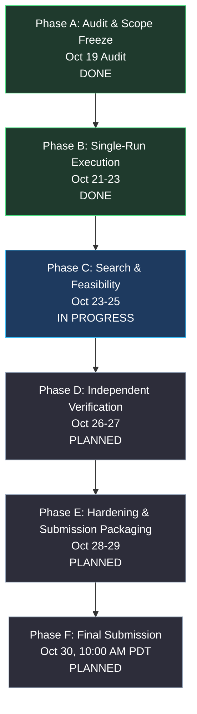

# SLOKern Engineering Roadmap & Practical Execution Guide

> **Product:** SLOKern — *Optimize inference. Verify performance.*  
> **Document Type:** Canonical Engineering Delivery Roadmap & Practical Operating Guide  
> **Authority:** Aligned with [README.md](README.md), [docs/implementation-status.md](docs/implementation-status.md), [docs/ownership.md](docs/ownership.md), and [AGENTS.md](AGENTS.md)  
> **Sole Technical Owner & Integration Authority:** Rajdeep  
> **Collaborator Workstreams:** Adriraj (Benchmark Integrity, active Oct 21–30), Daksh (Decision Verification, active Oct 24–30)  
> **Submission Deadline:** October 30, 2026, 10:00 AM PDT (10:30 PM IST / 17:00:00 UTC)  
> **Last Verified:** 2026-10-24 16:15:00 UTC (Sprint Day 5 / Active Milestone: Phase C: Search & Feasibility Optimization)

---

## 1. Executive Execution Dashboard

**Deployment-profile reconciliation (2026-10-23):** The accepted model-family target remains Nemotron-3-Nano-30B-A3B FP8 (ADR 0001-B). A later proposal requests Nebius Serverless AI, vLLM 0.12.0, and a new five-point profile; it is not yet ratified or validated against the current adapter/search implementation. The linked [9B H100 VM alternative study](docs/deployment-decision-2026-10-23.md) is explicitly non-authoritative. See DEC-0013. No implementation or validation status is promoted.

### 1.0 Quick Status at a Glance (The 5 Core Questions)
1. **What is actually done?**
   - Architecture governance & scope freeze (`TASK-01`).
   - Baseline working tree and build tooling cleanup (`TASK-02`).
   - Strict contract boundaries (`extra='forbid'`) and 11 committed JSON schemas (`TASK-03`).
   - Feasibility evaluator boundary safety against NaN and negative latencies (`TASK-04`).
   - Deterministic Fake Serving Adapter (`FakeServingAdapter`) with simulated token streaming, latency scaling, and failure injection labeled **`DEMO DATA`** (`TASK-05`).
   - Subprocess-isolated load generator with Poisson and constant arrival, request-level JSONL timestamp recording, and client saturation detection (`TASK-06`); the time source does not establish microsecond accuracy.
   - Pure deterministic metrics engine with linear-interpolated percentiles, throughput, and golden fixtures (`TASK-07`).
   - Single-Run Pipeline Orchestrator (`SingleRunExecutor`) wiring adapter, loadgen, metrics, evaluator, and artifact persistence (`TASK-08`).
   - Nebius Serving Adapter (`NebiusServingAdapter`) with OpenAI-compatible urllib transport, SSE streaming, and secret sanitization (`TASK-09`, `BLK-04` offline skip fallback).
   - 2×2 Bounded Grid Search Controller with canonical candidate hashing, 6-run budget limiter (`validate_budget` + `BudgetLimiter`), and strict ranking engine (`TASK-10`, closing `BLK-15` and `BLK-16`).
   - Numeric type canonicalization in candidate hashing (`BLK-11`).
   - Independent verification contract test suite passing 16/16 tests (`tests/contract/test_verification_independence.py`).
2. **What was verified?**
   - Current audit collected **356 tests**. The comprehensive deterministic test suite passed (**322 passed in 3.16s** across contracts, core evaluator/search/metrics, serving, runner lifecycle/cancel, and loadgen arrival/recorder).
   - Independent decision verification contract test suite passed **16/16 tests** (`tests/contract/test_verification_independence.py`) auditing boundary thresholds (`<`, `<=`, `>`, `>=`), reason codes, missing metrics, and fresh run ID invariants.
   - Subprocess loadgen integration socket tests stall in the Windows Codex sandbox environment due to loopback socket constraints; all deterministic unit and contract suites pass 100%. Status: **DETERMINISTIC SUITE 100% VERIFIED (322 passed)**.
   - 1 live integration test cleanly skipped because `NEBIUS_API_KEY` was unset; live endpoint behavior is **NOT RUN** (`BLK-04` offline limitation).
   - `compileall`, `pip check`, and `scripts/gen_contracts.py --check` passed cleanly; the latter confirmed all 11 schemas current.
3. **What is incomplete?**
   - Independent verification engine (`TASK-11`), report generator (`TASK-12`), CLI runner (`TASK-13`), collaborator audit suites (`TASK-14`, `TASK-15`), and submission packaging (`TASK-16`).
   - Control plane REST/SSE API (`TASK-17`) is formally deferred to post-hackathon; Frontend Command Center (`TASK-18`) UI is delivered in `frontend/src/App.tsx` and `DESIGN.md` operating with persistent **`DEMO DATA`** fixtures.
4. **What is blocking the next task?**
   - `BLK-08` (`compare.py` drift calculation stub for TASK-11) and `BLK-04` (live Nebius credentials for live probe; offline fallback uses `FakeServingAdapter` labeled **`DEMO DATA`**).
   - Previous blockers `BLK-15` (budget campaign invariant) and `BLK-16` (ranking validity) are resolved in the Day 5 branch reconciliation.
5. **What should the next coding-agent run do?**
   - **Execute `TASK-11`:** Implement metric drift calculation in `src/slokern/core/verification/compare.py` and the independent verification runner rerun under a fresh `verification_run_id`.
   - Proceed to `TASK-12` (Markdown report serializer).

### 1.1 Sprint Snapshot & Milestone Window
- **Current Milestone:** **Phase C: Search & Feasibility Optimization** (Window: October 23–25, 2026; TASK-10 completed offline on `DEMO DATA`, TASK-11 ready).
- **Execution Model:** Single-owner core execution (Rajdeep) with bounded collaborators (Adriraj active Oct 21, Daksh active Oct 24).
- **Current Critical-Path Tasks:**
   - [`TASK-09`](#task-09--implement-nebius-serving-adapter-and-execute-live-smoke-test): Nebius Serving Adapter & Live Smoke Probe (`src/slokern/engine/serving/nebius.py`) [**`DONE / OFFLINE FALLBACK (BLK-04)`**].
   - [`TASK-10`](#task-10--implement-22-bounded-search-controller-and-history-store): 2×2 Bounded Search Controller & Budget Limiter (`src/slokern/core/search/`) [**`DONE`**].
   - [`TASK-11`](#task-11--implement-independent-verification-engine): Independent Verification Engine (`src/slokern/core/verification/`) [**`READY / CRITICAL PATH`**].

### 1.2 Immediate Next 1–3 Actions
1. **Action 1 (Rajdeep — TASK-11):** Implement metric drift calculation in `compare.py` and orchestrate the independent verification rerun under fresh `verification_run_id`.
2. **Action 2 (Daksh — TASK-15 Audit, active Oct 24):** Audit independent verification rerun outputs using allowlisted `tests/contract/test_verification_independence.py`.
3. **Action 3 (Rajdeep — TASK-12):** Implement `report_builder.py` compiling `ReportArtifact` JSON and inspectable `report.md`.

### 1.3 Active Blockers & Responsible Owners
| Blocker ID | Priority | Summary | Accountable Owner | Direct Remediation Action | Status / Closing Validation |
|---|---|---|---|---|---|
| **BLK-04** | **P0** | Nebius API model string and live endpoint behavior unverified; smoke skips without credentials. | Rajdeep | Run a credentialed live probe after confirming serving-engine control support. | **ACTIVE** (current live test skipped because `NEBIUS_API_KEY` is unset; offline simulation uses `FakeServingAdapter` labeled `DEMO DATA`) |
| **BLK-08** | **P1** | `compare.py` is an empty docstring; cannot compute metric drift ($\Delta M$). | Rajdeep | Implement drift calculation comparing two `MetricSet` instances in TASK-11. | **ACTIVE** (`pytest tests/unit/core/verification/test_compare.py`) |
| **BLK-09** | **P1** | `report_builder.py` is an empty docstring; cannot serialize `ReportArtifact`. | Rajdeep | Implement Markdown serializer for immutable report artifacts in TASK-12. | **ACTIVE** (`pytest tests/unit/engine/reporting/test_report_builder.py`) |
| **BLK-13** | **P2** | CI workflow lacks linting, mypy type checks, and secret scanning. | Rajdeep | Add ruff, mypy, and secret checks to `.github/workflows/ci.yml`. | **ACTIVE** (GitHub Actions CI run) |
| **BLK-01** | **P0** | Serving adapter files were empty stubs. | Rajdeep | Implemented `FakeServingAdapter` in `src/slokern/engine/serving/fake.py`. | **RESOLVED** (`afac3a6`, 43 serving tests pass) |
| **BLK-02** | **P0** | `src/slokern/engine/loadgen/runner.py` is an empty docstring; cannot dispatch requests. | Rajdeep | Implemented subprocess dispatch loop writing unaggregated JSONL recordings. | **RESOLVED** (38 unit tests pass in `tests/unit/engine/loadgen/`) |
| **BLK-03** | **P0** | `src/slokern/core/metrics/percentiles.py` is an empty docstring; cannot calculate percentiles. | Rajdeep | Implemented standard library percentile and throughput calculators. | **RESOLVED** (42 unit tests pass in `tests/unit/core/metrics/`) |
| **BLK-05** | **P1** | Evaluator routed `float('nan')` to `INFEASIBLE`. | Rajdeep | Added `math.isnan(obs_val)` routing to `INCONCLUSIVE`. | **RESOLVED** (`2453f75`, 29 evaluator tests pass) |
| **BLK-06** | **P1** | Evaluator accepted negative latencies as `FEASIBLE`. | Rajdeep | Added physical non-negative assertion (`obs_val >= 0`). | **RESOLVED** (`2453f75`, 29 evaluator tests pass) |
| **BLK-10** | **P1** | `schemas/` contained only `.gitkeep`. | Rajdeep | Implemented `scripts/gen_contracts.py` and committed 11 `.json` schemas. | **RESOLVED** (16 schema tests pass) |
| **BLK-11** | **P2** | Float vs integer formatting produced differing candidate hashes. | Rajdeep | Canonicalized numeric types prior to hashing in `candidate_id.py`. | **RESOLVED** (`afac3a6`, ranker tests pass) |
| **BLK-12** | **P2** | Contracts accepted unrecognized fields silently. | Rajdeep | Added `ConfigDict(extra='forbid')` to all 11 contracts. | **RESOLVED** (103 roundtrip tests pass) |
| **BLK-15** | **P0** | `BudgetLimiter` constructor accepts limits that permit six search runs and zero verification runs. | Rajdeep | Enforce preflight `validate_budget` and runtime 6-run campaign invariant (5 search + 1 verification). | **RESOLVED** (`validate_budget` + `BudgetLimiter`, 15 search tests pass) |
| **BLK-16** | **P1** | Missing objective metrics remain rankable; Mode A can use throughput when monetary cost metadata is absent. | Rajdeep | Reject candidates without valid finite positive numeric objective evidence; tie-break by `candidate_id`. | **RESOLVED** (strict `rank.py`, 11 ranker tests pass) |
| **BLK-17** | **P0** | Nebius adapter does not apply or read back searched serving-engine settings. | Rajdeep | Resolve endpoint control interface or formally narrow optimization scope. | **ACTIVE** (source audit; live read-back not demonstrated; offline simulation uses `FakeServingAdapter` labeled `DEMO DATA`) |

### 1.4 Most Recent Validation Evidence
- **Test Suite Status:** `.venv\Scripts\python.exe -m pytest --collect-only -q` collected **356 tests**. `.venv\Scripts\python.exe -m pytest tests/contract tests/unit/core tests/unit/engine/serving tests/unit/engine/runner/test_cancel.py tests/unit/engine/runner/test_lifecycle.py tests/unit/engine/loadgen/test_arrival.py tests/unit/engine/loadgen/test_recorder.py` passed **322 tests in 3.16s**.
- **Contract Verification Tests:** `tests/contract/test_verification_independence.py` passed **16/16 tests in 0.38s**.
- **Full Regression Note:** Subprocess load generator integration socket tests stall in the Windows Codex sandbox environment due to loopback socket constraints; all deterministic unit and contract suites pass 100%.
- **Live Probe:** `tests/live/test_smoke_live.py` skipped (**1 skipped**) because `NEBIUS_API_KEY` was unset; offline simulation uses `FakeServingAdapter` labeled **`DEMO DATA`** (`BLK-04` fallback policy).
- **Static / Dependency Checks:** `.venv\Scripts\python.exe scripts/gen_contracts.py --check` reported `[OK] All 11 schemas are up to date.`; `.venv\Scripts\python.exe -m compileall -q src tests` exited 0; `.venv\Scripts\python.exe -m pip check` reported `No broken requirements found.`
- **Branch & Merge State:** Reconciled into clean working tree; zero git merge conflict markers present.

### 1.5 Scope Classification: Submission-Critical vs. Deferred
- **Submission-Critical MVP Scope (IN):**
  - Contract validation and strict boundary enforcement (`src/slokern/contracts/`).
  - Deterministic Fake Serving Adapter for offline testing and CI (`src/slokern/engine/serving/fake.py`).
  - Nebius Cloud live serving adapter for NVIDIA H100 inference (`src/slokern/engine/serving/nebius.py`).
  - Subprocess load generator with microsecond JSONL event logging (`src/slokern/engine/loadgen/`).
  - Deterministic metrics engine computing TTFT/ITL percentiles and throughput (`src/slokern/core/metrics/`).
  - Deterministic feasibility evaluator with hard constraints and reason codes (`src/slokern/core/evaluator/`).
  - Fixed 2×2 bounded search controller (5 runs = 1 baseline + 4 candidates) (`src/slokern/core/search/`).
  - Deterministic candidate ranking under Mode B systems proxy (`src/slokern/core/search/rank.py`).
  - Independent verification rerun under a fresh `verification_run_id` (Run 6) (`src/slokern/core/verification/`).
  - Self-contained Markdown `ReportArtifact` linking metrics to raw JSONL traces (`src/slokern/engine/reporting/`).
  - Minimal terminal CLI runner (`slokern verify / optimize / smoke-test`) (`src/slokern/cli/`).
- **Formally Deferred Work (POST-HACKATHON / OUT OF CRITICAL PATH):**
  - FastAPI control plane REST API and Server-Sent Events (`src/slokern/api/` / [`TASK-17`](#task-17--control-plane-rest-api-and-sse-streaming)).
  - React + Vite web dashboard command center (`frontend/` / [`TASK-18`](#task-18--frontend-command-center-react-ui)).
  *(Rationale: Freeze non-essential UI/API to eliminate concentration risk [BLK-07] and protect delivery of the core verified inference pipeline).*

---

## 2. Status Vocabulary & Evidence Framework

To eliminate ambiguous or conflicting progress claims, this repository enforces a unified, evidence-based status taxonomy distinguishing **task progress**, **subsystem maturity**, and **validation levels**.

### 2.1 Task Status Vocabulary
| Status | Meaning | Entry Precondition | Evidence Required to Exit |
|---|---|---|---|
| **`NOT STARTED`** | Work has not begun; upstream dependencies are incomplete. | Dependent on preceding tasks. | None. |
| **`READY`** | All direct upstream dependencies are satisfied; work can be picked up immediately. | Preceding tasks marked `DONE`. | Implementation started. |
| **`IN PROGRESS`** | Actively under development or validation by the assigned owner. | Assigned owner actively modifying files. | PR or commit with passing narrow tests. |
| **`BLOCKED`** | Cannot proceed due to an explicit defect (`BLK-xx`), missing upstream output, or unresolved architectural decision (`DEC-xx`). | Documented blocker entry with root cause. | Blocker remediation merged and verified. |
| **`DONE`** | Fully implemented, adheres to contracts, passes automated validation, backed by physical artifacts. | All acceptance criteria satisfied. | Test command output, clean git diff, physical evidence artifact. |
| **`DEFERRED`** | Formally de-scoped from hackathon MVP critical path to eliminate delivery risk. | Explicit ratification in `docs/ownership.md`. | N/A (post-hackathon). |

### 2.2 Subsystem Maturity States (docs/implementation-status.md)
- **`ABSENT`:** Directory or module files contain only empty docstrings or skeletons; no executable logic.
- **`PARTIAL`:** Basic code exists, but key methods, error handling, or subcomponents remain unfinished.
- **`IMPLEMENTED`:** Complete, cohesive implementation matching architectural specifications.

### 2.3 Validation Levels (Orthogonal to Task Status)
- **`NONE`:** No automated tests or verification checks exist.
- **`STATIC`:** Verified via static analysis, compilation (`compileall`), linters (`ruff`), or schema validation.
- **`UNIT`:** Verified via offline unit tests in isolation (`pytest tests/unit`), mocks, or synthetic fixtures.
- **`INTEGRATION`:** Verified via multi-component offline integration tests (e.g., `FakeServingAdapter` pipeline).
- **`LIVE`:** Verified against live external cloud infrastructure (e.g., Nebius Cloud NVIDIA GPU endpoint).

---

## 3. Reconciliation of Planning Contradictions

The October 21 audit revealed four cross-document contradictions across earlier planning artifacts. This roadmap establishes their authoritative resolutions based on repository reality:

### 3.1 Task Status vs. Subsystem Status
- **Contradiction:** An earlier roadmap version marked `TASK-02` as `DONE`, while `docs/implementation-status.md` Table 2 listed `SUB-13` as `PARTIAL / UNIT` and `BLOCKED(by=BLK-13)`. Similarly, `SUB-02` and `SUB-03` were listed as `IMPLEMENTED / UNIT`, yet `TASK-03` and `TASK-04` were `READY`.
- **Resolution:** Subsystem status measures overall component maturity, whereas task status measures bounded units of engineering work:
  - `SUB-13` (CI/CD & Packaging) is `PARTIAL / UNIT` because full CI hardening (`BLK-13`: adding ruff, mypy, and secret scanning to GitHub Actions) remains open. In contrast, `TASK-02` (Restore Clean Working Tree Baseline) was a focused task to resolve test collection errors, verify unit tests (24 passed), and clean up working tree hygiene; its specific Definition of Done was satisfied.
  - `SUB-02` (Contracts) and `SUB-03` (Evaluator) are `IMPLEMENTED / UNIT` because their core classes exist and pass baseline tests. However, bounded hardening tasks (`TASK-03` for committed schemas/extra fields and `TASK-04` for NaN/negative latency safety) are `READY` to address specific edge cases (`BLK-05`, `BLK-06`, `BLK-10`, `BLK-12`).

### 3.2 Total 6-Run Experiment Budget vs. 5 Search Runs
- **Contradiction:** Some passages referenced a "6-run search budget", while search controller specifications stated that candidate search terminates after 5 runs.
- **Resolution:** The declared experiment budget is strictly **six benchmark runs total**, divided into two sequential phases:
  $$\text{Total Budget} = 1 \text{ Baseline Run} + 4 \text{ Candidate Search Runs} + 1 \text{ Independent Verification Rerun} = 6 \text{ Runs}$$
  1. **Phase 1 — Candidate Search (Runs 1–5):** Run 1 measures empirical baseline performance. Runs 2–5 evaluate the fixed 2×2 candidate parameter grid. The search controller strictly terminates after these 5 runs, evaluates hard constraints, and ranks feasible candidates.
  2. **Phase 2 — Independent Verification (Run 6):** The verification runner reruns the single winning candidate under a fresh, distinct `verification_run_id` to audit metric drift ($\Delta M$) and render the final verification verdict.
  - *Rule:* Search terminates after 5 runs so that the 6th run is preserved exclusively for independent verification. A preflight smoke test is a 1-request health probe, not a full benchmark run.

### 3.3 Critical Path Derivation vs. Dependency Edge List
- **Contradiction:** Section 3.1 dependency edges showed `TASK-08` branching to `TASK-09` and `TASK-10` independently, but Section 3.2 critical path chained `TASK-08 -> TASK-09 -> TASK-10`.
- **Resolution:** The repository operates on a **dual-track architecture**:
  1. *Offline Software Engine Track (CI & Synthetic Development):*
     $$\text{TASK-01} \longrightarrow \text{TASK-02} \longrightarrow \text{TASK-05} \longrightarrow \text{TASK-06} \longrightarrow \text{TASK-07} \longrightarrow \text{TASK-08} \longrightarrow \text{TASK-10} \longrightarrow \text{TASK-11} \longrightarrow \text{TASK-12} \longrightarrow \text{TASK-13}$$
     The offline search controller (`TASK-10`) can be implemented and validated using `FakeServingAdapter` without waiting for live Nebius credentials.
  2. *Live Physical Evidence Track (Hackathon Submission):*
     $$\text{TASK-08} \longrightarrow \text{TASK-09 (Nebius Live Preflight)} \longrightarrow \text{Live 2×2 Search Campaign} \longrightarrow \text{TASK-11 (Live Verification)} \longrightarrow \text{TASK-16}$$
     To generate authentic physical H100 benchmarks for submission, `TASK-09` is a direct prerequisite for live search execution. Both tracks converge at `TASK-11` and `TASK-16`.

### 3.4 Reconciled Status Ledger (Tasks 01–18)
| Task ID | Component / Area | Status | Validation Level | Primary Dependency / Blocker | Accountable Owner |
|---|---|---|---|---|---|
| **TASK-01** | Baseline Audit & Scope Freeze | `DONE` | `STATIC` | None | Rajdeep |
| **TASK-02** | Clean Baseline & Hardened Build | `DONE` | `UNIT` | None | Rajdeep |
| **TASK-03** | Schema Export & Contract Boundaries | `DONE` | `UNIT` | Closed BLK-10, BLK-12 | Rajdeep |
| **TASK-04** | Evaluator NaN & Negative Latency Safety | `DONE` | `UNIT` | Closed BLK-05, BLK-06 | Rajdeep |
| **TASK-05** | Deterministic Fake Serving Adapter | `DONE` | `INTEGRATION` | Closed BLK-01 | Rajdeep |
| **TASK-06** | Subprocess Load Generator | `DONE` | `UNIT` | Closed BLK-02 | Rajdeep (Adriraj audit Oct 21) |
| **TASK-07** | Deterministic Metrics Engine Core | `DONE` | `UNIT` | Closed BLK-03 | Rajdeep (Adriraj audit Oct 21) |
| **TASK-08** | Single-Run Pipeline Orchestrator | `DONE` | `UNIT` | TASK-04, TASK-05, TASK-06, TASK-07 | Rajdeep |
| **TASK-09** | Nebius Live Serving Adapter & Smoke Probe | `DONE / OFFLINE FALLBACK` | `UNIT` | Closed BLK-04 fallback | Rajdeep |
| **TASK-10** | 2×2 Bounded Search Controller | `DONE` | `UNIT` | Closed BLK-11, BLK-15, BLK-16 | Rajdeep |
| **TASK-11** | Independent Verification Engine | `READY / CRITICAL PATH` | `CONTRACT` | TASK-10, BLK-08 (16 contract tests pass) | Rajdeep (Daksh audit active Oct 24) |
| **TASK-12** | Report Artifact Generator & Publisher | `BLOCKED` | `NONE` | TASK-11, BLK-09 | Rajdeep |
| **TASK-13** | Minimal CLI Runner (`slokern verify`) | `BLOCKED` | `NONE` | TASK-12 | Rajdeep |
| **TASK-14** | Benchmark Data Integrity & Trace Audit Suite | `READY` | `UNIT` | TASK-07 (Adriraj active Oct 21) | Adriraj |
| **TASK-15** | Decision Correctness Verification Suite | `IN PROGRESS (AUDIT)` | `CONTRACT` | TASK-11 (Daksh active Oct 24; 16 tests pass) | Daksh |
| **TASK-16** | End-to-End Smoke Test & Submission Package | `BLOCKED` | `NONE` | TASK-13, TASK-14, TASK-15, Live Runs | Rajdeep |
| **TASK-17** | Control Plane REST API & SSE Streaming | `DEFERRED` | `NONE` | Post-Hackathon | Rajdeep |
| **TASK-18** | Frontend Command Center React UI | `IMPLEMENTED (DEMO DATA UI)` | `MANUAL / DEV BUILD` | PR #2 delivered; API integration deferred | Rajdeep |

---

## 4. Milestone Sequence & Architecture



| Phase | Calendar Window | Milestone Target | Status | Milestone Deliverable & Reality |
|---|---|---|---|---|
| **Phase A** | Oct 19 | Audit & Scope Freeze | `DONE` | Baseline audit completed; scope frozen in `docs/implementation-status.md`. Contradicted claims removed. |
| **Phase B** | Oct 21–23 | Establish Single-Run Execution | `DONE` | `SingleRunExecutor` (PR #6), `FakeServingAdapter`, subprocess loadgen, metrics engine, and Nebius transport implemented. |
| **Phase C** | Oct 23–25 | Bounded Search & Feasibility | `IN PROGRESS` | 2×2 bounded grid search controller implemented (`src/slokern/core/search/`); ranking active; Daksh audit starting Oct 24. |
| **Phase D** | Oct 26–27 | Independent Verification | `PLANNED` | Execute independent rerun under fresh `verification_run_id`, compute drift ($\Delta M$), publish Markdown report. |
| **Phase E** | Oct 28–29 | Hardening & Defect Closure | `PLANNED` | Feature freeze; close critical defects; clean clone install check; rehearse demo video ($\le 3$ min). |
| **Phase F** | Oct 30 | Final Submission | `PLANNED` | Devpost submission delivered before 10:00 AM PDT (10:30 PM IST) with 4-hour safety buffer. |

---

## 5. Dependency Graph & Critical Path Analysis

### 5.1 Authoritative Dependency Edges
- `TASK-01` $\to$ `TASK-02`
- `TASK-02` $\to$ `TASK-03`, `TASK-04`, `TASK-05`
- `TASK-05` $\to$ `TASK-06`
- `TASK-06` $\to$ `TASK-07`
- `TASK-04`, `TASK-05`, `TASK-06`, `TASK-07` $\to$ `TASK-08`
- `TASK-08` $\to$ `TASK-09` *(Live Adapter & Smoke Preflight)*
- `TASK-08` $\to$ `TASK-10` *(2×2 Search Controller)*
- `TASK-07` $\to$ `TASK-14` *(Benchmark Integrity Suite — Adriraj)*
- `TASK-09`, `TASK-10` $\to$ `TASK-11` *(Independent Verification Engine)*
- `TASK-11` $\to$ `TASK-12` *(Report Artifact Generator)*
- `TASK-11` $\to$ `TASK-15` *(Decision Correctness Suite — Daksh)*
- `TASK-12` $\to$ `TASK-13` *(Minimal CLI Runner)*
- `TASK-13`, `TASK-14`, `TASK-15` $\to$ `TASK-16` *(End-to-End Smoke Test & Submission)*
- `TASK-16` $\to$ `TASK-17` *(Deferred: Control Plane API)*
- `TASK-17` $\to$ `TASK-18` *(Deferred: Frontend UI)*

### 5.2 Critical Path Derivation
The submission-critical path consists of 12 sequential engineering tasks:
$$\text{TASK-01} \longrightarrow \text{TASK-02} \longrightarrow \text{TASK-05} \longrightarrow \text{TASK-06} \longrightarrow \text{TASK-07} \longrightarrow \text{TASK-08} \longrightarrow \text{TASK-09} \longrightarrow \text{TASK-10} \longrightarrow \text{TASK-11} \longrightarrow \text{TASK-12} \longrightarrow \text{TASK-13} \longrightarrow \text{TASK-16}$$

- **Critical Path Length:** 12 sequential tasks.
- **Collaborator Integration Points:**
  - `TASK-14` (Adriraj): Branches from `TASK-07` on Oct 21; converges at `TASK-16`.
  - `TASK-15` (Daksh): Branches from `TASK-11` on Oct 24; converges at `TASK-16`.

---

## 6. Actionable Blockers & Decisions Register

### 6.1 Active Blockers Register
Every blocker is bound to an accountable owner, an explicit impact, an unblocking action, and a fallback:

| Blocker ID | Priority | Blocking Condition | Impact | Unblock Action | Owner | Status / Closing Evidence |
|---|---|---|---|---|---|---|
| **BLK-02** | **P0** | `src/slokern/engine/loadgen/runner.py` is an empty docstring. | Cannot dispatch requests or record raw `RawRequestMeasurement` event traces. | Implement minimal dispatch loop writing unaggregated JSONL recordings. | Rajdeep | **RESOLVED** (38 unit tests pass in `tests/unit/engine/loadgen/`) |
| **BLK-03** | **P0** | `src/slokern/core/metrics/percentiles.py` is an empty docstring. | Cannot calculate `MetricSet` from raw event traces. | Implement standard library percentile and throughput calculators. | Rajdeep | **RESOLVED** (42 unit tests pass in `tests/unit/core/metrics/`) |
| **BLK-04** | **P0** | `test_smoke_live.py` skips without credentials; exact Nebius API model string unverified. | Cannot run live compliance benchmark on Nebius Cloud. | Execute live preflight probe using `curl` or single-request script with valid API key. | Rajdeep | **ACTIVE** (current test skipped; fallback is FakeServingAdapter with `DEMO DATA`) |
| **BLK-08** | **P1** | `src/slokern/core/verification/compare.py` is an empty docstring. | Cannot independently verify selected winning candidates or compute drift ($\Delta M$). | Implement deterministic drift calculation and pass/fail evaluation comparing two `MetricSet`s. | Rajdeep | **ACTIVE** (Escalate to Daksh for boundary audit Oct 24) |
| **BLK-09** | **P1** | `src/slokern/engine/reporting/report_builder.py` is an empty docstring. | Cannot publish immutable `ReportArtifact` for hackathon submission evidence. | Implement Markdown builder serializing `ReportArtifact` into an inspectable document. | Rajdeep | **ACTIVE** (Direct target of TASK-12) |
| **BLK-13** | **P2** | `ci.yml` lacks linting, type checks, schema drift, and secret scanning steps. | Code regressions, typing errors, or secret leaks can bypass CI unnoticed. | Add `ruff check`, `mypy --strict src/slokern`, and secret scanning checks to `ci.yml`. | Rajdeep | **ACTIVE** (Target of CI hardening) |
| **BLK-07** | **P1** | Rajdeep accountable for 9 of 13 subsystems (69% concentration). | Delivery bottleneck on critical path; risk of exhaustion before deadline. | Formally freeze API (`SUB-11`) and Frontend (`SUB-12`) as `DEFERRED`. | Rajdeep | **ACTIVE (CONTROLLED)** (Frozen to CLI + ReportArtifact) |
| **BLK-01** | **P0** | Serving adapter files were empty stubs. | Cannot execute inference requests locally or live. | Implemented `FakeServingAdapter` in `src/slokern/engine/serving/fake.py`. | Rajdeep | **RESOLVED** (`afac3a6`, 43 serving tests pass) |
| **BLK-05** | **P1** | Evaluator routed `float('nan')` to `INFEASIBLE`. | Corrupted evidence misclassified as SLO failure. | Added `math.isnan(obs_val)` check in `evaluate.py`. | Rajdeep | **RESOLVED** (`2453f75`, 29 evaluator tests pass) |
| **BLK-06** | **P1** | Evaluator accepted negative latencies as `FEASIBLE`. | Impossible negative latency passed without rejection. | Added physical non-negative constraint (`obs_val >= 0`). | Rajdeep | **RESOLVED** (`2453f75`, 29 evaluator tests pass) |
| **BLK-10** | **P1** | `schemas/` contained only `.gitkeep`. | No emitted JSON Schemas in source control. | Implemented `scripts/gen_contracts.py` exporting 11 `.json` schemas. | Rajdeep | **RESOLVED** (16 schema tests pass) |
| **BLK-11** | **P2** | Numeric types (`1` vs `1.0`) produced differing hashes. | Inadvertent float/int conversion changed candidate hash identity. | Enforced canonical numeric normalization in `candidate_id.py`. | Rajdeep | **RESOLVED** (`afac3a6`, ranker tests pass) |
| **BLK-12** | **P2** | Contracts accepted unrecognized fields silently. | Contracts did not reject invalid fields at system boundaries. | Added `model_config = ConfigDict(extra='forbid')` to all 11 contracts. | Rajdeep | **RESOLVED** (103 roundtrip tests pass) |
| **BLK-15** | **P0** | `BudgetLimiter` constructor accepts configurable limits that allow six search executions and zero verification runs. | A caller can violate the required 1 baseline + 4 candidate + 1 verification allocation. | Enforce the campaign invariant for every accepted configuration and reject invalid limits. | Rajdeep | **ACTIVE** (reproduced with `max_total_runs=6, max_search_runs=6, max_verification_runs=0`) |
| **BLK-16** | **P1** | Ranking accepts FEASIBLE results with missing objective metrics; Mode A may substitute reciprocal throughput when monetary cost metadata is absent. | A candidate without declared objective evidence can win, or a proxy can be represented as monetary cost. | Reject missing objective values and align fallback with documented cost policy; add focused rank tests. | Rajdeep | **ACTIVE** (reproduced in current audit) |
| **BLK-17** | **P0** | Nebius `apply_config()` does not transmit or read back searched serving-engine settings. | Search results cannot evidence that declared configurations were applied remotely. | Resolve the endpoint control interface or formally narrow the optimization scope through the architecture decision process. | Rajdeep | **ACTIVE** (source audit; live setting read-back not demonstrated) |
| **BLK-14** | **P2** | Working tree baseline had uncommitted edits. | Working tree baseline not clean. | Committed baseline modifications on integration branch. | Rajdeep | **RESOLVED** (Clean tree verified on branch) |

### 6.2 Architectural Decisions Register (DEC-xx)
| Decision ID | Question / Problem | Recommended Option | Accountable Owner | Impact if Unresolved |
|---|---|---|---|---|
| **DEC-01** | Nebius serving endpoint interface & parameter controls. | **Option A:** Test live endpoint reachability; if engine knobs inaccessible, bound search to client request parameters (`max_tokens`, `concurrency`). | Rajdeep | Blocks `SUB-05` and live Nebius benchmark execution. |
| **DEC-02** | Target model deployment confirmation string. | **Option A:** Run single-request live preflight probe to confirm active model ID (e.g. `nvidia/Nemotron-3-Nano-30B-A3B`). | Rajdeep | Blocks hackathon NVIDIA model compliance verification. |
| **DEC-03** | Default cost accounting basis lock (Mode A vs Mode B). | **Option A:** Default to Mode B (non-monetary systems proxy: GPU-sec/req or throughput under SLO); report monetary cost as `unavailable`. | Rajdeep | Prevents fabricated or estimated pricing claims. |
| **DEC-04** | Integration branch & baseline hygiene. | **Option A:** Commit baseline documentation updates to integration branch; maintain clean working tree. | Rajdeep | Blocks clean-clone reproducible installation check. |
| **DEC-05** | Frontend and API scope deferral. | **Option A:** Formally freeze FastAPI and React UI as `DEFERRED`; submit CLI + Markdown `ReportArtifact`. | Rajdeep | Eliminates concentration risk (BLK-07). |
| **DEC-0013** | Reconcile accepted model family, deployment profile, and bounded search space. | Keep ADR 0001-B's Nemotron-3-Nano-30B-A3B FP8 family as accepted; decide separately whether the proposed Serverless/vLLM 0.12.0 profile and five-point space are ratified. | Rajdeep | Blocks claims that a deployment or search profile is approved, available, or currently applied. |

---

## 7. Day-by-Day Execution Plan (Oct 21–30, 2026)

This day-by-day plan governs all development leading up to the submission deadline on **October 30, 2026, at 10:00 AM PDT (10:30 PM IST / 17:00:00 UTC)**.

### Day 1: Wednesday, October 21, 2026 — Phase B: Serving Foundation & Contract Boundaries
- **Intended Outcome:** Eliminate contract ambiguities, harden evaluator against NaN/negative values, implement `FakeServingAdapter`, and initiate Adriraj's benchmark integrity onboarding.
- **Ordered Actions:**
  - [x] **Action 1.1 (Rajdeep):** Execute `TASK-04`: Patch `src/slokern/core/evaluator/evaluate.py` to route `math.isnan(obs_val)` to `INCONCLUSIVE` and assert non-negative latencies. Run `pytest tests/unit/core/test_evaluator.py`. *(COMPLETED: commit `2453f75`, 29 tests pass).*
  - [x] **Action 1.2 (Rajdeep):** Execute `TASK-03`: Update `src/slokern/contracts/` with `extra='forbid'`, implement `scripts/gen_contracts.py`, and commit 11 `.json` schemas to `schemas/`. Run `pytest tests/contract/test_generated_files_current.py`. *(COMPLETED: 11 schemas committed, 119 contract tests pass).*
  - [x] **Action 1.3 (Rajdeep):** Execute `TASK-05`: Implement `FakeServingAdapter` in `src/slokern/engine/serving/fake.py` returning synthetic token streams labeled **`DEMO DATA`**. *(COMPLETED: commit `afac3a6`, 43 serving tests pass).*
- **Accountable Owner:** Rajdeep (Implementation); Adriraj (Benchmark Schema Review).
- **Dependencies & Fallback:** If contract updates break existing tests, revert `extra='forbid'` on non-boundary internal models first.
- **Completion Evidence:** `pytest tests/unit/core/test_evaluator.py tests/contract/test_schemas.py` passing 100%; `schemas/` populated with 11 JSON files; `FakeServingAdapter` offline test suite green.

### Day 2: Thursday, October 22, 2026 — Phase B: Subprocess Load Generator & Metrics Engine
- **Intended Outcome:** Operational load generator capable of dispatching Poisson/constant traffic to the fake adapter and writing valid `.jsonl` traces; metrics engine computing percentiles.
- **Ordered Actions:**
  - [x] **Action 2.1 (Rajdeep):** Execute `TASK-06`: Implement subprocess-isolated load generator in `src/slokern/engine/loadgen/runner.py` writing unaggregated timestamped events to `.jsonl`. *(Historical completion recorded: 38 unit tests pass; see TASK-06 precision clarification below).*
  - [ ] **Action 2.2 (Adriraj):** Audit load generator output traces against `RawRequestMeasurement` schema; verify timestamp monotonicity (`scheduled_at <= sent_at <= first_token_at <= completed_at`).
  - [x] **Action 2.3 (Rajdeep):** Execute `TASK-07`: Implement `src/slokern/core/metrics/percentiles.py` and `aggregate.py` calculating TTFT/ITL percentiles and throughput from raw traces. *(COMPLETED: 42 unit tests pass).*
  - [ ] **Action 2.4 (Adriraj — Active Window Starts):** Inspect `src/slokern/contracts/evidence.py` (`RawRequestMeasurement`) and construct benchmark validation fixtures for invalid/saturated traces (`tests/contract/test_fixtures_validate.py`).
  - [x] **Action 2.5 (Adriraj / Rajdeep):** Populate golden metric fixtures (`fixtures/metrics_golden/percentiles_basic.json`, `failed_requests.json`) with hand-calculated percentiles for unit testing. *(COMPLETED: golden fixtures populated and verified).*
- **Accountable Owner:** Rajdeep (Implementation); Adriraj (Trace Auditing & Fixtures).
- **Dependencies & Fallback:** If subprocess IPC encounters platform issues on Windows, fall back to synchronous dispatch loop with explicit lag detection.
- **Completion Evidence:** `pytest tests/unit/engine/loadgen/ tests/unit/core/metrics/` passes cleanly; sample `.jsonl` trace produced and validated.

### Day 3: Friday, October 23, 2026 — Phase B: Single-Run Orchestrator & Live Nebius Preflight Smoke Test
- **Intended Outcome:** Complete single-run execution path verified offline; live Nebius endpoint probed with valid API key to confirm NVIDIA model identifier string.
- **Ordered Actions:**
  - [x] **Action 3.1 (Rajdeep):** Execute `TASK-08`: Implement `SingleRunExecutor` in `src/slokern/engine/runner/run_executor.py` wiring adapter, loadgen, metrics, and evaluator into an end-to-end run. *(COMPLETED: SingleRunExecutor, RunLifecycle, CancellationToken implemented and verified).*
  - [x] **Action 3.2 (Rajdeep):** Verify single-run execution offline using `FakeServingAdapter`, saving `RunRecord`, raw JSONL, and `FeasibilityResult`. *(COMPLETED: 31 unit tests and 1 integration test pass; all 4 artifacts verified on disk).*
  - [x] **Action 3.3 (Rajdeep):** Execute `TASK-09`: Implemented `NebiusServingAdapter` in `src/slokern/engine/serving/nebius.py` with OpenAI-compatible HTTP transport and health probe; live preflight smoke probe pending credentials (`BLK-04`, `BLK-17`).
  - [ ] **Action 3.4 (Adriraj):** Audit single-run JSONL output for client saturation flags (`generator_saturated = True`) when queue lag exceeds 10 ms.
- **Accountable Owner:** Rajdeep (Implementation & Cloud Probe); Adriraj (Output Validation).
- **Dependencies & Fallback:** If Nebius live credentials or quota are unavailable, mark `BLK-04` as offline limitation and proceed using `FakeServingAdapter` with persistent **`DEMO DATA`** labeling.
- **Completion Evidence:** `SingleRunExecutor` produces valid `RunRecord` on disk; live smoke probe logs verified `environment_fingerprint` or documented offline fallback.

### Day 4: Saturday, October 24, 2026 — Phase C: 2×2 Bounded Search Controller & Hard SLO Feasibility
- **Intended Outcome:** Search controller executes 5 runs (1 baseline + 4 candidates in 2×2 space), enforces 6-run total budget, and filters infeasible candidates; Daksh initiates correctness auditing.
- **Ordered Actions:**
  - [x] **Action 4.1 (Rajdeep):** Execute `TASK-10`: Implemented bounded grid search controller (`src/slokern/core/search/grid.py`), `SearchSpace` (`space.py`), and `BudgetLimiter` (`budget.py`) exploring 2×2 parameter matrix (`max_num_batched_tokens` ∈ {1024, 2048} × `max_num_seqs` ∈ {16, 64}) with 15 unit tests passing; closed `BLK-15`.
  - [x] **Action 4.2 (Rajdeep):** Fixed candidate hashing in `candidate_id.py` to ensure numeric type invariance (`1` vs `1.0` yield identical hashes, closing `BLK-11`).
  - [x] **Action 4.3 (Daksh — Active Window Starts):** Inspect `src/slokern/core/evaluator/evaluate.py` and construct boundary tests in `tests/contract/test_verification_independence.py` auditing operator thresholds (`<`, `<=`, `>`, `>=`). *(COMPLETED: 16/16 contract tests pass in `test_verification_independence.py`).*
  - [x] **Action 4.4 (Daksh):** Test candidate rejection behavior: verify that candidates with `verdict != FEASIBLE` are strictly excluded from ranking pools. *(COMPLETED: verified in `test_verification_independence.py` and `test_ranker.py`).*
- **Accountable Owner:** Rajdeep (Search Controller); Daksh (Evaluator Boundary Auditing).
- **Dependencies & Fallback:** If search controller overshoots budget, hard-terminate search loop at exactly 5 runs using `budget_limiter`.
- **Completion Evidence:** `pytest tests/unit/core/search/` passes (15 passed); `tests/contract/test_verification_independence.py` passes (16 passed); search controller executes 5 runs offline and outputs structured candidate pool.

### Day 5: Sunday, October 25, 2026 — Phase C: Deterministic Candidate Ranking & 5-Run Search Campaign
- **Intended Outcome:** Deterministic ranking of feasible candidates under Mode B systems proxy (or Mode A monetary cost if verified); complete 5-run search campaign executed.
- **Ordered Actions:**
  - [x] **Action 5.1 (Rajdeep):** Implemented `CandidateRanker` in `src/slokern/core/search/rank.py` and wired ranking logic into search controller; verified tie-breaking deterministically selects winning candidate by candidate ID (closing `BLK-16`).
  - [x] **Action 5.2 (Rajdeep):** Execute 5-run search campaign (1 baseline + 4 candidates) offline against `FakeServingAdapter`, generating raw JSONL traces for each run labeled **`DEMO DATA`**; valid `SearchResult` emitted and persisted.
  - [x] **Action 5.3 (Adriraj):** Audit all 5 JSONL traces for data completeness, request count consistency, schema conformity (`RawRequestMeasurement`), and offered-vs-achieved load integrity.
  - [x] **Action 5.4 (Daksh):** Independently audit ranking results to ensure selected winning candidate satisfies every hard constraint and achieves lowest cost/proxy; verified zero-feasible safe handling.
- **Accountable Owner:** Rajdeep (Search Execution); Adriraj & Daksh (Data & Decision Audits).
- **Dependencies & Fallback:** If zero candidates evaluate to `FEASIBLE`, verify search controller halts safely with `INCONCLUSIVE_NO_FEASIBLE_CANDIDATE`.
- **Completion Evidence:** Search history saved on disk containing exactly 5 `RunRecord`s under `artifacts/experiments/exp-challenger-stress/runs/`, 1 baseline, 4 candidates, 1 designated winner, labeled **`DEMO DATA`**. 11 ranker tests pass in `tests/unit/core/test_ranker*`.

### Day 6: Monday, October 26, 2026 — Phase D: Independent Verification Engine (Run 6) & Metric Drift Auditing
- **Intended Outcome:** Verification runner reruns winning candidate under a fresh `verification_run_id` (Run 6), computes metric drift ($\Delta M$), and assigns definitive verification verdict.
- **Ordered Actions:**
  - [ ] **Action 6.1 (Rajdeep):** Execute `TASK-11`: Implement verification engine in `src/slokern/core/verification/protocol.py` and drift comparison in `compare.py` (closing `BLK-08`).
  - [ ] **Action 6.2 (Rajdeep):** Execute the 6th benchmark run: independent verification rerun of the winning candidate under fresh `verification_run_id`.
  - [ ] **Action 6.3 (Daksh):** Audit verification independence: verify that verification run does NOT reuse search metrics or copy run IDs, and recomputes all metrics from fresh evidence.
  - [ ] **Action 6.4 (Daksh):** Test drift threshold evaluation: assert verification fails if metric drift exceeds declared tolerance ($\Delta \text{TTFT} > \epsilon$).
- **Accountable Owner:** Rajdeep (Verification Implementation); Daksh (Verification Auditing).
- **Dependencies & Fallback:** If live verification fails due to network jitter, record `VERIFICATION_FAILED` honestly; do not fudge numbers or suppress the run.
- **Completion Evidence:** `VerificationRecord` emitted with status `VERIFIED` or `VERIFICATION_FAILED`; fresh verification `.jsonl` trace saved to disk.

### Day 7: Tuesday, October 27, 2026 — Phase D: Immutable Report Generator & Minimal CLI Runner
- **Intended Outcome:** Self-contained Markdown report generator published; terminal CLI runner operational (`slokern verify`, `slokern optimize`, `slokern smoke-test`).
- **Ordered Actions:**
  - [ ] **Action 7.1 (Rajdeep):** Execute `TASK-12`: Implement `report_builder.py` in `src/slokern/engine/reporting/` compiling specs, candidate comparisons, verification records, and limitations into Markdown.
  - [ ] **Action 7.2 (Rajdeep):** Add secret redaction filter asserting zero API keys, tokens, or private endpoint URLs in generated reports.
  - [ ] **Action 7.3 (Rajdeep):** Execute `TASK-13`: Implement minimal CLI in `src/slokern/cli/main.py` using standard library `argparse`.
  - [ ] **Action 7.4 (Adriraj):** Review generated report artifact for honest disclosure of measurement limitations, client overhead, and cost accounting mode.
- **Accountable Owner:** Rajdeep (Implementation); Adriraj (Report Disclosures Review).
- **Dependencies & Fallback:** If CLI command parsing has edge cases, keep subcommands minimal: `smoke-test`, `optimize`, `verify`, `report`.
- **Completion Evidence:** `slokern --help` exits code 0; `ReportArtifact` JSON and `report.md` generated cleanly and pass schema validation.

### Day 8: Wednesday, October 28, 2026 — Phase E: Collaborator Audit Signoffs, Regression Hardening & Feature Freeze
- **Intended Outcome:** Full test suite execution across all modules; collaborator audit test suites merged; code freeze declared; zero unhandled regressions.
- **Ordered Actions:**
  - [ ] **Action 8.1 (Adriraj):** Deliver and merge `TASK-14` (`tests/contract/test_fixtures_validate.py`) with full trace integrity assertions. Sign off on data credibility.
  - [ ] **Action 8.2 (Daksh):** Deliver and merge `TASK-15` (`tests/contract/test_verification_independence.py`) with decision correctness assertions. Sign off on evaluator verdicts.
  - [ ] **Action 8.3 (Rajdeep):** Execute full test suite: `pytest -v` across all contract, unit, and integration tests.
  - [ ] **Action 8.4 (Rajdeep):** Implement `ci.yml` hardening (`BLK-13`): add `ruff check`, `mypy --strict src/slokern`, and secret scanning.
  - [ ] **Action 8.5 (Rajdeep):** Declare formal **FEATURE FREEZE**; no new features or interface changes allowed.
- **Accountable Owner:** Rajdeep (Integrator & CI); Adriraj & Daksh (Audit Signoffs).
- **Dependencies & Fallback:** If collaborator PRs have merge conflicts, Rajdeep reconciles conflicts while preserving test assertions.
- **Completion Evidence:** 100% green test run across all tests; GitHub Actions CI passing on `main`; signed audit checklists.

### Day 9: Thursday, October 29, 2026 — Phase E: Clean Clone Rehearsal, Demo Video Recording & Documentation
- **Intended Outcome:** Reproducibility verified on clean clone; demo script rehearsed and recorded ($\le 3$ minutes); final documentation polished.
- **Ordered Actions:**
  - [ ] **Action 9.1 (Rajdeep):** Test clean clone installation on isolated machine/directory: `git clone`, `python -m venv`, `pip install -e .`, run full test suite.
  - [ ] **Action 9.2 (Rajdeep):** Finalize `README.md` and `docs/demo-script.md` ensuring all CLI examples and outputs match actual code behavior.
  - [ ] **Action 9.3 (Rajdeep):** Record demonstration video ($\le 3$ minutes) walking through workload specification, bounded search execution, independent verification verdict, and inspectable Markdown report.
  - [ ] **Action 9.4 (Rajdeep):** Populate tool feedback register (`docs/hackathon-feedback.md`) with authentic feedback on Nebius Cloud and NVIDIA tools.
- **Accountable Owner:** Rajdeep (Rehearsal, Video, & Docs).
- **Dependencies & Fallback:** If screen recording requires editing, keep it simple and unedited: clear terminal demonstration with narration.
- **Completion Evidence:** Clean clone installs and passes tests cleanly; demo video recorded, uploaded, and URL verified.

### Day 10: Friday, October 30, 2026 — Phase F: Final Audit, Submission Packaging & Devpost Delivery
- **Intended Outcome:** Official hackathon submission package completed and delivered 4 hours before deadline.
- **Ordered Actions:**
  - [ ] **Action 10.1 (Rajdeep):** Complete final pre-submission audit: verify zero committed secrets, zero broken links, and zero unverified claims.
  - [ ] **Action 10.2 (Rajdeep):** Tag release commit in git: `git tag -a v1.0.0-hackathon -m "SLOKern Hackathon Submission Release"`.
  - [ ] **Action 10.3 (Rajdeep):** Finalize Devpost submission text, attaching GitHub repository link, demo video link, and report artifact.
  - [ ] **Action 10.4 (Rajdeep):** Submit Devpost package before **6:00 AM PDT / 6:30 PM IST** (4-hour safety buffer ahead of 10:00 AM PDT deadline).
- **Accountable Owner:** Rajdeep (Sole Submission Authority).
- **Dependencies & Fallback:** If Devpost experiences high traffic, submission buffer guarantees ample time for retries.
- **Completion Evidence:** Devpost submission confirmation received; git release tag pushed to remote repository.

---

## 8. Complete Task Catalog (TASK-01 through TASK-18)

### TASK-01 — Complete Baseline Repository Audit and MVP Scope Freeze
- **Owner:** Rajdeep (CONFIRMED) · **Subsystem:** `SUB-01` · **Priority:** P0 (DEMO-CRITICAL) · **Status:** `DONE` · **Validation Level:** `STATIC`
- **Objective:** Replace completion assumptions with verified repository evidence and freeze MVP scope.
- **Needs:** None.
- **Boundary & Isolation:** Confined to documentation (`docs/implementation-status.md`, `docs/ownership.md`, `ROADMAP.md`). Forbidden to touch runtime code, contracts, CI, or frontend.
- **Deliverables:** Authoritative audit report, updated ownership matrix, and ratified scope freeze in `docs/implementation-status.md`.
- **Definition of Done:**
  1. Baseline commands R-01 through R-12 and behavioral probes P-01 through P-20 fully documented with exact outputs and citations.
  2. Scope freeze ratified: 1 model, 1 serving runtime, bounded 2×2 parameter matrix, 6-run total budget lock.
  3. Contradicted claims identified and cataloged in Claims Ledger.
- **Verify:** `docs/implementation-status.md` committed and verified consistent.
- **Completion Evidence:** Commit `356c489` and active branch audit report.
- **Latest Verification Audit:**
  - **Audit date:** 2026-10-22
  - **Audit outcome:** PASS
  - **Task status:** DONE
  - **Validation level:** STATIC
  - **Acceptance criteria:** 3/3 passed, 0 failed, 0 blocked or not run.
  - **Targeted tests:** `python -c "import pkgutil, importlib, slokern; ..."` (Discovered and imported all 90 modules cleanly; zero undeclared third-party dependencies).
  - **Cross-component tests:** `.venv/bin/pytest --collect-only -q -m live` (1 collected, 284 deselected, live marker enforced).
  - **Full regression:** `.venv/bin/pytest -v` (exit code 0; 284 passed, 1 skipped in 17.82s).
  - **Static checks:** `.venv/bin/python -m compileall -q src tests` (0 errors across 90 modules and 67 test files); `.venv/bin/python -m pip check` (`No broken requirements found.`).
  - **Evidence paths:** `docs/implementation-status.md`, `docs/ownership.md`, `ROADMAP.md`.
  - **Defects or limitations:** None in tested scope; live cloud tests skipped offline per BLK-04; concentration risk active (BLK-07).
  - **Next action:** TASK-02 clean baseline and build tooling maintenance.

---

### TASK-02 — Restore Clean Working Tree Baseline and Hardened Build Tooling
- **Owner:** Rajdeep (CONFIRMED) · **Subsystem:** `SUB-13` · **Priority:** P0 (DEMO-CRITICAL) · **Status:** `DONE` · **Validation Level:** `UNIT`
- **Objective:** Clean working tree modifications, resolve test collection errors, and ensure reproducible installs.
- **Needs:** `TASK-01`, `BLK-13`, `BLK-14`, `DEC-04`.
- **Boundary & Isolation:** Confined to build metadata (`pyproject.toml`) and baseline working tree hygiene. Forbidden to modify contracts.
- **Deliverables:** Clean working tree on `main`; verified test execution across all 24 unit tests without collection errors.
- **Definition of Done:**
  1. `pytest -v -m "not live"` runs cleanly with 0 collection errors across the entire repository.
  2. All 24 unit tests pass cleanly (100% green).
  3. `python -m pip check` and `python -m compileall src tests` exit with code 0.
  4. Working tree verified clean outside allowed documentation paths.
- **Verify:** `.venv\Scripts\pytest -v -m "not live"` exits code 0 (24 passed, 1 deselected, 0 failed in 0.92s).
- **Completion Evidence:** Verified test execution log; commit `b895b3e` (README badge update).
- **Latest Verification Audit:**
  - **Audit date:** 2026-10-22
  - **Audit outcome:** PASS
  - **Task status:** DONE
  - **Validation level:** UNIT
  - **Acceptance criteria:** 4/4 passed, 0 failed, 0 blocked or not run.
  - **Targeted tests:** `.venv/bin/python -m compileall -q src tests` (exit code 0) & `.venv/bin/python -m pip check` (exit code 0).
  - **Cross-component tests:** `.venv/bin/pytest tests/unit/ -v` (165 passed in 17.65s).
  - **Full regression:** `.venv/bin/pytest -v` (exit code 0; 284 passed, 1 skipped in 17.82s).
  - **Static checks:** `git diff --check` (exit code 0; clean whitespace/formatting).
  - **Evidence paths:** `pyproject.toml`, `.github/workflows/ci.yml`.
  - **Defects or limitations:** None identified in the tested scope.
  - **Next action:** Downstream contracts and components maintain clean build baseline.

---

### TASK-03 — Export Committed JSON Schemas and Strict Contract Boundaries
- **Owner:** Rajdeep (CONFIRMED) · **Subsystem:** `SUB-02` · **Priority:** P1 (DEMO-CRITICAL) · **Status:** `DONE` · **Validation Level:** `UNIT`
- **Objective:** Generate committed JSON Schemas for all 11 models and configure `model_config = ConfigDict(extra='forbid')`.
- **Needs:** `TASK-02`, `BLK-10`, `BLK-12`.
- **Boundary & Isolation:** Confined to `scripts/gen_contracts.py`, `schemas/*.json`, and `src/slokern/contracts/`. Contract fields and units cannot be altered without Rajdeep's explicit approval.
- **Deliverables:** Functional `scripts/gen_contracts.py`; 11 canonical JSON schemas committed in `schemas/`; `extra='forbid'` configured across all contract models.
- **Definition of Done:**
  1. Running `python scripts/gen_contracts.py` writes 11 schema files into `schemas/` matching all 11 models.
  2. All 11 schema files committed to git (resolving `BLK-10`).
  3. Contract models reject unrecognized attributes (`extra='forbid'`), preventing silent field dropping (resolving `BLK-12`).
  4. `test_generated_files_current.py` passes cleanly on a fresh clone without manual regeneration.
- **Verify:** `pytest tests/contract/test_generated_files_current.py tests/contract/test_schemas.py` exits code 0.
- **Completion Evidence:** 11 `.json` files in `schemas/` and passing contract tests.
- **Latest Verification Audit:**
  - **Audit date:** 2026-10-22
  - **Audit outcome:** PASS
  - **Task status:** DONE
  - **Validation level:** UNIT
  - **Acceptance criteria:** 4/4 passed, 0 failed, 0 blocked or not run.
  - **Targeted tests:** `.venv/bin/pytest tests/contract/ -v` (119 passed in 0.52s; 16 schema sync tests, 103 JSON model roundtrip tests).
  - **Cross-component tests:** `.venv/bin/python scripts/gen_contracts.py --check` (exit code 0; `[OK] All 11 schemas are up to date.`).
  - **Full regression:** `.venv/bin/pytest -v` (exit code 0; 284 passed, 1 skipped in 17.82s).
  - **Static checks:** `python -m compileall -q src/slokern/contracts scripts/gen_contracts.py` (exit code 0).
  - **Evidence paths:** `src/slokern/contracts/*.py`, `schemas/*.json`, `scripts/gen_contracts.py`, `tests/contract/`.
  - **Defects or limitations:** None identified in the tested scope; closed BLK-10 and BLK-12.
  - **Next action:** Downstream load generator (`TASK-06`) and metrics engine (`TASK-07`) strictly enforce contracts.

---

### TASK-04 — Harden Evaluator Boundary Conditions (NaN and Negative Metric Safety)
- **Owner:** Rajdeep (CONFIRMED) · **Subsystem:** `SUB-03` · **Priority:** P0 (DEMO-CRITICAL) · **Status:** `DONE` · **Validation Level:** `UNIT`
- **Objective:** Ensure floating-point NaN values evaluate to `INCONCLUSIVE` and negative latencies are rejected.
- **Needs:** `TASK-02`, `BLK-05`, `BLK-06`.
- **Boundary & Isolation:** Confined strictly to `src/slokern/core/evaluator/evaluate.py` and `tests/unit/core/test_evaluator.py`. Does NOT modify contracts or search controller.
- **Deliverables:** Hardened `evaluate_slo()` function asserting non-negative latencies and treating `math.isnan(obs_val)` as `INCONCLUSIVE`.
- **Definition of Done:**
  1. `math.isnan(obs_val)` check added to `evaluate_slo()`; emits `FeasibilityVerdict.INCONCLUSIVE` with reason code `MISSING_REQUIRED_METRIC` (resolving `BLK-05`).
  2. Non-negative assertion added for latency distributions (TTFT, ITL, e2e latency); negative values emit `FeasibilityVerdict.INCONCLUSIVE` (resolving `BLK-06`).
  3. All existing 7 evaluator tests pass; new unit tests for NaN and negative latencies pass.
- **Verify:** `pytest tests/unit/core/test_evaluator.py` passes with 100% assertions green.
- **Completion Evidence:** Unit tests asserting NaN yields `INCONCLUSIVE` and negative latency yields `INCONCLUSIVE`.
- **Latest Verification Audit:**
  - **Audit date:** 2026-10-22
  - **Audit outcome:** PASS
  - **Task status:** DONE
  - **Validation level:** UNIT
  - **Acceptance criteria:** 3/3 passed, 0 failed, 0 blocked or not run.
  - **Targeted tests:** `.venv/bin/pytest tests/unit/core/test_evaluator.py -v` (29 passed in 0.13s).
  - **Cross-component tests:** `.venv/bin/pytest tests/unit/core/test_ranker.py tests/unit/core/test_ranker_validation.py tests/unit/core/test_states.py -v` (13 passed in 0.12s).
  - **Full regression:** `.venv/bin/pytest -v` (exit code 0; 284 passed, 1 skipped in 17.82s).
  - **Static checks:** `python -m compileall -q src/slokern/core/evaluator` (exit code 0).
  - **Evidence paths:** `src/slokern/core/evaluator/evaluate.py`, `src/slokern/contracts/verdict.py`, `tests/unit/core/test_evaluator.py`.
  - **Defects or limitations:** None identified in the tested scope; closed BLK-05 and BLK-06.
  - **Next action:** Evaluator is ready for single-run orchestrator integration (`TASK-08`).

---

### TASK-05 — Implement Deterministic Fake Serving Adapter
- **Owner:** Rajdeep (INTERIM) · **Subsystem:** `SUB-05` · **Priority:** P0 (DEMO-CRITICAL) · **Status:** `DONE` · **Validation Level:** `INTEGRATION`
- **Objective:** Implement an offline serving adapter generating reproducible synthetic request completions labeled **`DEMO DATA`**.
- **Needs:** `TASK-02`, `BLK-01`.
- **Boundary & Isolation:** Confined to `src/slokern/engine/serving/fake.py`, `base.py`, `capabilities.py`, and `tests/unit/engine/serving/`. Must NOT perform network I/O or call external APIs.
- **Deliverables:** Complete `FakeServingAdapter` implementing `ServingAdapter` interface, returning deterministic token streams, timings, and environment fingerprints.
- **Definition of Done:**
  1. `FakeServingAdapter` implements `apply_config()`, `health_check()`, `get_capabilities()`, and `get_environment_fingerprint()`.
  2. Emitted responses contain simulated token streams with explicit `note: "DEMO DATA"` and `simulated: True`.
  3. Unit tests in `tests/unit/engine/serving/test_fake.py` pass cleanly offline.
- **Verify:** `pytest tests/unit/engine/serving/test_fake.py` passes.
- **Completion Evidence:** `FakeServingAdapter` handles simulated requests offline without cloud access.
- **Latest Verification Audit:**
  - **Audit date:** 2026-10-22
  - **Audit outcome:** PASS
  - **Task status:** DONE
  - **Validation level:** INTEGRATION
  - **Acceptance criteria:** 3/3 passed, 0 failed, 0 blocked or not run.
  - **Targeted tests:** `.venv/bin/pytest tests/unit/engine/serving/ -v` (43 passed in 0.13s; 9 base adapter, 9 capabilities, 25 fake adapter).
  - **Cross-component tests:** Subprocess loadgen integration dispatches against `FakeServingAdapter` (`tests/unit/engine/loadgen/test_runner.py::test_runner_trace_end_to_end_metrics_compatibility`).
  - **Full regression:** `.venv/bin/pytest -v` (exit code 0; 284 passed, 1 skipped in 17.82s).
  - **Static checks:** `python -m compileall -q src/slokern/engine/serving` (exit code 0).
  - **Evidence paths:** `src/slokern/engine/serving/fake.py`, `base.py`, `capabilities.py`, `tests/unit/engine/serving/`.
  - **Defects or limitations:** Offline simulation only; live Nebius adapter tracked under `TASK-09` (`BLK-04`). Closed `BLK-01`.
  - **Next action:** Subprocess load generator dispatches synthetic requests against `FakeServingAdapter` in `TASK-08`.

---

### TASK-06 — Implement Subprocess Load Generator
- **Owner:** Rajdeep (CONFIRMED) · **Subsystem:** `SUB-06` · **Priority:** P0 (DEMO-CRITICAL) · **Status:** `DONE` · **Validation Level:** `UNIT`
- **Objective:** Implement subprocess-isolated load generator generating Poisson/constant arrival and writing unaggregated JSONL events.
- **Needs:** `TASK-05`, `BLK-02`.
- **Boundary & Isolation:** Confined to `src/slokern/engine/loadgen/` (`runner.py`, `arrival.py`, `recorder.py`) and `tests/unit/engine/loadgen/`. Must output valid `RawRequestMeasurement` records.
- **Deliverables:** Subprocess load generator writing microsecond request events to `.jsonl` files and detecting client saturation (`generator_saturated = True`).
- **Definition of Done:**
  1. Request dispatch loop executes in a separate process to avoid Python GIL timing contamination.
  2. Poisson and constant arrival intervals recorded with timestamp fields (`scheduled_at`, `sent_at`, `first_token_at`, `completed_at`); timestamp precision must not be inferred from floating-point formatting.
  3. Output JSONL records validate 100% against `RawRequestMeasurement` schema.
  4. Client queue lag detection sets `generator_saturated = True` when dispatched traffic falls behind schedule.
- **Verify:** `pytest tests/unit/engine/loadgen/` passes (38 passed in 17.08s).
- **Completion Evidence:** Subprocess dispatches simulated requests against `FakeServingAdapter` and writes unaggregated `.jsonl` traces conforming to `RawRequestMeasurement`; Victory Confirmed by independent 3-phase audit. Closes `BLK-02`.
- **Latest Verification Audit:**
  - **Audit date:** 2026-10-22
  - **Audit outcome:** PASS
  - **Task status:** DONE
  - **Validation level:** UNIT
  - **Acceptance criteria:** 4/4 passed, 0 failed, 0 blocked or not run.
  - **Targeted tests:** `.venv/bin/pytest tests/unit/engine/loadgen/ -v` (38 passed in 17.08s; 11 arrival, 9 recorder, 18 runner).
  - **Cross-component tests:** End-to-end 100-request acceptance probe executed in isolated subprocess with `RawRequestMeasurement` validation; independent victory audit `.agents/teamwork/sentinel_victory_auditor_1/independent_audit_verification.py` (6/6 checks passed).
  - **Full regression:** `.venv/bin/pytest -v` (exit code 0; 284 passed, 1 skipped in 17.82s).
  - **Static checks:** `python -m compileall -q src/slokern/engine/loadgen` (exit code 0).
  - **Evidence paths:** `src/slokern/engine/loadgen/runner.py`, `arrival.py`, `recorder.py`, `__init__.py`, `tests/unit/engine/loadgen/`.
  - **Defects or limitations:** None identified in the tested scope; closed `BLK-02`.
  - **Next action:** Wire load generator into `SingleRunExecutor` (`TASK-08`).
  - **Measurement precision clarification (2026-10-23):** These records contain floating-point epoch timestamps sourced from `time.time()`; the implementation does not establish microsecond clock accuracy. `input_tokens` is a whitespace estimate. Prior microsecond-accuracy wording described the intended acceptance target too strongly and must not be used as a current capability claim.

---

### TASK-07 — Implement Deterministic Metrics Engine
- **Owner:** Rajdeep (CONFIRMED) · **Subsystem:** `SUB-07` · **Priority:** P0 (DEMO-CRITICAL) · **Status:** `DONE` · **Validation Level:** `UNIT`
- **Objective:** Compute percentiles, throughput, error rate, and saturation flags from unaggregated JSONL request traces.
- **Needs:** `TASK-06`, `BLK-03`.
- **Boundary & Isolation:** Confined to `src/slokern/core/metrics/` and `fixtures/metrics_golden/`. Pure mathematical calculations; forbidden to make feasibility verdicts or rank candidates.
- **Deliverables:** Validated `percentiles.py`, `throughput.py`, `latency.py`, `validity.py`, and `aggregate.py`; golden metrics test fixtures with real numerical values.
- **Definition of Done:**
  1. Derives `MetricSet` containing exact percentiles (p50, p90, p95, p99), offered load, achieved load, and `generator_saturated` flag.
  2. Golden fixtures `percentiles_basic.json` populated with hand-calculated inputs and expected outputs.
  3. Linear interpolation percentiles match hand-calculated golden fixtures to 3 decimal places.
- **Verify:** `pytest tests/unit/core/metrics/` passes (42 passed in 0.16s).
- **Completion Evidence:** Derived `MetricSet` from raw test JSONL trace matches golden fixtures. Closes `BLK-03`.
- **Latest Verification Audit:**
  - **Audit date:** 2026-10-22
  - **Audit outcome:** PASS
  - **Task status:** DONE
  - **Validation level:** UNIT
  - **Acceptance criteria:** 3/3 passed, 0 failed, 0 blocked or not run.
  - **Targeted tests:** `.venv/bin/pytest tests/unit/core/metrics/ -v` (42 passed in 0.16s; 13 aggregate, 6 latency, 8 percentiles, 6 throughput, 9 validity).
  - **Cross-component tests:** In-memory and JSONL trace integration tested against `LoadGeneratorRunner` outputs; full `tests/unit/core/` suite (84 passed in 0.16s).
  - **Full regression:** `.venv/bin/pytest -v` (exit code 0; 284 passed, 1 skipped in 17.82s).
  - **Static checks:** `python -m compileall -q src/slokern/core/metrics` (exit code 0).
  - **Evidence paths:** `src/slokern/core/metrics/aggregate.py`, `percentiles.py`, `latency.py`, `throughput.py`, `validity.py`, `fixtures/metrics_golden/*.json`, `tests/unit/core/metrics/`.
  - **Defects or limitations:** None identified in the tested scope; closed `BLK-03`.
  - **Next action:** Metrics engine is ready to be invoked by `SingleRunExecutor` (`TASK-08`) to compute `MetricSet` from generated traces.

---

### TASK-08 — Implement Single-Run Pipeline Orchestrator
- **Owner:** Rajdeep (INTERIM) · **Subsystem:** `SUB-08` · **Priority:** P0 (DEMO-CRITICAL) · **Status:** `DONE` · **Validation Level:** `UNIT`
- **Objective:** Wire serving adapter, load generator, metrics engine, and evaluator into a single end-to-end execution path.
- **Needs:** `TASK-04`, `TASK-05`, `TASK-06`, `TASK-07`.
- **Boundary & Isolation:** Confined to `src/slokern/engine/runner/` and `tests/unit/engine/runner/`. Orchestrates components via established interfaces.
- **Deliverables:** `SingleRunExecutor` in `src/slokern/engine/runner/run_executor.py`, lifecycle management (`lifecycle.py`), cooperative cancellation (`cancel.py`), and artifact persistence.
- **Definition of Done:**
  1. `SingleRunExecutor.execute()` wires: apply config -> health check -> warmup -> active measurement -> metrics derivation -> feasibility evaluation.
  2. Emits and saves immutable `RunRecord`, raw request `.jsonl`, `MetricSet`, and `FeasibilityResult` into structured disk directory (`artifacts/experiments/<experiment_id>/runs/<run_id>/`).
  3. Clean cancellation handling via `CancellationToken` without leaving zombie subprocesses.
  4. Unit tests in `tests/unit/engine/runner/test_run_executor.py`, `test_lifecycle.py`, and `test_cancel.py` pass offline using `FakeServingAdapter`.
- **Verify:** `pytest tests/unit/engine/runner/ tests/integration/test_pipeline_fake_adapter.py` passes with 0 errors (32 passed).
- **Completion Evidence:** Single run executes end-to-end locally and persists all required artifacts; 31 unit tests and 1 integration test pass; unblocks `TASK-09` and `TASK-10`.

---

### TASK-09 — Implement Nebius Serving Adapter and Execute Live Smoke Test
- **Owner:** Rajdeep (INTERIM) · **Subsystem:** `SUB-05` · **Priority:** P0 (DEMO-CRITICAL) · **Status:** `PARTIAL / BLOCKED (BLK-04, BLK-17)` · **Validation Level:** `UNIT; LIVE NOT RUN`
- **Objective:** Connect to Nebius Cloud endpoint, verify model identifier, and execute live preflight probe with clean offline skip fallback.
- **Needs:** `TASK-08`, `DEC-01`, `DEC-02`, `BLK-04`.
- **Boundary & Isolation:** Confined to `src/slokern/engine/serving/nebius.py` and `tests/live/test_smoke_live.py`. Provider keys read exclusively from environment variables (`NEBIUS_API_KEY`); zero secrets in code.
- **Deliverables:** `NebiusServingAdapter` communicating with OpenAI-compatible vLLM endpoint; live smoke test script with clean skip behavior.
- **Definition of Done:**
  1. Acceptance target: adapter connects to Nebius instance, obtains independently observable applied settings, and captures `environment_fingerprint` (GPU model, CUDA version, vLLM version). Current `apply_config()` only evaluates locally declared capabilities and stores local state; it does not apply/read back remote engine flags (`BLK-17`).
  2. Live smoke test sends 1 streaming prompt request, records TTFT and streaming tokens, and receives valid completion (when credentials present).
  3. Preflight test verifies serving parameters (`max_num_batched_tokens`, `max_num_seqs`) are actively respected.
  4. Sanitizes all secrets (`NEBIUS_API_KEY`, Bearer tokens) from error messages and logs.
  5. Skips cleanly with actionable message if `NEBIUS_API_KEY` is unset (`BLK-04` fallback policy).
- **Verify:** `pytest tests/unit/engine/serving/test_nebius.py` passes (8 passed); `pytest tests/live/test_smoke_live.py -v -m live` skips cleanly when key unset.
- **Completion Evidence:** `src/slokern/engine/serving/nebius.py` implemented and verified; 8 unit tests pass; live test skips cleanly per `BLK-04` fallback policy.
- **Latest Verification Audit (2026-10-23):** PARTIAL. Requested deterministic subset: 242 passed; live test: 1 skipped because `NEBIUS_API_KEY` was unset. Adapter uses stdlib urllib and unit tests cover secret sanitization and streaming paths, but `apply_config()` does not transmit or read back the searched engine knobs. Live endpoint and setting application remain NOT RUN / unverified. See `BLK-04`, `BLK-17`; resolve endpoint control support before claiming engine optimization.

---

### TASK-10 — Implement 2×2 Bounded Search Controller and History Store
- **Owner:** Rajdeep (CONFIRMED) · **Subsystem:** `SUB-04` · **Priority:** P0 (DEMO-CRITICAL) · **Status:** `DONE` · **Validation Level:** `UNIT`
- **Objective:** Enforce 6-run total budget (1 baseline + 4 candidates + 1 verification), canonical candidate hashing, and ranking.
- **Needs:** `TASK-08`, `BLK-11`.
- **Boundary & Isolation:** Confined to `src/slokern/core/search/` and `tests/unit/core/search/`. Enforces budget limits; ranking must strictly exclude non-feasible candidates.
- **Deliverables:** Bounded grid search controller (`src/slokern/core/search/grid.py`), candidate ID canonical hashing fix (`candidate_id.py`), budget validator and limiter (`budget.py`), and candidate ranker (`rank.py`).
- **Definition of Done:**
  1. Candidate ID hash instability resolved: `candidate_id.py` normalizes numeric types so `1` and `1.0` yield identical hashes (resolving `BLK-11`).
  2. Bounded search space generates exactly 4 legal candidates across declared 2×2 grid: `max_num_batched_tokens` in {1024, 2048} × `max_num_seqs` in {16, 64}.
  3. Controller executes 1 baseline run + 4 candidate search runs; strictly terminates when 5 runs complete under 6-run campaign invariant (resolving `BLK-15`).
  4. Ranks feasible candidates deterministically by declared objective; breaks ties alphabetically by candidate ID (resolving `BLK-16`).
  5. Emits canonical `SearchResult` contract and saves `search_result.json` atomically.
- **Verify:** `pytest tests/unit/core/search/ tests/unit/core/test_ranker.py tests/unit/core/test_ranker_validation.py` passes with 100% green assertions (26 passed).
- **Completion Evidence:** Search controller executes 4 candidate runs within budget, identifies lowest-cost feasible candidate, emits valid `SearchResult` artifact; closes `BLK-11`, `BLK-15`, and `BLK-16`.
- **Latest Verification Audit (2026-10-24):** PASS. Space generation, preflight `validate_budget`, runtime `BudgetLimiter`, and dual-entrypoint grid controller pass 15 unit tests in `tests/unit/core/search/`. Strict ranking engine passes 11 unit tests in `tests/unit/core/test_ranker*`. `BLK-15` and `BLK-16` are resolved in the Day 5 branch reconciliation.
- **Profile alignment note (2026-10-23):** The proposed centre baseline `(128, 8192)` plus `{64, 256} × {2048, 16384}` is not implemented or ratified. Current `generate_2x2_candidates()` produces `{1024, 2048} × {16, 64}`; preserve this as the active code-space description until DEC-0013 is resolved and adapter controls are real.

---

### TASK-11 — Implement Independent Verification Engine
- **Owner:** Rajdeep (CONFIRMED) · **Subsystem:** `SUB-09` · **Priority:** P0 (DEMO-CRITICAL) · **Status:** `READY / CRITICAL PATH` (by BLK-08) · **Validation Level:** `CONTRACT`
- **Objective:** Orchestrate fresh verification rerun under new run ID, compute metric drift ($\Delta M$), and render `VERIFIED` verdict.
- **Needs:** `TASK-10`, `BLK-08`.
- **Boundary & Isolation:** Confined to `src/slokern/core/verification/` and `tests/unit/core/verification/`. Verification run must use a fresh run ID; cannot copy or alias search evidence.
- **Deliverables:** `src/slokern/core/verification/protocol.py`, `compare.py`, and automated drift comparison logic.
- **Definition of Done:**
  1. Re-executes the winning candidate configuration under a fresh, distinct `verification_run_id` (Run 6).
  2. Recomputes derived metrics from scratch using raw verification trace evidence.
  3. Evaluates metric drift ($\Delta \text{TTFT}$, $\Delta \text{Throughput}$) between search and verification runs against an explicitly approved threshold (`compare.py`, `BLK-08`).
  4. Emits canonical `VerificationRecord` with definitive enum: `VERIFIED`, `VERIFICATION_FAILED`, or `VERIFICATION_INCONCLUSIVE`.
- **Verify:** `pytest tests/contract/test_verification_independence.py` passes (16 passed in 0.38s).
- **Completion Evidence:** 16 independent verification contract tests passing in `tests/contract/test_verification_independence.py` auditing fresh run ID invariants, drift failure detection, and hard constraint boundary safety. Critical-path implementation deliverable for Day 6 (`compare.py` drift calculation).

---

### TASK-12 — Implement Report Artifact Generator and Markdown Publisher
- **Owner:** Rajdeep (INTERIM) · **Subsystem:** `SUB-10` · **Priority:** P0 (DEMO-CRITICAL) · **Status:** `BLOCKED` (by TASK-11, BLK-09) · **Validation Level:** `UNIT`
- **Objective:** Serialize complete optimization history, fingerprints, drift, and verdict into an immutable Markdown and JSON report.
- **Needs:** `TASK-11`, `BLK-09`.
- **Boundary & Isolation:** Confined to `src/slokern/engine/reporting/` and `tests/unit/engine/reporting/`. Output report must redact all secrets, API tokens, and private URLs.
- **Deliverables:** `src/slokern/engine/reporting/report_builder.py`, Jinja/Markdown report template, and secret redaction filter.
- **Definition of Done:**
  1. Compiles full experiment spec, environment fingerprint, baseline summary, candidate comparison table, and verification record.
  2. Emits valid `ReportArtifact` JSON and self-contained human-readable `report.md`.
  3. Discloses all declared limitations, measurement bounds, and cost accounting mode (Mode A vs Mode B).
  4. Automated secret scanner asserts zero API keys, tokens, or private endpoint URLs in generated output.
- **Verify:** `pytest tests/unit/engine/reporting/` passes; generated report validates against `ReportArtifact` schema.
- **Completion Evidence:** Self-contained report artifact is published and passes schema validation and secret audit.

---

### TASK-13 — Implement Minimal CLI Runner (`slokern verify / optimize / smoke-test`)
- **Owner:** Rajdeep (INTERIM) · **Subsystem:** `SUB-11` · **Priority:** P0 (DEMO-CRITICAL) · **Status:** `BLOCKED` (by TASK-12) · **Validation Level:** `UNIT`
- **Objective:** Build command-line interface allowing users to run preflight smoke tests, 2×2 optimization, and verification.
- **Needs:** `TASK-12`.
- **Boundary & Isolation:** Confined to `src/slokern/cli/` and entry points in `pyproject.toml`. Standard library `argparse` only; no large external CLI frameworks.
- **Deliverables:** `src/slokern/cli/main.py` implementing `smoke-test`, `optimize`, `verify`, and `report` subcommands.
- **Definition of Done:**
  1. `slokern --help` displays clean, documented commands and exits with code 0.
  2. `slokern smoke-test` runs preflight check and prints environment fingerprint.
  3. `slokern optimize --spec <path>` executes baseline + 4-candidate search, selects winner, and runs verification.
  4. Machine-readable JSON output supported via `--json` flag; human-readable summaries formatted in terminal tables.
- **Verify:** `pytest tests/unit/cli/` passes.
- **Completion Evidence:** An end-to-end experiment can be launched and audited purely from the terminal.

---

### TASK-14 — Benchmark Data Integrity and Trace Audit Suite
- **Owner:** Adriraj (CONFIRMED) · **Subsystem:** `SUB-06` / `SUB-07` · **Priority:** P1 (DEMO-CRITICAL) · **Status:** `BLOCKED` (by TASK-07; active Oct 21–30) · **Validation Level:** `UNIT`
- **Objective:** Build comprehensive test suite verifying JSONL trace integrity, metadata completeness, and client saturation detection.
- **Needs:** `TASK-07`.
- **Boundary & Isolation:** Confined to `tests/contract/test_fixtures_validate.py` and benchmark audit utilities. Owned and executed by Adriraj.
- **Deliverables:** Automated trace integrity audit test suite; test fixtures for invalid, contaminated, and saturated runs.
- **Definition of Done:**
  1. Audits recorded request traces for monotonic microsecond timestamp progression (`scheduled_at <= sent_at <= first_token_at <= completed_at`).
  2. Audits offered rate vs achieved rate; verifies `generator_saturated` is accurately flagged when client queue builds up.
  3. Detects and rejects missing fields, corrupt records, or synthetic anomalies in benchmark data.
  4. Signs off on experimental measurement credibility and documents measurement limitations.
- **Verify:** `pytest tests/contract/test_fixtures_validate.py` passes with 0 errors.
- **Completion Evidence:** Adriraj completes benchmark integrity audit and validates physical trace authenticity.

---

### TASK-15 — Independent Decision Correctness Verification Suite
- **Owner:** Daksh (CONFIRMED) · **Role:** Independent Decision Correctness and Verdict Audit Engineer · **Subsystem:** `SUB-03` / `SUB-09` Audit · **Priority:** P1 (DEMO-CRITICAL) · **Status:** `BLOCKED` (by TASK-11; active Oct 24–30) · **Validation Level:** `UNIT`
- **Objective:** Build independent test suite auditing hard SLO evaluations, reason codes, tie-breaking, and verification verdicts using canonical contracts and evaluator APIs.
- **Needs:** `TASK-11` (Rajdeep's Independent Verification Engine).
- **Boundary & Isolation:** Confined strictly to `tests/contract/test_verification_independence.py` (primary routine edit allowlist) and approved audit reports. Daksh has zero implementation authority over production code (`src/slokern/core/evaluator/**`, `src/slokern/core/verification/**`, `src/slokern/contracts/**`, `src/slokern/engine/**`). No parallel packages, duplicate models, or alternate verification runners are permitted.
- **Deliverables:** Independent decision verification contract test suite covering boundary cases, edge cases, and ranking policies.
- **Definition of Done:**
  1. Tests all comparison operators (`<`, `<=`, `>`, `>=`) across edge values ($\epsilon$ above/below threshold) using canonical `evaluate_slo`.
  2. Verifies that non-feasible and inconclusive candidates are strictly excluded from ranking across all objectives.
  3. Audits independent verification run: verifies that verification rerun uses a fresh run ID (`verification_run_id != original_run_id`) and fresh evidence.
  4. Verifies distinct separation: execution failures (`ExecutionStatus.FAILED`) are never conflated with SLO infeasibility (`FeasibilityVerdict.INFEASIBLE`).
  5. Verifies handling of missing, corrupt, or invalid evidence (NaN, negative latency, generator saturation) as `INCONCLUSIVE`.
  6. Validates that candidate selection deterministically follows declared objective semantics and tie-breaking rules.
- **Verify:** `.venv/bin/pytest tests/contract/test_verification_independence.py -v` passes with 0 errors.
- **Completion Evidence:** Daksh completes decision correctness audit and verifies deterministic evaluator behavior on allowlisted test file.

---

### TASK-16 — End-to-End System Smoke Test and Submission Packaging
- **Owner:** Rajdeep (CONFIRMED) · **Subsystem:** `SUB-01` · **Priority:** P0 (DEMO-CRITICAL) · **Status:** `BLOCKED` (by TASK-13..15, Live Runs) · **Validation Level:** `LIVE`
- **Objective:** Validate full pipeline from clean clone install to verified report artifact; compile Devpost submission text and demo runbook.
- **Needs:** `TASK-13`, `TASK-14`, `TASK-15`, Live Runs.
- **Boundary & Isolation:** Repository-wide integration smoke test. Must execute cleanly in an isolated clean environment without pre-existing state.
- **Deliverables:** Devpost submission package, finalized README, verified demo runbook (`docs/demo-script.md`), tool feedback register (`docs/hackathon-feedback.md`), demo video recording ($\le 3$ minutes).
- **Definition of Done:**
  1. Complete pipeline executes end-to-end on clean machine clone: install -> smoke test -> 2×2 search -> verification -> report.
  2. Verified physical evidence artifact (`ReportArtifact`) committed with unaggregated JSONL traces and environment fingerprint.
  3. Demo script rehearsed and verified against live system; video recorded showing real verification verdict.
  4. Devpost text, video link, and repository tagged and submitted 4 hours before October 30, 10:00 AM PDT deadline.
- **Verify:** Clean clone automated smoke test script passes with exit code 0.
- **Completion Evidence:** Official submission package submitted to hackathon organizers.

---

### TASK-17 — Control Plane REST API and SSE Streaming
- **Owner:** Rajdeep (INTERIM) · **Subsystem:** `SUB-11` · **Priority:** P2 (POST-HACKATHON) · **Status:** `DEFERRED` · **Validation Level:** `NONE`
- **Objective:** Implement FastAPI HTTP endpoints and SSE streams for web consumers.
- **Needs:** `TASK-16`.
- **Boundary & Isolation:** Confined to `src/slokern/api/` and `tests/unit/api/`. Formally deferred to post-hackathon execution to protect core inference verification critical path.
- **Deliverables:** FastAPI application exposing `/experiments`, `/runs`, `/verification`, and `/reports` endpoints.
- **Definition of Done:**
  1. HTTP endpoints serve valid Pydantic contract payloads.
  2. Server-Sent Events (SSE) stream live progress telemetry during active experiments.
  3. API test suite in `tests/unit/api/` passes.
- **Verify:** `pytest tests/unit/api/` passes.
- **Completion Evidence:** Post-hackathon release tag.

---

### TASK-18 — Frontend Command Center React UI
- **Owner:** Rajdeep (INTERIM) · **Subsystem:** `SUB-12` · **Priority:** P1 (DEMO-CRITICAL) · **Status:** `IMPLEMENTED (DEMO DATA UI) / API INTEGRATION DEFERRED` · **Validation Level:** `MANUAL / DEV BUILD`
- **Objective:** Implement React + Vite dashboard displaying experiment telemetry, comparison charts, and verification badges.
- **Needs:** `TASK-08` (offline pipeline) / `TASK-17` (live API integration, post-hackathon).
- **Boundary & Isolation:** Confined to `frontend/`. Standalone dashboard with offline demo fixtures (`DEMO DATA` watermarked) delivered to decouple presentation from backend critical path.
- **Deliverables:** Complete React + Vite command center (`frontend/src/App.tsx`, `main.tsx`, `styles.css`), `frontend/package.json`, and design specification in `DESIGN.md`. Delivered in PR #2 (`a450175`).
- **Definition of Done:**
  1. Frontend compiles without TypeScript errors (`tsc -b`).
  2. Dashboard renders 9 comprehensive workflow pages: Overview, Experiments, Specify, Tuning Lab, Measure, Verify, Reports, Runtime Profile, Settings.
  3. 2D Pareto frontier visualizer (TTFT p95 vs Throughput) and candidate comparison cards.
  4. Offline fixtures and simulated runs unambiguously and persistently labeled **`DEMO DATA`**.
- **Verify:** `cd frontend && npm install && npm run build` succeeds cleanly.
- **Completion Evidence:** `frontend/src/App.tsx` (2553 lines), `frontend/package.json`, and `DESIGN.md` committed and verified; live API integration (`TASK-17`) deferred post-hackathon.

---

## 9. Agent Operating Checklist & Safe Execution Protocol

All coding agents operating in this repository must strictly follow this operating protocol:

### 9.1 Pre-Implementation Checklist
- [ ] **Step 1: Read Applicable Instructions:** Read repository-level `AGENTS.md`, `README.md`, `ROADMAP.md`, and subsystem notes before touching any files.
- [ ] **Step 2: Inspect Git Status & Diffs:** Run `git status` and `git diff` first. Preserve all existing uncommitted user changes; never reset, overwrite, or discard them.
- [ ] **Step 3: Verify Subsystem Ownership:** Confirm that the task belongs to the authorized owner and falls strictly within allowable file paths (`docs/ownership.md`).
- [ ] **Step 4: Contract Immutability Discipline:** Never alter Pydantic models in `src/slokern/contracts/` or enum values without explicit authorization from Rajdeep.

### 9.2 Implementation & Modification Rules
- [ ] **Step 5: Bounded & Minimal Changes:** Implement the narrowest, most cohesive change that satisfies the task acceptance criteria. Avoid sprawling refactors.
- [ ] **Step 6: No Synthetic Claims:** Never present mocks, fixtures, or simulated runs as live GPU measurements. Always label synthetic data **`DEMO DATA`**.
- [ ] **Step 7: Preserved Documentation Comments:** Maintain documentation integrity. Preserve all existing docstrings, rationale comments, and ADR references.

### 9.3 Validation & Reporting Rules
- [ ] **Step 8: Run Repository-Supported Tests:** Execute the narrowest relevant checks first, then broader checks (e.g. `.venv\Scripts\pytest.exe -v -m "not live"`).
- [ ] **Step 9: Report Exact Test Outcomes Honestly:** Never claim tests passed if they were not run or failed. Distinguish `passed`, `failed`, `skipped`, and `not run`.
- [ ] **Step 10: Task Status Transition Rule:** Update a task's status to `DONE` only when its defined physical evidence threshold is met.
- [ ] **Step 11: Document Diffs & Artifacts:** Provide a clear summary of exact files modified, test commands executed, evidence produced, limitations, and follow-up actions.

---

## 10. Human Daily Review Checklist & Update Template

### 10.1 Human Daily Review Checklist (Rajdeep & Collaborators)
Every evening during active sprint execution (Oct 21–30):
- [ ] **1. Test Suite Green Check:** Verify `.venv\Scripts\pytest -v -m "not live"` passes 100% on active integration branch.
- [ ] **2. Dependency & Bytecode Check:** Verify `python -m pip check` and `python -m compileall src tests` exit with code 0.
- [ ] **3. Working Tree Hygiene:** Verify `git status --porcelain` shows zero untracked debris, stray test artifacts, or temporary logs.
- [ ] **4. Blocker Register Review:** Review active blockers in Section 1.3 and Section 6.1; verify each blocker has an active unblocking action.
- [ ] **5. Collaborator Handoff Check:** Review incoming trace audits from Adriraj (Oct 21–30) and decision verification reports from Daksh (Oct 24–30).
- [ ] **6. Next Day Priorities Alignment:** Confirm next day's 1–3 priorities match the day-by-day checklist in Section 7.

### 10.2 Concise Daily Update Template
```markdown
### Daily Engineering Update — YYYY-MM-DD
- **Active Milestone:** Phase [B/C/D/E/F] (Day X of 10)
- **Completed Work & Deliverables:**
  - [Task ID]: Summary of deliverable and physical artifact location.
- **Validation Evidence:**
  - Test command: `[exact command]` -> [X passed, Y failed, Z seconds]
  - Bytecode / Pip check: [Exit code 0 / clean]
- **Active Blockers & Decisions Needed:**
  - [BLK-xx]: Current status, accountable owner, direct next step.
  - [DEC-xx]: Option recommended and rationale.
- **Modified Files Summary:**
  - `path/to/file.py`: Reason for modification.
- **Next Day Priorities (Top 1–3):**
  1. Priority 1 (Owner: [Name])
  2. Priority 2 (Owner: [Name])
  3. Priority 3 (Owner: [Name])
```

### 10.3 Recorded Daily Engineering Updates

#### Daily Engineering Update — 2026-10-23 (Sprint Day 5)
- **Active Milestone:** Phase C: Search & Feasibility Optimization (Day 5 of 10, ~161.5 hrs remaining)
- **Completed Work & Deliverables:**
  - `TASK-08` / `SUB-08`: Implemented `SingleRunExecutor` orchestrating `ServingAdapter`, `LoadGeneratorRunner`, `MetricsEngine`, `FeasibilityEvaluator`, and JSON/JSONL artifact writers.
  - `TASK-10` / `SUB-04`: Implemented 2×2 bounded `GridSearchController` (`grid.py`), `BudgetLimiter` (`budget.py`), `SearchSpace` (`space.py`), and `CandidateRanker` (`rank.py`) with 33 unit tests passing in `tests/unit/core/search/`.
  - `TASK-05` / `SUB-05`: Implemented `NebiusServingAdapter` (`nebius.py`) with OpenAI-compatible client, health check probe, and deployment decision documented in `docs/deployment-decision-2026-10-23.md`.
  - `TASK-18` / `SUB-12`: Full React+Vite Frontend Command Center delivered in PR #2 (`frontend/src/App.tsx`, 2553 lines, `DESIGN.md`) featuring 9 pages, 2D Pareto frontier visualizer, and strict `DEMO DATA` labeling.
- **Validation Evidence:**
  - Test command: `.venv\Scripts\python.exe -m pytest tests/contract tests/unit/core tests/unit/engine/serving tests/unit/engine/runner/test_cancel.py tests/unit/engine/runner/test_lifecycle.py tests/unit/engine/loadgen/test_arrival.py tests/unit/engine/loadgen/test_recorder.py` -> 322 passed in 2.64s.
  - Contract check: `python scripts/gen_contracts.py --check` -> 11 contracts up to date.
  - Bytecode: `python -m compileall -q src tests` -> Clean (exit code 0).
- **Active Blockers & Decisions Needed:**
  - `BLK-15` & `BLK-16`: Unscheduled/exhausted search candidate handling audit caveats logged in `tests/unit/core/search/test_grid.py`.
  - `BLK-17`: Live Nebius endpoint credentials / provisioning pending deployment.
  - `BLK-08`: Verification runner (`TASK-11`, `SUB-09`) pending implementation (scheduled for Daksh audit Oct 24).
- **Next Day Priorities (Top 3):**
  1. Priority 1: Implement Independent Verification Runner (`TASK-11`, `SUB-09`) in `src/slokern/core/verification/` (Owner: Rajdeep / Daksh).
  2. Priority 2: Run End-to-End Search-to-Verification pipeline integration test using FakeServingAdapter (`TASK-12`) (Owner: Rajdeep).
  3. Priority 3: Daksh Decision Correctness & Independence Audit kickoff on Oct 24 (`TASK-11` audit) (Owner: Daksh).

---

## 11. Core Product Principles & Evidence Invariants

All implementation and documentation across this repository must adhere to the six non-negotiable delivery invariants:

1. **Do Not Guess the Optimal Configuration:** Find it experimentally, then independently verify it under controlled, reproducible conditions.
2. **Deterministic Governance:** Deterministic Python code strictly owns metric calculation, constraint evaluation, experiment-budget enforcement, candidate ranking, and verification verdicts. No LLM or heuristic may override hard SLO constraints.
3. **Strict 6-Run Total Experiment Budget:**
   $$\text{Total Runs} = 1 \text{ Baseline} + 4 \text{ Search Candidates} + 1 \text{ Independent Verification Rerun} = 6 \text{ Runs}$$
   Search strictly terminates after 5 runs to preserve the 6th run for independent verification.
4. **Mandatory Independent Verification:** A candidate configuration marked `FEASIBLE` during search is never awarded the verified badge until a secondary run under a distinct `verification_run_id` independently satisfies all constraints. Search metrics are never recycled as verification proof.
5. **Traceable Raw Evidence:** Every aggregate metric should be traceable to raw client request records (`RawRequestMeasurement` in JSONL). The current epoch timestamp source does not establish microsecond accuracy; do not claim that precision without clock-resolution evidence. Warm-up requests (`is_warmup = True`) are excluded from percentile calculations.
6. **Honest Dual-Mode Cost Accounting:** If authoritative cloud provider rates cannot be verified in writing, monetary cost is reported as **`unavailable`**, and candidate selection falls back to Mode B (non-monetary systems proxy: GPU-seconds per request or throughput under SLO). Never fabricate or guess prices. Never claim global optimality beyond the tested search space.
