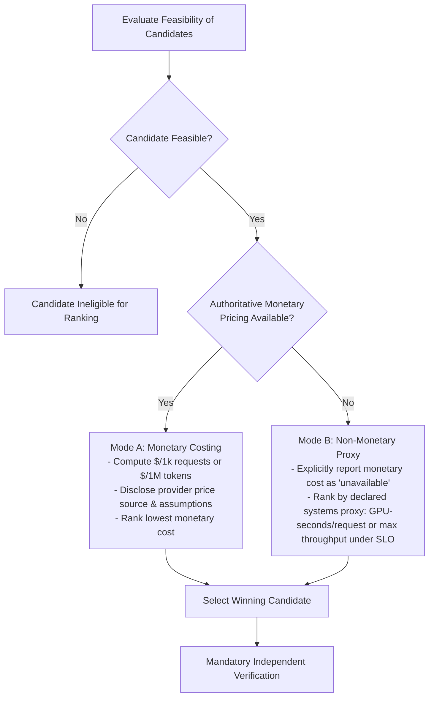

# ADR 0002: Dual-Mode Cost Accounting and Optimization Objective Policy

> **Status:** Accepted  
> **Date:** 2026-10-14  
> **Owner:** Rajdeep (Technical Lead / Architecture)  
> **Scope:** Repository-wide  
> **Authority:** Aligned with [README.md](../../README.md) and [ROADMAP.md](../../ROADMAP.md)

---

## 1. Context and Problem Statement

The core value proposition of SLOKern is finding the lowest-cost serving configuration that satisfies declared service-level objectives (SLOs). However, in cloud infrastructure environments, monetary pricing is often complex: GPU instance rates vary across commitment tiers, token billing rates differ from dedicated hardware pricing, and spot instances fluctuate dynamically.

If SLOKern assumes an arbitrary price (e.g., \$2.50/hr) without an authoritative source, it risks presenting fabricated cost savings. Conversely, if SLOKern drops cost entirely, it fails to solve the user's optimization problem. We must define a principled policy for how cost is sourced, calculated, and reported.

---

## 2. Decision Drivers

1. **Absolute Honesty in Claims:** Never invent prices or present synthetic cost calculations as verified financial facts.
2. **Defensibility of Rankings:** Feasible candidates must be ranked using a transparent, reproducible objective function.
3. **Graceful Fallback:** If cloud pricing is inaccessible or unverified, the optimizer must still identify the most efficient feasible configuration using measurable systems proxies.
4. **Primacy of Hard Constraints:** A candidate that violates an SLO hard constraint can never be selected, regardless of how inexpensive it is.

---

## 3. Decision Outcome

We establish a **Dual-Mode Cost Policy**:

### 3.1 Mode A: Verified Monetary Costing
- **Precondition:** An authoritative, verifiable price source is provided (e.g., official Nebius GPU rate card in USD/hour or provider token rate).
- **Calculation Formula:**
  $$\text{Cost per 1k requests} = \frac{\text{Hourly GPU Rate (\$/hr)}}{\text{Achieved Requests per Hour}} \times 1000$$
- **Reporting Requirements:** Must cite currency, price source, timestamp, billing increments, and hardware specification.

### 3.2 Mode B: Non-Monetary Systems Proxy (Fallback)
- **Precondition:** Monetary pricing is unconfirmed, variable, or missing.
- **Reporting Requirements:** Monetary cost is explicitly declared **`unavailable`** across all reports, API responses, and UI badges.
- **Optimization Proxy:** The search controller ranks feasible candidates by a declared non-monetary systems efficiency metric:
  1. *Resource-Time:* GPU execution seconds consumed per completed request (lower is better).
  2. *Throughput under SLO:* Completed output tokens per second while maintaining all latency hard constraints (higher is better).
- **Strict Rule:** A non-monetary proxy must **never** be described as monetary savings, dollar discounts, or financial ROI.

### 3.3 Rule of Constraint Primacy
Hard SLO constraints (TTFT, ITL, error rate) are evaluated strictly *before* search ranking. An infeasible configuration is never eligible for cost efficiency ranking. Search ranks only candidates whose search-run evidence is `FEASIBLE` and whose declared objective metric is valid; independent verification happens after winner selection and must not be implied by the `FEASIBLE` label. The current ranker still has a missing-objective evidence gap (`BLK-16`).

---

## 4. Consequences and Mitigations

- **No Speculative Marketing:** Prevents misleading claims during hackathon evaluations.
- **Clear UI Labeling:** The frontend must support an explicit `unavailable` badge for monetary cost and display the active systems proxy cleanly.
- **Auditability:** Every report artifact records the pricing mode, source, and exact calculation formulas.

---

## 5. Related Documents

- [System Architecture](../architecture.md)
- [Metrics Definitions & Aggregation Rules](../metrics.md)
- [Decision Policy & Verdict Semantics](../decision-policy.md)
- [ADR 0001: MVP Scope & Evidence Policy](0001-mvp-scope-and-evidence.md)
