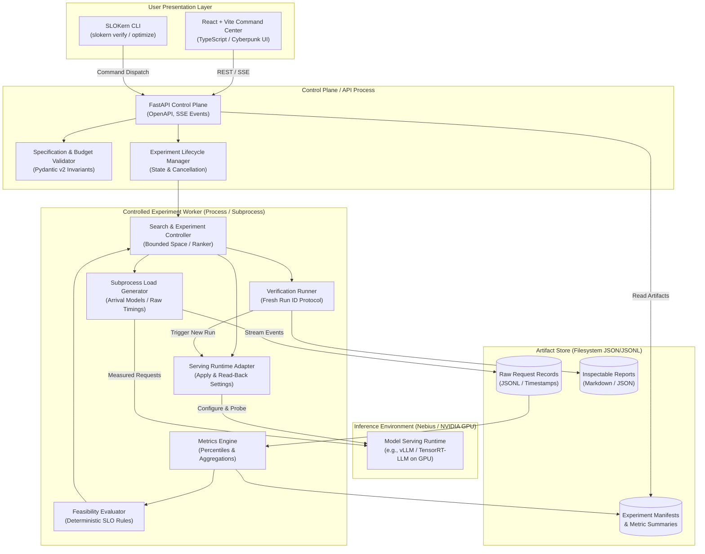

# SLOKern System Architecture

> **Product:** SLOKern — *Optimize inference. Verify performance.*  
> **Status:** Draft / Active Specification  
> **Owner:** Rajdeep (Single Technical Owner & Integration Authority)  
> **Authority:** Aligned with [README.md](../README.md) and [ROADMAP.md](../ROADMAP.md)

---

## 1. Executive Summary & Mission

SLOKern is an SLO-aware LLM inference optimization system developed for the Nebius × NVIDIA Global AI Hackathon. Given a declared workload profile and service-level objectives (SLOs), SLOKern measures a bounded set of serving configurations, identifies the lowest-cost configuration that satisfies the declared constraints, and independently verifies the recommendation.

### Core Engineering Principle

> **One model, one serving environment, a small configuration space, reproducible experiments.**

SLOKern rejects unverified claims and heuristic guessing. Optimal serving configurations are discovered experimentally under controlled conditions and validated through an independent, repeatable verification protocol before being recommended.

### Key Architectural Tenets

1. **Deterministic Authority:** Deterministic Python modules own all metric calculations, constraint evaluations, experiment budget enforcement, candidate selection, and verification verdicts. Optional AI components are strictly advisory and cannot override deterministic decisions.
2. **Empirical Evidence First:** Every recommendation must be traceable to raw request-level measurements (`RawRequestMeasurement`) and documented environment metadata. Synthetic fixtures and offline runs must be explicitly marked **DEMO DATA**.
3. **Strict Scope & Legality:** The system evaluates only legal, supported serving parameters that the serving adapter can actively apply and verify. It never claims global optimality or universal runtime support.
4. **Independent Verification:** A winning candidate configuration must undergo an independent verification run with a fresh run ID before receiving a verified verdict.
5. **Decoupled Lifecycle States:** Execution health, evidence validity, SLO feasibility, and verification status are tracked as separate, non-collapsing state machines.

---

## 2. System Boundaries & Process Model

To eliminate measurement interference while keeping the architecture maintainable for a focused single-owner sprint, SLOKern adopts a **modular monolith control plane paired with an isolated subprocess experiment worker**.



### Process Isolation Rationale

- **No Request-Path Contamination:** The dashboard polling, SSE broadcasting, and API request handling run in the control-plane process. They must never share event loops or CPU threads with the load generator.
- **Subprocess Load Generation:** The load generator runs in an isolated subprocess to guarantee that request scheduling, socket I/O, and microsecond-level timing timestamps are not warped by garbage collection or concurrent UI tasks.
- **Filesystem Artifact Persistence:** Experiment data is written to structured JSON/JSONL files on disk (`artifacts/experiments/<experiment_id>/`). No external database is required for the MVP, ensuring maximum inspectability and zero deployment friction.

### Current Implementation Boundary and Proposed Deployment Profile

The architecture above describes intended boundaries; it is not evidence that all lifecycle stages are implemented. Current runtime integration is an OpenAI-compatible HTTP/SSE adapter. `NebiusServingAdapter.apply_config()` evaluates candidate settings against locally declared capabilities and updates its local configuration object; it does not launch/restart a vLLM process or read effective server flags from the provider. `BLK-17` remains active.

The accepted model-family candidate is Nemotron-3-Nano-30B-A3B FP8 (exact checkpoint/revision and provider identifier pending). The current proposal is a Nebius Serverless AI custom container on H100 using vLLM 0.12.0, with a Docker GPU VM fallback. This remains unratified and unverified; see [DEC-0013](decision-log.md#dec-0013-reconcile-the-controlled-deployment-and-search-profile-open). The prior 9B VM memo is an alternative study, not a change to ADR 0001-B.

The proposed `(max_num_seqs, max_num_batched_tokens)` centre baseline `(128, 8192)` and four corners `{64,256} × {2048,16384}` are distinct from the current source grid `{16,64} × {1024,2048}`. Keep these profiles explicitly separate until the owner ratifies an implementation change. Restart/recreate requirements, Serverless argument forwarding, effective-setting read-back, image/model compatibility, and H100 availability require a physical preflight.

---

## 3. End-to-End Execution Pipeline

### 3.1 Canonical Seven-Step Pipeline Mapping

SLOKern structures its user-facing and architectural flow into seven canonical conceptual steps:

$$\text{Specify} \to \text{Validate} \to \text{Measure} \to \text{Evaluate} \to \text{Optimize} \to \text{Verify} \to \text{Explain}$$

To prevent measurement contamination and ensure auditability, these conceptual steps are mapped cleanly to concrete orchestration phases:

| Conceptual Step | Accountable Owner | Concrete Orchestration Phase | Function & Invariant |
|---|---|---|---|
| **1. Specify** | Rajdeep | Phase 0: Specification | User defines workload traffic profile, hard SLO thresholds, and experiment budget. |
| **2. Validate** | Rajdeep | Phase 0: Pre-Flight | Pydantic v2 validation enforces structural integrity; serving adapter rejects unsupported candidate parameters before GPU allocation. |
| **3. Measure** | Rajdeep | Phase 1 (Baseline) & Phase 2 (Candidates) | Subprocess load generator executes warmup followed by the active window. **Baseline establishment is executed first** as an explicit anchor before candidate exploration. Raw timestamps recorded in JSONL. |
| **4. Evaluate** | Rajdeep | Phase 1 & Phase 2 | Deterministic Feasibility Evaluator calculates MetricSet and audits each hard constraint against thresholds (`FEASIBLE`, `INFEASIBLE`, `INCONCLUSIVE`). |
| **5. Optimize** | Rajdeep | Phase 2 (Search Loop) | Bounded search controller proposes legal configurations and ranks feasible candidates by declared objective (Mode A monetary cost or Mode B systems proxy). |
| **6. Verify** | Rajdeep | Phase 3 (Verification) | Mandatory independent rerun of top-ranked feasible candidate under a fresh `verification_run_id`. Recalculates metrics and audits for threshold drift. Emits formal enum: `VERIFIED`, `VERIFICATION_FAILED`, or `VERIFICATION_INCONCLUSIVE`. |
| **7. Explain** | Rajdeep | Phase 4 (Reporting) | Publishes immutable `ReportArtifact` linking recommendation, hardware fingerprint, raw evidence, and declared limitations. |

### 3.2 Concrete Orchestration Sequence

The execution sequence follows a strict, non-negotiable critical path:

```mermaid
sequenceDiagram
    autonumber
    participant U as User / Dashboard
    participant CP as Control Plane (API)
    participant SC as Search Controller
    participant SA as Serving Adapter
    participant LG as Load Generator
    participant ME as Metrics Engine
    participant FE as Feasibility Evaluator
    participant VR as Verification Runner
    participant FS as Artifact Store

    U->>CP: Submit ExperimentSpec (Workload + SLO + Budget)
    CP->>CP: Validate schemas, parameter legality, and budgets
    CP->>SC: Initialize Experiment Run
    
    rect rgb(20, 30, 45)
        note over SC,SA: Phase 1: Baseline Establishment
        SC->>SA: Apply reference/baseline configuration
        SA->>SA: Verify effective settings via read-back
        SC->>LG: Execute baseline workload protocol (warm-up + measurement)
        LG->>FS: Persist RawRequestMeasurement records (JSONL)
        FS->>ME: Compute baseline MetricSet
        ME->>FE: Evaluate SLO constraints
        FE-->>SC: Baseline FeasibilityResult
    end

    rect rgb(25, 40, 35)
        note over SC,LG: Phase 2: Bounded Candidate Search
        loop For each legal candidate (within budget)
            SC->>SA: Apply CandidateConfig
            SA->>SA: Read-back & record environment fingerprint
            SC->>LG: Run identical workload protocol
            LG->>FS: Persist raw measurements
            FS->>ME: Derive MetricSet
            ME->>FE: Evaluate constraints -> FeasibilityResult
            FE-->>SC: Candidate verdict & reason codes
        end
        SC->>SC: Filter Feasible candidates & Rank by declared objective
    end

    rect rgb(45, 25, 35)
        note over VR,FS: Phase 3: Independent Verification
        SC->>VR: Handoff top-ranked candidate for verification
        VR->>VR: Generate NEW unique run_id
        VR->>SA: Re-apply winner configuration
        VR->>LG: Re-run workload protocol under identical conditions
        LG->>FS: Write fresh verification raw measurements
        FS->>ME: Recalculate verification MetricSet independently
        ME->>FE: Re-evaluate constraints -> Final Verification Verdict
    end

    VR->>FS: Generate ReportArtifact (reconciled metrics, verdicts, limitations)
    CP-->>U: Publish final results, charts, and downloadable report
```



---

## 4. Shared Data Contracts

SLOKern enforces strict typed schemas across API boundaries, workers, CLI, frontend, and report generators. The canonical source of truth for all contracts is defined in Pydantic v2 within [`src/slokern/contracts/`](../src/slokern/contracts/).

### Contract Summary Table

| Contract Class | Accountable Owner | Purpose |
|---|---|---|
| `WorkloadSpec` | Rajdeep | Declares request fixture, arrival mode, offered rate, duration, and token policies |
| `SLOSpec` | Rajdeep | Defines hard constraint thresholds, target percentiles, operators, and required units |
| `CandidateConfig` | Rajdeep | Canonical serving parameter settings (requested vs. effective read-back) |
| `ExperimentSpec` | Rajdeep | Complete submission payload combining workload, SLO, candidate space, and budget |
| `RunRecord` | Rajdeep | Single execution run metadata, environment fingerprint, timestamps, and status |
| `RawRequestMeasurement`| Rajdeep | Granular, unaggregated event capture for every request initiated |
| `MetricSet` | Rajdeep | Documented summary statistics derived from valid raw measurements |
| `FeasibilityResult` | Rajdeep | Deterministic constraint-by-constraint audit, reason codes, and overall verdict |
| `SearchResult` | Rajdeep | Bounded search history, candidate rankings, stopping rationale, and winner selection |
| `VerificationRecord` | Rajdeep | Independent verification run linkage, metric comparison, drift, and final verdict |
| `ReportArtifact` | Rajdeep | Immutable, publishable bundle of all specs, results, environment metadata, and limitations |

---

### Contract Definitions & Specifications

#### 1. `WorkloadSpec` (Owner: Rajdeep; Historical design: Adriraj)
Defines the offered traffic profile to ensure benchmark repeatability.
- `schema_version`: String version identifier (e.g., `"1.0.0"`).
- `workload_name`: Identifier for the workload profile.
- `fixture_id`: Hash or path of the versioned prompt dataset.
- `arrival_mode`: Arrival process: `"poisson"`, `"constant"`, or `"closed"`.
- `target_offered_rate`: Intended requests per second (float, requests/s).
- `concurrency_limit`: Maximum concurrent requests in flight.
- `warmup_duration_s`: Warm-up window duration in seconds (excluded from final metrics).
- `measurement_duration_s`: Active measurement window in seconds.
- `max_input_tokens`: Upper bound on input prompt length.
- `max_output_tokens`: Maximum generated token limit.

#### 2. `SLOSpec` (Owner: Rajdeep; Historical design: Daksh)
Specifies the non-negotiable service-level objectives against which candidates are evaluated.
- `slo_id`: Unique identifier for the SLO declaration.
- `constraints`: List of hard constraint rules:
  - `metric_name`: Target metric (`"ttft"`, `"itl"`, `"e2e_latency"`, `"error_rate"`, `"request_throughput"`).
  - `statistic`: Declared statistic (`"p50"`, `"p90"`, `"p95"`, `"p99"`, `"mean"`, `"max"`).
  - `threshold`: Numeric threshold value.
  - `unit`: Explicit unit (`"ms"`, `"s"`, `"requests/s"`, `"fraction"`).
  - `operator`: Comparison operator (`"<="`, `"<"`, `">="`, `">"`).
- `min_sample_count`: Minimum required valid requests to allow an authoritative verdict.

#### 3. `CandidateConfig` (Owner: Rajdeep; Historical design: Rohan & Aman)
Represents a concrete serving configuration. Distinguishes intent from verified runtime reality.
- `candidate_id`: Stable deterministic hash of canonical parameter values.
- `model_name`: Formal model identifier (e.g., `"Nemotron-3-Nano-30B-A3B"` (FP8) as selected hackathon candidate pending runtime verification, or `"meta-llama/Meta-Llama-3-8B-Instruct"` for internal baseline).
- `runtime_name`: Serving engine (e.g., `"vllm"`, `"tensorrt-llm"`).
- `requested_settings`: Key-value pairs requested by the search controller (illustrative examples: `{"max_num_seqs": 32, "gpu_memory_utilization": 0.85}`; specific 2×2 candidate dimensions and values are pending confirmation from the serving interface).
- `effective_settings`: Key-value pairs confirmed by the adapter via runtime read-back.
- `parameter_status`: Map of parameters to status: `"applied"`, `"unsupported"`, `"rejected"`, `"default_fallback"`.
- `environment_fingerprint`: Hash/dictionary of GPU hardware, driver, CUDA version, and runtime software commit.

#### 4. `ExperimentSpec` (Owner: Rajdeep)
The root document defining an entire optimization experiment.
- `experiment_id`: Unique identifier for the experiment session.
- `workload`: Embedded `WorkloadSpec`.
- `slo`: Embedded `SLOSpec`.
- `search_space`: Declared legal parameter ranges and candidate generation rules.
- `budget`:
  - `max_candidates`: Hard upper limit on candidate configurations tested.
  - `max_wallclock_seconds`: Maximum total experiment duration.
  - `max_cost_limit`: Optional expenditure ceiling.
- `verification_policy`: Rules governing the independent verification rerun (e.g., repetitions, duration multiplier).

#### 5. `RunRecord` (Owner: Rajdeep; Historical design: Rajdeep & Aman)
Metadata tracking an individual benchmark execution.
- `run_id`: Unique identifier for this specific execution attempt.
- `experiment_id`: Parent experiment identifier.
- `candidate_id`: Evaluated candidate identifier.
- `is_verification_run`: Boolean distinguishing search runs from verification runs.
- `execution_status`: Run status (`"pending"`, `"running"`, `"completed"`, `"failed"`, `"cancelled"`).
- `started_at` / `completed_at`: Microsecond UTC ISO timestamps.
- `raw_artifact_uri`: Relative path to raw request recordings (`.jsonl`).
- `execution_error`: Structured error details if execution failed before measurement completion.

#### 6. `RawRequestMeasurement` (Owner: Rajdeep; Historical design: Adriraj)
Granular, unaggregated event capture for every request. Must be preserved for reproducibility.
- `request_id`: Unique request identifier.
- `run_id`: Associated run identifier.
- `scheduled_at`: Intended dispatch timestamp (epoch seconds / ISO).
- `sent_at`: Socket write start timestamp.
- `first_token_at`: First token receipt timestamp (nullable for non-streaming or failed requests).
- `completed_at`: Response completion or abort timestamp.
- `http_status`: Response code.
- `input_tokens`: Measured prompt token count.
- `output_tokens`: Measured generated token count.
- `itl_observations_ms`: Optional list of inter-token intervals in milliseconds.
- `error_type`: Error classification if failed (`"timeout"`, `"connection_refused"`, `"http_error"`, `"generator_saturated"`).
- `is_warmup`: Boolean indicating if sample occurred during warm-up (excluded from metrics).
- `is_valid`: Boolean indicating whether sample is free of client-side measurement anomalies.

#### 7. `MetricSet` (Owner: Rajdeep; Historical design: Adriraj)
Aggregated performance indicators calculated deterministically from valid measurement windows.
- `metric_version`: Version of metric calculation policy.
- `run_id`: Associated run identifier.
- `sample_count`: Count of completed valid requests analyzed.
- `failed_request_count`: Count of failed or aborted requests.
- `offered_load_rps`: Actual rate at which client scheduled requests.
- `achieved_load_rps`: Actual completed request throughput over the measurement window.
- `ttft_ms`: Object containing `p50`, `p90`, `p95`, `p99`, `mean`, `min`, `max`.
- `itl_ms`: Object containing `p50`, `p90`, `p95`, `p99`, `mean` (with documented aggregation).
- `e2e_latency_ms`: Percentiles and summary of total request durations.
- `request_throughput_rps`: Achieved completed requests per second.
- `token_throughput_tps`: Total output tokens generated per second.
- `error_rate`: Ratio of failed requests to total offered requests.
- `generator_saturated`: Boolean flag indicating whether client load generator saturated.

#### 8. `FeasibilityResult` (Owner: Rajdeep; Historical design: Daksh)
Deterministic constraint audit result.
- `policy_version`: Version of feasibility evaluation rules.
- `run_id`: Associated run identifier.
- `overall_verdict`: Enum: `FEASIBLE`, `INFEASIBLE`, `INCONCLUSIVE`.
- `constraint_evaluations`: List of per-constraint evaluation records:
  - `metric_name`: Target metric.
  - `statistic`: Evaluated statistic.
  - `observed_value`: Derived metric value (null if metric missing or sample insufficient).
  - `required_threshold`: Threshold from `SLOSpec`.
  - `operator`: Comparison operator.
  - `passed`: Boolean or null.
  - `reason_code`: Machine-readable reason code (`"HARD_CONSTRAINT_PASSED"`, `"TTFT_P95_EXCEEDED"`, `"INSUFFICIENT_SAMPLES"`, etc.).
- `validity_status`: Enum: `VALID`, `INVALID`, `CONTAMINATED`.
- `audit_notes`: Structured text explaining edge cases or exclusions.

#### 9. `SearchResult` (Owner: Rajdeep; Historical design: Rohan)
Bounded search exploration history and candidate ranking.
- `experiment_id`: Parent experiment identifier.
- `baseline_candidate_id`: ID of baseline configuration.
- `tested_candidates`: List of tested candidate IDs in execution order.
- `candidate_summaries`: Map of candidate ID to feasibility verdict and ranking metric.
- `ranking_objective`: Declared objective function (e.g., `"monetary_cost_per_token"`, `"gpu_seconds_per_request"`, `"max_throughput_under_slo"`).
- `selected_candidate_id`: Winning feasible candidate ID (null if no candidate was feasible).
- `selection_rationale`: Deterministic justification for the winning choice.
- `stopping_reason`: Reason search halted (`"budget_exhausted"`, `"space_exhausted"`, `"early_convergence"`, `"timeout"`).

#### 10. `VerificationRecord` (Owner: Rajdeep; Historical design: Daksh)
Independent verification audit record for the winning candidate.
- `verification_id`: Unique identifier for the verification session.
- `experiment_id`: Associated experiment identifier.
- `candidate_id`: Frozen candidate configuration tested.
- `original_run_id`: Search run ID where candidate was selected.
- `verification_run_id`: Fresh run ID under which rerun was conducted.
- `verification_verdict`: Enum: `VERIFIED`, `VERIFICATION_FAILED`, `VERIFICATION_INCONCLUSIVE`.
- `drift_analysis`:
  - `metric_deltas`: Percent difference between search run and verification run metrics.
  - `slo_drift_detected`: Boolean indicating whether verification drifted across a threshold.
- `final_decision_notes`: Explanation of confirmation or failure.

#### 11. `ReportArtifact` (Owner: Rajdeep)
Self-contained, inspectable artifact published for users and hackathon judges.
- `report_id`: Unique report identifier.
- `created_at`: UTC ISO timestamp.
- `experiment_spec`: Complete immutable specification.
- `environment_fingerprint`: Full hardware/runtime environment documentation.
- `baseline_summary`: Baseline metrics and verdict.
- `search_summary`: Candidate table, rankings, and rejected options.
- `selected_candidate`: Detailed configuration of the winning candidate.
- `verification_record`: Complete verification audit.
- `limitations_disclosed`: Tested search space bounds and known environment constraints.
- `cost_accounting_basis`: Explicit source of pricing data or declaration of `unavailable`.
- `artifact_paths`: References to raw measurement files and logs.

---

## 5. Lifecycle and State Separation Model

A critical flaw in naive benchmark systems is collapsing execution state, evidence quality, feasibility, and verification into a single status string. SLOKern maintains **four distinct status domains**:

```text
1. Execution Status:   PENDING → RUNNING → [ COMPLETED | FAILED | CANCELLED ]
2. Evidence Validity:  VALID | INVALID | CONTAMINATED
3. SLO Feasibility:    FEASIBLE | INFEASIBLE | INCONCLUSIVE
4. Verification State: NOT_RUN → VERIFYING → [ VERIFIED | VERIFICATION_FAILED | VERIFICATION_INCONCLUSIVE ]
```

### State Semantics

- **Execution Failed != SLO Infeasible:** If a network timeout, CUDA out-of-memory error, or bad auth causes an experiment run to crash, the run is marked `FAILED` in execution status. It is **never** recorded as a measured SLO failure (`INFEASIBLE`), because no valid latency or throughput distribution was observed.
- **Inconclusive != Feasible:** If sample count falls below `min_sample_count` or the client generator saturated (`CONTAMINATED`), the feasibility evaluator returns `INCONCLUSIVE`. An inconclusive result can never be ranked or declared a winner.
- **Verification Independence:** A candidate configuration marked `FEASIBLE` during search is **never** given the `VERIFIED` badge until a secondary run under `verification_run_id` independently yields `FEASIBLE`.

---

## 6. Cost Policy & Objective Function

SLOKern explicitly resolves cost accounting into a dual-mode model to prevent fabricated claims:

### Mode A: Trustworthy Monetary Costing
- **Precondition:** Verifiable hourly GPU instance pricing or token billing rates are officially provided (e.g., Nebius cloud rate card) and stored with explicit currency, billing increment, and time basis.
- **Calculation:** 
  $$\text{Cost per 1k requests} = \frac{\text{Hourly GPU Rate}}{\text{Achieved Requests per Hour}}$$
- **Reporting:** Cites exact pricing source, hardware tier, and assumptions.

### Mode B: Non-Monetary Proxy (Default when pricing is unconfirmed)
- **Precondition:** Cloud provider pricing is missing, variable, or unverified.
- **Reporting:** Monetary cost is explicitly declared **`unavailable`**.
- **Objective Proxy:** Optimization ranks feasible candidates by a declared non-monetary systems efficiency objective:
  1. *Resource-Time:* GPU seconds consumed per successful request. *(Note: If GPU instance count and dedicated residency cannot be verified, such as on managed serverless endpoints where physical GPU allocation is hidden, GPU-seconds per request is also reported as `unavailable`, and ranking falls back to Throughput Under SLO).*
  2. *Throughput Under SLO:* Maximum achieved output tokens/second while satisfying all hard latency constraints.
- **Rule:** A non-monetary proxy must **never** be described as monetary savings or dollar amounts. Disambiguate request throughput (completed requests/s) and achieved load from hardware GPU utilization (compute/memory occupancy %).

---

## 7. Component Ownership & Consolidated Engineering Responsibilities

Under the single-owner core execution model with bounded collaborators (updated October 19, 2026), **Rajdeep** assumes sole end-to-end accountability, critical-path implementation, and integration authority across all architectural subsystems, with bounded collaborator workstreams for **Adriraj** (Benchmark Integrity, active Oct 21) and **Daksh** (Independent Decision Verification, active Oct 24). The modular component boundaries originally designed for the distributed team remain strictly enforced to preserve architectural integrity:

| Subsystem Component | Accountable Owner | Active Window | Deliverable & Boundary |
|---|---|---|---|
| **Architecture & Contracts** | **Rajdeep** | Full sprint | Canonical Pydantic v2 schemas (`src/slokern/contracts/`), API/dashboard contracts, stable interfaces. |
| **Serving & Infrastructure** | **Rajdeep** *(Historical: Aman)* | Full sprint | Serving adapter (`src/slokern/engine/serving/`), model runtime deployment, parameter read-back, environment fingerprint. |
| **Loadgen Subprocess & Workload** | **Rajdeep** *(Historical: Adriraj)* | Full sprint | Workload fixtures, subprocess load generator (`src/slokern/engine/loadgen/`), raw event capture to JSONL (`RawRequestMeasurement`). |
| **Evaluator Core & Feasibility** | **Rajdeep** *(Historical: Daksh)* | Full sprint | Feasibility evaluator (`src/slokern/core/evaluator/`), deterministic SLO logic, reason codes, verification runner. |
| **Search & Optimizer** | **Rajdeep** *(Historical: Rohan)* | Full sprint | Bounded 2×2 parameter matrix, search controller (`src/slokern/core/search/`), candidate ranking, 6-run budget limit. |
| **Control Plane & Presentation** | **Rajdeep** | Full sprint | FastAPI app (`src/slokern/api/`), CLI (`src/slokern/cli/`), report generator (`src/slokern/engine/reporting/`), demo command center. |
| **Benchmark Integrity & Credibility** | **Adriraj** | **Oct 21–30** | Benchmark schema validation, required metadata checks, missing/inconsistent record detection, offered-vs-achieved load audits, comparison summaries (`docs/metrics.md`). |
| **Independent Decision Verification** | **Daksh** | **Oct 24–30** | Independent verification test suite, hard SLO violation tests, feasibility boundary tests, missing/invalid measurement handling, reproducible defect reports (`docs/decision-policy.md`). |

For the complete responsibility matrix, collaborator workstream boundaries, daily engineering rituals, and historical attribution, see [docs/ownership.md](ownership.md).

---

## 8. Technology Stack & Implementation Mapping

### Planned Technology Defaults

- **Core Backend:** Python 3.11+, managed with `uv`.
- **Contract Source of Truth:** Pydantic v2 schemas in `src/slokern/contracts/`.
- **API & Streaming:** FastAPI with Server-Sent Events (SSE) for real-time progress.
- **Frontend Command Center:** React, TypeScript, Vite, Tailwind CSS, Lucide icons.
- **Persistence:** Local filesystem artifacts (`artifacts/experiments/<id>/`).
- **Load Generation:** Python `asyncio` / `httpx` subprocess worker.

### Codebase Layout Mapping

The active implementation is organized under `src/slokern/`, reflecting modern Python standards:

```text
slokern/
├── src/slokern/
│   ├── contracts/        # Canonical Pydantic v2 data models
│   ├── common/           # IDs, clock, errors, structured logging
│   ├── api/              # FastAPI application, routes, SSE streaming
│   ├── cli/              # Click / Typer CLI commands (slokern verify, etc.)
│   ├── core/
│   │   ├── metrics/      # Latency, percentiles, throughput calculations
│   │   ├── evaluator/    # Feasibility evaluation and reason codes
│   │   ├── search/       # Bounded search spaces, grid/random search, ranker
│   │   ├── verification/ # Independent verification comparison logic
│   │   └── cost/         # Pricing and resource-time estimators
│   ├── engine/
│   │   ├── loadgen/      # Subprocess load generator, arrival schedules, recorder
│   │   ├── serving/      # Nebius serving adapter, fake adapter, capabilities
│   │   ├── runner/       # Experiment controller, lifecycle, cancellation
│   │   ├── store/        # Filesystem artifact writer, redaction, layout
│   │   └── reporting/    # Markdown/JSON report builder
│   └── ai/               # (Optional/Advisory) Draft spec & explanation helpers
├── frontend/             # React + Vite dashboard
├── fixtures/             # Versioned workloads and golden metric test suites
├── experiments/          # Protocol specifications and example configurations
├── tests/                # Contract, unit, integration, and live tests
└── docs/                 # Architecture, methodology, policies, and ADRs
```

---

## 9. Related Documentation & Cross-References

- [MVP Checklist & Scope Boundaries](mvp-checklist.md)
- [Team Ownership & Collaboration Model](ownership.md)
- [Architecture Decision Log](decision-log.md)
- [Integration & Daily Ritual Checklist](integration-checklist.md)
- [Decision Policy & Verdict Semantics](decision-policy.md)
- [Metrics Definitions & Aggregation Rules](metrics.md)
- [Experiment & Measurement Methodology](experiment-methodology.md)
- [Serving Deployment & Runtime Notes](deployment.md)
- [Demo Script & Fallback Runbook](demo-script.md)
- [ADR 0001: MVP Scope & Evidence Policy](adr/0001-mvp-scope-and-evidence.md)
- [ADR 0002: Dual-Mode Cost Accounting](adr/0002-cost-model.md)
