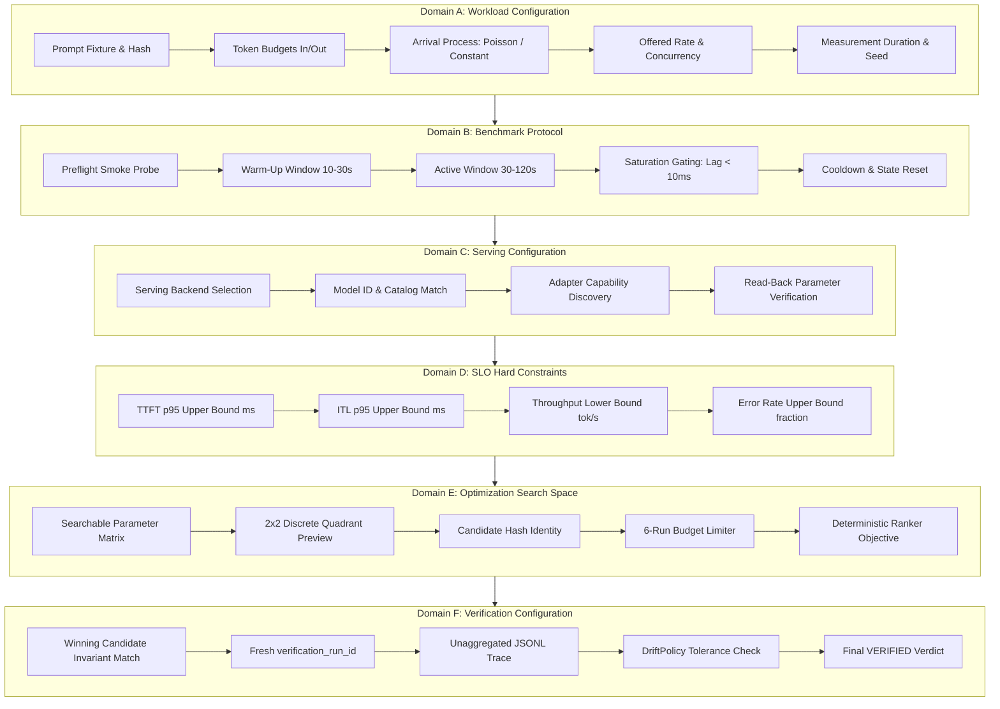
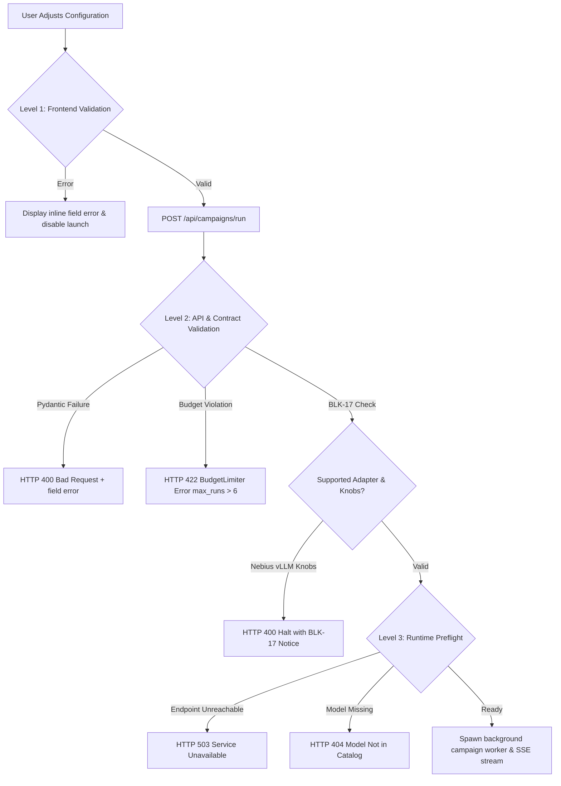
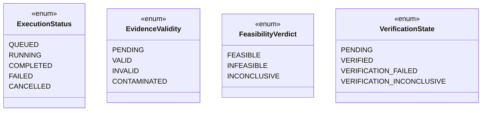

# Benchmarking & Tuning Configuration Centre — Architecture & Implementation Plan

> **Product:** SLOKern — *Optimize inference. Verify performance.*  
> **Subsystem:** Benchmarking, Workload Configuration & Optimization Control Centre  
> **Document Type:** Configuration Architecture & Technical Specification  
> **Status:** APPROVED PLANNING SPECIFICATION (Execution Mode: PLANNING ONLY)  
> **Date:** November 18, 2026  
> **Authority:** Aligned with AGENTS.md, ROADMAP.md, and DEC-0014/DEC-0015

---

## 1. Architectural Vision & Core Principles

The SLOKern **Benchmarking & Tuning Configuration Centre** is the mission-critical control plane where platform engineers and evaluators define, preflight, execute, and verify automated LLM serving optimizations.

### 1.1 Non-Negotiable Invariants
1. **No False Capabilities:** A control must never be exposed if the underlying serving adapter or load generator cannot measure, apply, or verify it.
2. **Deterministic Evaluation Authority:** Metrics derivation, hard constraint evaluations, budget limits, candidate rankings, and verification verdicts are governed exclusively by deterministic Python algorithms.
3. **Strict 6-Run Experiment Budget:** The campaign controller strictly allocates:
   - 1 Baseline measurement (Anchor)
   - 4 Candidate explorations (2×2 Search Space)
   - 1 Independent verification rerun of the winning candidate under a fresh run ID
   - **Total: Exactly 6 controller runs.** Preflight smoke probes are separate zero-budget operational health checks.
4. **Honest Evidence Watermarking:** Simulated or offline runs must be persistently labeled **`DEMO DATA`**. Mock success strings in catch blocks are forbidden.
5. **Four Decoupled Lifecycle Domains:** Execution status, evidence validity, feasibility verdict, and verification status remain separate, uncollapsed states.

---

## 2. Six Configuration Domains

The Configuration Centre unifies the optimization workflow into six technical domains.



---

### Domain A: Workload Configuration

The Workload Configuration defines the traffic shape injected by the load generator against the serving endpoint.

1. **Workload Fixtures:**
   - Pre-registered fixture selector (`sharegpt-v3-eval`, `humaneval-synthetic-eval`, `custom-jsonl`).
   - Displays fixture path, total prompt count, and SHA-256 content hash.
   - For custom workloads, users upload or enter JSONL prompts; the system computes a SHA-256 fingerprint saved into `experiment_spec.json`.
2. **Token Budgets:**
   - `max_input_tokens`: Range [1, 4096], default 1024 tokens.
   - `max_output_tokens`: Range [1, 2048], default 256 tokens.
   - Dynamic empirical ratio visualizer: classifies workload as **Prefill-Bound (GEMM)** ($\ge 2:1$) or **Decode-Bound (KV-Bandwidth)** ($< 2:1$).
3. **Arrival Processes:**
   - **Poisson Process (Open Loop):** Inter-arrival times exponentially distributed ($\Delta t \sim \text{Exp}(\lambda)$). Burst-prone, simulates independent real-world traffic where slow responses cause client-side queueing.
   - **Constant Rate (Open Loop):** Deterministic cadence ($\Delta t = 1 / \lambda$). Stress tests queue thresholds and steady-state pipeline saturation.
   - **Closed Concurrency Loop (Gated/Disabled in UI):** Clearly marked *"Contract declared; disabled in load generator runner until asynchronous connection pooling is delivered"*. Prevents user from selecting an unsupported mode (`ValueError` in `arrival.py`).
4. **Traffic Rates & Concurrency:**
   - `target_offered_rate` ($\lambda$): Range [0.5, 100.0] req/s.
   - `concurrency_limit`: Maximum allowed in-flight requests on the client. Range [1, 256].
   - **Critical Distinction:** The UI prominently distinguishes *Offered Load* ($\lambda_{\text{offered}} = N_{\text{dispatched}} / \Delta t$) from *Achieved Load* ($\lambda_{\text{achieved}} = N_{\text{completed}} / \Delta t$). A low achieved load under high offered load indicates server saturation or queueing, not low client pressure.
5. **Duration & Reproducibility:**
   - `warmup_duration_s`: Range [5, 60] seconds (default 15s). Requests are tagged `is_warmup = true` and strictly excluded from percentile and feasibility calculations.
   - `measurement_duration_s`: Range [15, 300] seconds (default 60s).
   - `workload_seed`: Seed integer (default 42) for deterministic Poisson inter-arrival schedules.

---

### Domain B: Benchmark Protocol Configuration

The Benchmark Protocol establishes measurement fidelity, saturation defense, and trace preservation.

1. **Preflight Smoke Test:**
   - A single-request health probe dispatched before any expensive search run begins.
   - Probes `/models` (Nebius) or `/api/tags` (Ollama), confirms model presence, and measures initial single-request TTFT.
   - Rejection rule: If preflight fails, the campaign runner is disabled. No synthetic fallback string is ever displayed.
2. **Thermalization & Warm-Up Window:**
   - Mandatory minimum: 5 seconds.
   - CUDA allocator pre-warming and initial KV cache page allocation occur during this window.
   - `SingleRunExecutor` asserts that all requests dispatched during $[0, t_{\text{warmup}})$ are logged with `is_warmup = true`.
3. **Active Measurement Window:**
   - Minimum sample requirement: $\ge 30$ valid samples (or `min_sample_count` declared in SLO).
   - Evaluator returns `INCONCLUSIVE` (`INSUFFICIENT_SAMPLES`) if completed valid samples fall below threshold.
4. **Client Saturation Gating (Contamination Defense):**
   - Client logs `scheduled_at` and `sent_at` using monotonic clocks (`time.monotonic()`).
   - Dispatch skew: $\Delta t_{\text{skew}} = \text{sent\_at} - \text{scheduled\_at}$.
   - **Gating Rule:** If mean dispatch skew $> 10\text{ ms}$ OR delivered offered rate falls below $90\%$ of target rate:
     - `generator_saturated = True`
     - Evidence validity = `CONTAMINATED`
     - Feasibility verdict = `INCONCLUSIVE` (`CONTAMINATED_LOAD`)
     - Candidate is barred from winning candidate selection.
5. **Cooldown & State Reset:**
   - Between candidate runs, the runner enforces a 3-second drain and cooldown period to flush lingering network buffers and GPU compute queues.

---

### Domain C: Serving Configuration & Parameter Registry

The Serving Configuration manages the target serving runtime and ensures only verified, readable parameters are manipulated.

#### Serving Target Matrix

| Backend Key | Display Name | Transport & Endpoint | Target Model | Tunable Parameters | Read-Back Support | Status |
|---|---|---|---|---|---|---|
| `vllm` | **Local vLLM (WSL2)** | Loopback HTTP (`http://localhost:8000`) | `slokern-qwen3-1.7b` (Qwen3-1.7B) | Dynamic: `concurrency` [1, 2], `max_tokens` [32, 128], `temperature`. Startup: `--max-num-seqs 2`, `--gpu-memory-utilization 0.80`, `--max-model-len 4096` | Full (`/health`, `/v1/models`, `/metrics` Prometheus counters & histograms) | **LIVE / VERIFIED (RTX 5060)** |
| `local` | **Local Ollama** | Loopback HTTP (`http://127.0.0.1:11434`) | `qwen3:4b-instruct-2507-q4_K_M` | `num_batch`, `num_ctx`, `temperature`, `max_tokens` | Partial (per-request chat options forwarded; server `eval_duration` metadata returned) | **LIVE / VERIFIED** |
| `fake` | **Deterministic Fake Adapter** | In-process Python simulator | `fake-qwen-4b` / `meta-llama/Meta-Llama-3-8B-Instruct` | `max_num_seqs`, `max_num_batched_tokens`, `gpu_memory_utilization`, `kv_cache_dtype`, `max_model_len` | Full (in-memory parameter state inspected) | **DEMO DATA / VERIFIED** |
| `nebius` | **Nebius Cloud Token Factory** | HTTPS (`https://api.tokenfactory.nebius.com/v1`) | `nvidia/NVIDIA-Nemotron-3-Nano-30B-A3B` | `temperature`, `max_tokens` (Request options only) | Preflight model catalog confirmed; scheduler flags unsupported (`BLK-17`) | **PREFLIGHT LIVE / OPTIMIZATION BLOCKED (BLK-17)** |

*Complete Parameter Registry with types, legal ranges, and dependencies is provided in Section 4 of this plan.*
*Detailed implementation plans for the Local vLLM adapter and verification ladder are specified in `docs/vllm-local-integration-plan.md` and `docs/local-benchmark-protocol.md`.*

---

### Domain D: SLO Configuration

Hard service-level objectives represent binding engineering constraints.

1. **Supported Constraints & Formats:**
   - **TTFT p95 Upper Bound:** Time to first token 95th percentile. Range [10, 5000] ms. Operator `<=`.
   - **ITL p95 Upper Bound:** Inter-token latency 95th percentile (per-request chunk gap average). Range [5, 500] ms. Operator `<=`.
   - **End-to-End Latency p95:** Complete request duration. Range [50, 10000] ms. Operator `<=`.
   - **Throughput Floor:** Minimum aggregate output token throughput. Range [1.0, 10000.0] tok/s. Operator `>=`.
   - **Error Rate Ceiling:** Maximum allowable failed request fraction. Range [0.0, 1.0] (displayed as 0% to 100%). Operator `<=`.
2. **Deterministic Evaluation Rules:**
   - A single hard constraint failure marks the candidate `INFEASIBLE`.
   - Missing required metrics yield `INCONCLUSIVE`, never `FEASIBLE`.
   - IEEE 754 NaN or negative latency values trigger `INCONCLUSIVE` (`CORRUPTED_MEASUREMENT`).
   - The UI displays explicit mathematical operators (`<=`, `>=`) and unit labels near every threshold input.

---

### Domain E: Optimization Search Space

The Optimization Search Space defines the candidate parameter envelope explored by the 2×2 grid search controller.

1. **Fixed 2×2 Candidate Space Design:**
   - For `fake`:
     $$\text{Search Space} = \{\text{max\_num\_batched\_tokens} \in [1024, 2048]\} \times \{\text{max\_num\_seqs} \in [16, 64]\}$$
   - For `local` (Ollama):
     $$\text{Search Space} = \{\text{num\_batch} \in [256, 1024]\} \times \{\text{num\_ctx} \in [1024, 2048]\}$$
   - Generates exactly 4 candidate configurations.
   - Added to 1 Baseline configuration = 5 search runs.
2. **Stable Candidate Hashing:**
   - Each configuration is assigned a deterministic 12-character SHA-256 hex digest (`candidate_id.py`):
     $$\text{candidate\_id} = \text{SHA256}(\text{model\_name} + \text{runtime\_name} + \text{canonical\_json}(\text{settings}))[:12]$$
   - Normalizes integers and floats to avoid hash fragmentation (`1` vs `1.0`).
3. **Experiment Budget Limiter (`BudgetLimiter`):**
   - Strictly validates:
     $$\text{max\_total\_runs} = 6 \quad (\text{Search Runs} = 5, \text{Reserved Verification Runs} = 1)$$
   - Halts immediately if total runs exceed 6 or search attempts exceed 5.
4. **Deterministic Winner Selection (`rank_candidates`):**
   - Filter: Only candidates with `verdict == FEASIBLE` and valid finite ranking metrics are eligible.
   - Objective: `MAX_THROUGHPUT_UNDER_SLO` (maximize token throughput) or `GPU_SECONDS_PER_REQUEST` (minimize GPU seconds).
   - Tie-breaking: Lexicographically ascending by canonical `candidate_id`.

---

### Domain F: Final Independent Verification Configuration

Verification is an architectural security gate designed to eliminate false positives caused by transient network/GPU noise.

1. **Verification Protocol Invariants (DEC-0014):**
   - **Distinct Run ID:** Verification runs under a brand new `verification_run_id != original_run_id`.
   - **Invariant Matching:** Serving backend, model identifier, workload specification, and candidate configuration must match the search run identically.
   - **Fresh Evidence:** An independent unaggregated JSONL trace is recorded. No metric values or traces are copied from the search run.
   - **Metric Recalculation:** Metrics are computed from scratch by `calculate_metrics()`.
2. **Drift Auditing Policy (`DriftPolicy`):**
   - **Latency Drift:** Maximum $+15.0\%$ relative increase across TTFT, ITL, and E2E percentiles:
     $$\Delta \text{Latency} = \frac{\text{Latency}_{\text{verif}} - \text{Latency}_{\text{search}}}{\text{Latency}_{\text{search}}} \times 100\% \le 15.0\%$$
   - **Throughput Drift:** Maximum $-15.0\%$ relative drop in request or token throughput:
     $$\Delta \text{Throughput} = \frac{\text{Throughput}_{\text{verif}} - \text{Throughput}_{\text{search}}}{\text{Throughput}_{\text{search}}} \times 100\% \ge -15.0\%$$
   - **Error Rate Drift:** Maximum $+0.01$ ($+1.0$ percentage point) absolute increase:
     $$\Delta \text{ErrorRate} = \text{ErrorRate}_{\text{verif}} - \text{ErrorRate}_{\text{search}} \le 0.01$$
3. **Dual-Verdict Semantics:**
   - Candidate is `VERIFIED` if and only if:
     1. All declared hard SLO constraints pass on verification evidence; AND
     2. All metric deltas fall within declared drift tolerances.
   - If constraints fail or drift exceeds tolerance: `VERIFICATION_FAILED`.
   - If execution fails or evidence is contaminated: `VERIFICATION_INCONCLUSIVE`.

---

## 3. Configuration Centre UX Architecture

### 3.1 UX Pattern Recommendation & Justification

**Recommendation: Hybrid Command-Centre Layout with Grouped Accordions and a Persistent Experiment Summary Bar.**

#### Comparative Evaluation

| Evaluation Criteria | 1. Multi-Stage Wizard | 2. Flat Single-Page Form | 3. Hybrid Command Centre (Recommended) |
|---|---|---|---|
| **Information Density** | Low (hides critical parameters across multiple steps) | Moderate (overwhelming vertical scroll) | **High (compact grouped sections, full visibility)** |
| **Cross-Parameter Interdependence** | Poor (requires forward/backward stepping to adjust rate vs SLOs) | Fair (scrolling required) | **Excellent (side-by-side Workload, SLO, and Matrix views)** |
| **Preflight Visibility** | Gated to final wizard step | Static | **Persistent top summary bar with live preflight status** |
| **Hackathon Demo Ergonomics** | Clunky (3 clicks to view changes) | Crowded | **Single-click preset selection + immediate visual feedback** |
| **Alignment with DESIGN.md** | Violates workstation density principles | Moderate | **100% compliant with Obsidian/Neon cyber-command center** |

### 3.2 Visual & Structural Layout

The hybrid architecture integrates three primary panels:

```text
+--------------------------------------------------------------------------------------------------------+
| TOP CONTEXT BAR: Serving Target Pill | Model ID | Health Status (Ping ms) | 6-Run Budget Indicator      |
+--------------------------------------------------------------------------------------------------------+
| LEFT CONFIGURATION PANE (420px width)            | RIGHT EXPERIMENT TOPOLOGY PANE (Fluid flex)         |
|                                                  |                                                     |
| [ Section 1: Serving Target & Model Selection ]  | [ Topology Selector: 2x2 Matrix | 2D Tradeoff Plot ]|
|  - Radio cards: Local Ollama / Fake Adapter      | +-------------------------------------------------+ |
|  - Model string, loopback/cloud host, port       | |                                                 | |
|  - Preflight Health Check Button [Run Probe]     | |  Interactive 2x2 Quadrant Visualizer            | |
|                                                  | |  (Displays candidates, baseline, Pareto line,   | |
| [ Section 2: Workload Traffic Profile ]          | |   winner beacon glow, and telemetry tooltips)   | |
|  - Preset pills: [Quick 2s] [Standard 5s] [Deep] | |                                                 | |
|  - Arrival Mode (Poisson / Constant)             | +-------------------------------------------------+ |
|  - Target Offered Rate (rps slider + numeric)   |                                                     |
|  - Concurrency Limit                             | [ Live Execution Timeline (SSE Streaming) ]         |
|  - Warm-up & Measurement Duration (s)            |  - Run 0: Baseline (run-00-baseline-xxxx)          |
|  - Token Budgets (Input / Output)                |  - Run 1-4: Grid Candidates (run-01 .. run-04)      |
|  - Token Ratio Prefill/Decode SVG curve          |  - Run 5: Independent Verification Rerun           |
|                                                  |    (Progress bar, completed/total reqs, TTFT)       |
| [ Section 3: Hard SLO Constraints ]              |                                                     |
|  - TTFT p95 Ceiling (ms)                         | [ Verification Outcome & Drift Reveal ]             |
|  - ITL p95 Ceiling (ms)                          |  - VERIFIED / FAILED badge                          |
|  - Output Throughput Floor (tok/s)               |  - Metric drift table vs search run                 |
|  - Max Error Rate (%)                            |  - Raw JSONL Trace download links                   |
|                                                  |                                                     |
| [ Section 4: 2x2 Search Space & Budget ]         |                                                     |
|  - 2x2 Parameter Matrix bounds                   |                                                     |
|  - Ranking Objective dropdown                    |                                                     |
|                                                  |                                                     |
| [ ACTION: Launch 6-Run Campaign ]                |                                                     |
+--------------------------------------------------------------------------------------------------------+
```

---

## 4. Parameter Registry & Capability Matrix

Every configuration parameter exposed in the Centre is strictly governed by this registry.

| Parameter Name | Data Type | Legal Envelope | Default Value | Local vLLM (WSL2) | Local Ollama | Fake Adapter | Nebius Cloud | Searchable | Read-Back Mechanism | Dependencies / Constraints |
|---|---|---|---|---|---|---|---|---|---|---|
| `model_name` | `string` | Catalog identifiers | `slokern-qwen3-1.7b` | Supported (`/v1/models`) | Supported (`/api/tags`) | Supported (`*`) | Supported (`Nemotron-3-Nano`) | No (Fixed per campaign) | HTTP probe response body | Must match active runtime model |
| `arrival_mode` | `enum` | `'poisson'`, `'constant'` | `'constant'` | Supported | Supported | Supported | Supported | No | Loadgen schedule config | `'closed'` is contract-only (disabled) |
| `target_offered_rate` | `float` | `0.5` to `100.0` req/s | `2.0` (vLLM) / `5.0` (cloud) | Supported | Supported | Supported | Supported | No | Loadgen timestamps (`sent_at`) | Must be $> 0$; $\Delta t_{\text{skew}} \le 10\text{ms}$ |
| `concurrency_limit` | `int` | `1` to `256` | `2` (vLLM) | Supported (`[1, 2]`) | Supported | Supported | Supported | Yes (on vLLM) | Client in-flight semaphore | Bounded by `--max-num-seqs 2` on RTX 5060 |
| `warmup_duration_s` | `int` | `0` to `60` s | `5` | Supported | Supported | Supported | Supported | No | Raw log `is_warmup` flag | Excluded from `MetricSet` |
| `measurement_duration_s` | `int` | `2` to `300` s | `15` | Supported | Supported | Supported | Supported | No | Raw log timestamps | Must yield $\ge \text{min\_sample\_count}$ |
| `max_input_tokens` | `int` | `1` to `4096` tokens | `64` | Supported | Supported | Supported | Supported | No | Prompt generation length | Must be $\le \text{max\_model\_len}$ (4096) |
| `max_output_tokens` | `int` | `1` to `2048` tokens | `64` (vLLM) | Supported (`[32, 128]`) | Supported | Supported | Supported | Yes (on vLLM) | HTTP payload `max_tokens` | Must be $\ge 1$ |
| `max_num_batched_tokens` | `int` | `128` to `65536` | `2048` | Startup flag (`4096`) | Unsupported | Supported (`[1024, 2048]`) | Unsupported (`BLK-17`) | Yes (on Fake) | Process CLI flag / Prometheus | Requires vLLM runtime container restart |
| `max_num_seqs` | `int` | `1` to `256` | `2` (vLLM) / `32` (Fake) | Startup flag (`2`) | Unsupported | Supported (`[16, 64]`) | Unsupported (`BLK-17`) | Yes (on Fake) | Process CLI flag / Prometheus | Fixed at 2 on RTX 5060 local host |
| `num_batch` | `int` | `1` to `8192` | `512` | Unsupported | Supported (`[256, 1024]`) | Unsupported | Unsupported | Yes (on Ollama) | Chat request `options` payload | Ollama prompt evaluation batch size |
| `num_ctx` | `int` | `128` to `32768` | `2048` | Unsupported | Supported (`[1024, 2048]`) | Unsupported | Unsupported | Yes (on Ollama) | Chat request `options` payload | Ollama KV-cache context allocation |
| `temperature` | `float` | `0.0` to `2.0` | `0.0` | Supported | Supported | Supported | Supported | No | Request JSON payload | Fixed at 0.0 for reproducible benchmarking |
| `p95_ttft_threshold` | `float` | `10.0` to `5000.0` ms | `2500.0` (local) / `150.0` (cloud) | Supported | Supported | Supported | Supported | No | Evaluator constraint check | Hard constraint; missing yields INCONCLUSIVE |
| `max_error_rate` | `float` | `0.0` to `1.0` fraction | `0.05` (5%) | Supported | Supported | Supported | Supported | No | Evaluator constraint check | Hard constraint; ratio of non-200 HTTP codes |
| `ranking_objective` | `enum` | `'MAX_THROUGHPUT'`, `'GPU_SECONDS'` | `'MAX_THROUGHPUT'` | Supported | Supported | Supported | Supported | No | `rank_candidates()` sorting key | Deterministic tie-breaking on `candidate_id` |

---

## 5. Three-Level Validation Architecture

Validation guarantees that malformed specifications or unsupported parameters are caught before any benchmark execution begins.



### Level 1: Frontend Client-Side Validation
- Real-time input checking:
  - Finiteness and positivity on all rate, duration, and token inputs.
  - Duration lower bounds ($\ge 5\text{s}$ warmup, $\ge 15\text{s}$ active measurement for statistical power).
  - Error rate clamped to $[0.0, 1.0]$.
  - Automatic detection of adapter parameter mismatch (e.g., hiding vLLM scheduler knobs when Local Ollama is selected).
- Form disabling: Submit button remains disabled with explicit explanatory tooltip if any field contains an error.

### Level 2: API Contract Validation
- Pydantic v2 strict schemas with `model_config = ConfigDict(extra="forbid")`.
- `validate_budget`: Enforces `max_total_runs <= 6`, `max_search_runs == 5`, `reserved_verification_runs == 1`.
- `validate_search_capabilities`: Preflights adapter against search space. Halts immediately with `SearchConfigurationError` citing `BLK-17` if unsupported startup flags are requested on managed endpoints.

### Level 3: Runtime Preflight Probe
- Dispatches HTTP probe to `/health` and `/models` (or `/api/tags`).
- Confirms model availability without downloading.
- Captures environment fingerprint (OS, GPU device name, VRAM MB, driver/CUDA version).
- Validates endpoint connectivity within a strict 5.0-second timeout.

---

## 6. Measurement Integrity & Reproducibility Architecture

### 6.1 Artifact Preservation Map
Every completed campaign writes an immutable, self-contained directory tree under `artifacts/experiments/<campaign_id>/`:

```text
artifacts/experiments/<campaign_id>/
├── experiment_spec.json           # Canonical declarative ExperimentSpec contract
├── search_result.json             # SearchResult with candidate summaries & winner rationale
├── verification_record.json       # VerificationRecord with drift analysis & independent verdict
├── report.json                    # Immutable ReportArtifact schema
├── report.md                      # Audit dossier with trace links & DEMO DATA / LIVE badges
└── runs/
    ├── run-00-baseline-xxxx/
    │   ├── candidate_config.json  # Requested vs effective settings
    │   ├── raw_measurements.jsonl # Unaggregated request timestamps (scheduled, sent, first, done)
    │   ├── metrics.json           # Deterministic MetricSet
    │   └── feasibility.json       # FeasibilityResult with reason codes
    ├── run-01-cand-yyyy/ ...
    ├── run-02-cand-zzzz/ ...
    ├── run-03-cand-aaaa/ ...
    ├── run-04-cand-bbbb/ ...
    └── run-05-verify-yyyy/        # Fresh verification run ID (anti-aliasing invariant)
        ├── raw_measurements.jsonl
        ├── metrics.json
        └── feasibility.json
```

### 6.2 The Four Decoupled Lifecycle Domains

The configuration centre strictly enforces that the four lifecycle domains remain independent and never collapse into a single status field:



1. **Execution Status:** Did the subprocess/network task finish without an unhandled exception or abort?
2. **Evidence Validity:** Did the load generator deliver traffic cleanly without saturation or queue lag $> 10\text{ ms}$?
3. **Feasibility Verdict:** Did the measured inference metrics pass all declared hard SLO thresholds?
4. **Verification Status:** Did the secondary rerun pass both hard SLO constraints AND drift tolerances?

---

## 7. Local RTX 5060 Workstation vs. Cloud Benchmark Representation

SLOKern operates across two physical environments, and the Configuration Centre must make the active environment unmistakable:

### 7.1 Local Development Environment (Verified Reality)
- **Hardware:** NVIDIA GeForce RTX 5060 Laptop GPU, 8,188 MiB GDDR7 VRAM.
- **Environment:** Windows 11 Enterprise (Build 26100) host / WSL2 Ubuntu 24.04.5 LTS (`6.18.33.2-microsoft-standard-WSL2`).
- **Serving Engines:**
  - **Local vLLM 0.34.0:** `http://localhost:8000` (PyTorch 2.15.0+cu132, Triton 3.9.0, FlashAttention 2, `--enforce-eager`, `--max-model-len 4096`, `--max-num-seqs 2`, `--gpu-memory-utilization 0.80`).
  - **Local Ollama:** `http://127.0.0.1:11434` (`qwen3:4b-instruct-2507-q4_K_M`).
- **Active Model (vLLM):** `Qwen/Qwen3-1.7B` (`Qwen3ForCausalLM` Safetensors, served as `slokern-qwen3-1.7b`).
- **Prometheus Telemetry:** Live Prometheus exposition on `http://localhost:8000/metrics` (394 metrics including TTFT, ITL, and KV cache percentage).
- **Physical Capabilities:** Concurrency limited to 1–2; eager mode execution active; context length $\le 4096$.
- **Presentation Rule:** Persistently tagged `LOCAL HOST · RTX 5060 (vLLM 0.34.0)`. Never claims cloud H100 compliance.
- **Detailed Specifications:** See `docs/vllm-local-integration-plan.md` and `docs/local-benchmark-protocol.md`.

### 7.2 Remote Cloud Benchmark Environment (Target / Gated Reality)
- **Hardware:** 1× NVIDIA H100 80GB SXM5.
- **Environment:** Nebius Cloud Token Factory / AI Cloud Dedicated Container.
- **Active Model:** `nvidia/NVIDIA-Nemotron-3-Nano-30B-A3B` (FP8).
- **Physical Capabilities:** High-throughput FP8 inference, 262K context window, 128 concurrency.
- **Current Blocker:** Managed Token Factory does not allow vLLM scheduler startup reconfiguration (`BLK-17`).
- **Presentation Rule:** Clearly labeled `NEBIUS CLOUD · H100 (PREFLIGHT PROBE ONLY · OPTIMIZATION GATED BY BLK-17)`.
