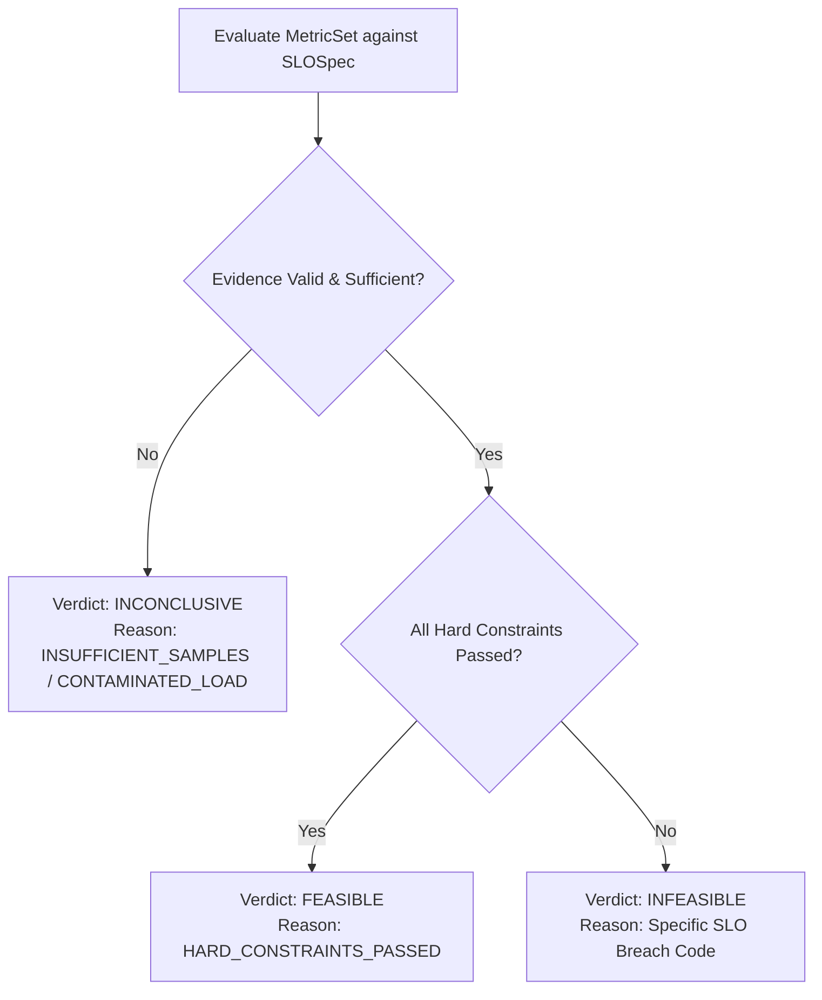

# SLOKern Decision Policy & Feasibility Semantics

> **Product:** SLOKern — *Optimize inference. Verify performance.*  
> **Status:** Active Specification (Policy Version: 1.0.0)  
> **Owner:** Rajdeep (Architecture, Verification & Optimization; Decision Verification Audit: Daksh, active Oct 24; Historical design: Daksh)  
> **Authority:** Aligned with [README.md](../README.md), [ROADMAP.md](../ROADMAP.md), and [docs/ownership.md](ownership.md)

---

## 1. Purpose & Core Principles

The Feasibility Evaluator is the deterministic core of SLOKern. Given a `MetricSet` and a declared `SLOSpec`, the evaluator determines whether a candidate serving configuration meets the user's hard constraints.

### Non-Negotiable Rules

1. **Deterministic Execution:** Feasibility decisions are calculated purely by deterministic Python code. No heuristic scoring, fuzzy weighting, or AI model can override an SLO evaluation.
2. **Missing != Passing:** A missing metric is never treated as a pass. If a required metric cannot be calculated, the verdict is `INCONCLUSIVE`.
3. **Hard Constraints are Absolute:** All hard constraints must pass. A single failure marks the candidate `INFEASIBLE`.
4. **Independent Status Domains:** Execution failure, measurement invalidity, SLO feasibility, and verification status are maintained as separate, uncollapsed states.
5. **No Green Inconclusive:** An `INCONCLUSIVE` result must never be displayed with a green pass badge in reports or the dashboard.

---

## 2. Verdict Semantics & Taxonomy

The evaluator emits one of three primary feasibility verdicts:



### 2.1 `FEASIBLE`
- **Definition:** Valid, uncontaminated evidence confirms that *every* required hard constraint in `SLOSpec` is strictly satisfied.
- **Preconditions:**
  - `EvidenceValidity` is `VALID`.
  - Number of valid non-warmup samples $\ge \text{min\_sample\_count}$.
  - Client load generator did not saturate.
  - Every evaluated constraint evaluates to `True`.

### 2.2 `INFEASIBLE`
- **Definition:** Valid evidence confirms that *at least one* required hard constraint in `SLOSpec` was violated.
- **Preconditions:**
  - `EvidenceValidity` is `VALID`.
  - At least one constraint observed value violates the threshold condition (e.g., observed TTFT p95 > threshold).
- **Note:** Infeasible candidates remain permanently in experiment history to explain why they were rejected.
- A valid completed run can be `INFEASIBLE`; execution failure, invalid evidence, missing metrics, or insufficient samples must not be translated into an SLO miss.

### 2.3 `INCONCLUSIVE`
- **Definition:** Evidence is invalid, missing, noisy, or insufficient to support an authoritative pass or fail verdict.
- **Triggers:**
  - Valid sample count falls below `min_sample_count`.
  - Client load generator saturated (`achieved_load` diverges significantly from `offered_load`).
  - Required metric is null or missing from `MetricSet`.
  - Benchmark run was aborted before measurement window completed.
- **Rule:** An inconclusive candidate can never win candidate selection or be submitted for verification.

### 2.4 Objective rankability is separate from feasibility

`FEASIBLE` means the declared hard SLO constraints passed; it does not mean a candidate has the evidence needed for the declared ranking objective. A candidate with missing, non-finite, invalid, or unavailable objective evidence must be ineligible for winner selection while retaining its original SLO verdict and an exclusion reason. A monetary-cost objective must not fall back to reciprocal throughput. An alternative objective is allowed only when declared and validated before the campaign.

**Current implementation gap (`BLK-16`):** `rank_candidates()` keeps `FEASIBLE` rows with `ranking_metric=None` and sorts them last; if every row lacks a metric, one can still be returned as winner. `extract_ranking_metric()` substitutes reciprocal throughput for missing Mode A monetary metadata. Documentation states the required policy; code does not yet enforce it.

### 2.5 Execution Failure vs. SLO Infeasibility
If an experiment terminates abnormally due to a process crash, out-of-memory error, network abort, or bad credentials, the `RunRecord` marks `execution_status = FAILED`. This is **not** an SLO infeasibility verdict (`INFEASIBLE`), because no valid inference distribution was observed.

**Integration limitation:** The current `evaluate_slo()` API receives `MetricSet` and `SLOSpec`, not the corresponding `RunRecord`; therefore the stated separation is a policy requirement, not a complete end-to-end implementation of run-validity gating. The run controller must prevent failed/invalid executions from entering ranking.

---

## 3. Reason Code Taxonomy

Every constraint evaluation produces an auditable, machine-readable reason code:

| Reason Code | Verdict Category | Description |
|---|---|---|
| `HARD_CONSTRAINTS_PASSED` | `FEASIBLE` | All declared hard constraints met or exceeded required thresholds. |
| `TTFT_P95_EXCEEDED` | `INFEASIBLE` | 95th percentile Time to First Token exceeded declared threshold. |
| `TTFT_P50_EXCEEDED` | `INFEASIBLE` | Median Time to First Token exceeded declared threshold. |
| `ITL_P95_EXCEEDED` | `INFEASIBLE` | 95th percentile Inter-Token Latency exceeded declared threshold. |
| `E2E_LATENCY_EXCEEDED` | `INFEASIBLE` | End-to-end request latency percentile exceeded threshold. |
| `ERROR_RATE_EXCEEDED` | `INFEASIBLE` | Fraction of failed requests exceeded allowed error budget. |
| `THROUGHPUT_DEFICIT` | `INFEASIBLE` | Achieved request or token throughput fell below required minimum. |
| `INSUFFICIENT_SAMPLES` | `INCONCLUSIVE` | Valid completed samples were fewer than `min_sample_count`. |
| `GENERATOR_SATURATED` | `INCONCLUSIVE` | Load generator CPU/thread starvation contaminated request dispatch. |
| `CONTAMINATED_LOAD` | `INCONCLUSIVE` | Offered load differed from target arrival schedule by > 10%. |
| `MISSING_REQUIRED_METRIC`| `INCONCLUSIVE` | A declared constraint targeted a metric not provided in `MetricSet`. |
| `UNSUPPORTED_OPERATOR` | `INCONCLUSIVE` | Constraint specified an unrecognized comparison operator. |

---

## 4. Boundary & Threshold Evaluation Rules

### Comparison Operators

Constraints are evaluated using strict mathematical operators:
- **`<=` (Less Than or Equal):** $\text{observed} \le \text{threshold}$. Example: $\text{TTFT}_{p95} \le 200.0\text{ ms}$. If observed is exactly 200.0 ms, the constraint passes.
- **`<` (Strictly Less Than):** $\text{observed} < \text{threshold}$.
- **`>=` (Greater Than or Equal):** $\text{observed} \ge \text{threshold}$. Example: $\text{Throughput} \ge 15.0\text{ req/s}$.
- **`>` (Strictly Greater Than):** $\text{observed} > \text{threshold}$.

### Precision and Rounding
- Latency metrics are evaluated in milliseconds (`ms`) with floating-point precision up to 2 decimal places.
- Throughput is evaluated in requests per second (`req/s`) or tokens per second (`tok/s`).
- Error rate is evaluated as a dimensionless fraction in range $[0.0, 1.0]$.
- No opportunistic rounding is performed to force a borderline candidate to pass.

---

## 5. Independent Verification Semantics

Verification is an architectural security feature to eliminate false positives from noisy search runs.

### Verification Lifecycle
```text
Candidate Selected (FEASIBLE during search)
              ↓
Assign brand new verification_run_id
              ↓
Execute identical WorkloadSpec & protocol
              ↓
Capture fresh RawRequestMeasurement stream
              ↓
Calculate independent verification MetricSet
              ↓
Evaluate constraints → Verification Verdict:
  - VERIFIED (if all hard constraints pass again)
  - VERIFICATION_FAILED (if any hard constraint fails)
  - VERIFICATION_INCONCLUSIVE (if rerun is noisy or incomplete)
```

### Verification Drift Analysis
If an accepted verification policy requests drift analysis, report metric deltas between the search run and the verification run:
$$\Delta M = \frac{M_{\text{verification}} - M_{\text{search}}}{M_{\text{search}}} \times 100\%$$

Verification feasibility is determined by applying the same declared hard SLOs to fresh verification evidence. A drift threshold is a separate policy from an SLO threshold and must not be inferred from it. The proposed ±15% p95 TTFT/TPOT tolerance is unapproved; TPOT is not currently in `MetricSet`. `src/slokern/core/verification/protocol.py` and `compare.py` are stubs, so drift behavior is not implemented.

---

## 6. Related Documentation

- [System Architecture](architecture.md)
- [Metrics Definitions & Aggregation Rules](metrics.md)
- [Experiment & Measurement Methodology](experiment-methodology.md)
- [ADR 0001: MVP Scope & Evidence Policy](adr/0001-mvp-scope-and-evidence.md)
- [ADR 0002: Dual-Mode Cost Accounting](adr/0002-cost-model.md)
