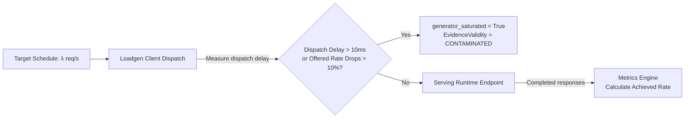

# SLOKern Experiment & Measurement Methodology

> **Product:** SLOKern — *Optimize inference. Verify performance.*  
> **Status:** Active Specification (Methodology Version: 1.0.0)  
> **Owner:** Rajdeep (Architecture, Benchmarking & Experiments; Historical design: Adriraj)  
> **Authority:** Aligned with [README.md](../README.md), [ROADMAP.md](../ROADMAP.md), and [docs/ownership.md](ownership.md)

---

## 1. Methodology Philosophy & Research Question

The core research question investigated by SLOKern is:

> **Under a fixed model, serving environment, workload profile, and experiment budget, can SLOKern experimentally identify a legal serving configuration that satisfies the declared SLO at lower measured cost—or discover feasibility more efficiently—than a default baseline configuration, and independently verify that recommendation?**

To answer this defensibly, benchmark measurements must be rigorously controlled, reproducible, and immune to client-side measurement artifacts.

---

## 2. Workload & Traffic Protocol

### 2.1 Prompt Fixtures
Benchmarks should use versioned, deterministic prompt fixtures (`fixtures/workloads/`). The proposed fixture mix is 70% small (256 input / 128 output tokens), 25% medium (1024 / 256), and 5% large (4096 / 256).
- **Exact tokenization is a gate:** Record the tokenizer revision, true prompt token count, completion count, fixture hash, and prompt ordering. The current load generator estimates input count as `int(len(prompt.split()) * 1.3)`; this is not exact tokenization. Do not describe it as measured tokenizer evidence. `RawRequestMeasurement.input_tokens` currently documents a measured count, so the implementation and contract description need a separately approved follow-up.
- **Fixture Provenance:** Record fixture path/content hash, tokenizer/model revision, arrival schedule seed, SLO-spec hash, and runtime versions with each run. Unique prompts and fixed request ordering reduce cache/order confounding but do not prove provider-side caches are disabled.

### 2.2 Traffic Arrival Processes
`WorkloadSpec` declares arrival models, while the current `ArrivalSchedule` implementation supports two open-loop models:

1. **Poisson Arrival Process (Open Loop):**
   - Inter-arrival times are exponentially distributed: $\Delta t \sim \text{Exp}(\lambda)$, where $\lambda$ is `target_offered_rate`.
   - Simulates realistic, bursty user traffic where new requests arrive independently of whether previous requests have completed.
2. **Constant Rate (Open Loop):**
   - Requests are dispatched at deterministic intervals: $\Delta t = \frac{1}{\lambda}$.
   - Ideal for stress testing queuing thresholds and measuring steady-state pipeline behavior.
3. **Closed Concurrency Loop (contract-only):** `ArrivalMode.CLOSED` exists in the Pydantic enum, but the current `ArrivalSchedule` rejects it. Do not claim the load generator implements this mode until code support is added and verified.

The proposed live benchmark uses a precomputed seeded Poisson schedule. Open-loop arrivals keep offered traffic independent of request completion, so slow responses cannot lower the generator's arrival rate and hide queueing. Constant-rate open-loop remains implemented and may be used if the campaign explicitly chooses it.

---

## 3. Warm-Up vs. Active Measurement Windows

A major source of flawed benchmark reporting is including cold-start samples in summary statistics. The current pipeline records warm-up flags and excludes warm-up rows from metrics. For the proposed 30B campaign, the planned windows are 120 seconds warm-up and `max(600 seconds, 2000 / λ*)` measurement, followed by draining outstanding requests to zero. This is a proposal, not an accepted or validated runtime profile.

```text
|<------------- Total Run Duration ------------->|
|-- Warm-Up Window --|---- Active Measurement Window ----|
[0s                120s]                              [120s + T]
  (Proposed warm-up)     (Proposed active window; at least 2,000 measured requests)
```

### 3.1 Warm-Up Window (`warmup_duration_s`)
- **Proposed duration:** 120 seconds for the proposed campaign; calibrate model-load and steady-state behavior during preflight. Do not shorten individual candidates after seeing results.
- **Purpose:** Warms CUDA memory allocations, pre-allocates KV-cache pages, populates instruction caches, and brings GPU clock frequencies to steady state.
- **Exclusion Rule:** Requests initiated during the warm-up window are marked `is_warmup = true` in raw logs and are **strictly excluded** from all `MetricSet` percentile calculations and SLO evaluations.

### 3.2 Active Measurement Window (`measurement_duration_s`)
- **Proposed duration:** `max(600 seconds, 2000 / λ*)`, where `λ*` is the pre-registered operating rate in requests/second. Drain outstanding requests before finalizing the run.
- **Execution:** Requests dispatched during this window represent the true steady-state performance. Only samples with `is_warmup = false` are analyzed by the metrics engine.

---

## 4. Offered vs. Achieved Load & Generator Saturation

A fundamental requirement in systems benchmarking is verifying that the benchmark client actually delivered the intended workload.



### Generator Saturation Detection
The subprocess load generator logs two timestamps for every request:
1. `scheduled_at`: Theoretical dispatch time dictated by the arrival schedule.
2. `sent_at`: Actual time socket transmission began.

If the load generator experiences thread starvation, high garbage collection latency, or CPU saturation:
$$\Delta t_{\text{dispatch\_skew}} = \text{sent\_at} - \text{scheduled\_at}$$
- The **current** implementation flags saturation if mean dispatch skew exceeds 10 ms or offered rate falls below 90% of target. The proposed campaign's p99 lateness ≤20 ms, client CPU <70%, and achieved/offered ≥0.98 are additional proposed gates only; they are not current evaluator rules.
- If an approved validity gate fails, record invalid/inconclusive evidence, not an SLO-infeasible serving result.
- If either current implemented condition is met, SLOKern flags:
  `generator_saturated = true`
- The run is tagged with `validity_status = CONTAMINATED`.
- **Consequence:** An evaluated candidate cannot be declared `FEASIBLE` under a contaminated run; the verdict is set to `INCONCLUSIVE` (`CONTAMINATED_LOAD`). This prevents falsely passing a slow server because the benchmark generator failed to deliver traffic.

---

## 5. Raw Event Capture (`RawRequestMeasurement`)

The load generator writes every individual request event directly to a local JSONL file (`artifacts/experiments/<id>/runs/<run_id>/raw_measurements.jsonl`):

> **Illustrative schema example only:** token-count values below are placeholders; current load generation estimates prompt tokens from whitespace and does not establish exact tokenizer counts.

```json
{
  "request_id": "req-0042a9b1",
  "run_id": "run-f19b02",
  "scheduled_at": 1792218400.100234,
  "sent_at": 1792218400.101012,
  "first_token_at": 1792218400.145620,
  "completed_at": 1792218400.312450,
  "http_status": 200,
  "input_tokens": 512,
  "output_tokens": 128,
  "is_warmup": false,
  "is_valid": true,
  "error_type": null
}
```

By persisting raw events rather than merely aggregates, any metric or percentile can be recalculated, audited, or plotted offline.

---

## 6. Fairness & Experimental Controls

To ensure scientific validity when comparing multiple candidates:

1. **Hardware & Environment Lock:** Hardware tier, GPU driver, CUDA version, container image, and OS kernel must remain unchanged across baseline, candidate search, and verification.
2. **Identical Workload Protocols:** Every candidate is tested using the exact same fixture, arrival rate, duration, and token limits.
3. **Configuration Isolation:** The target protocol requires effective-setting read-back before each warm-up window. Current Nebius adapter does not perform remote read-back (`BLK-17`), so this protocol is not yet executable against that adapter.

### 6.1 Proposed pilot, run budget, and cost accounting

The proposed pilot ladder tests a baseline at 2, 4, 8, 16, 32, and 64 requests/s for 90 seconds per rung, then applies a predeclared operating-point selection rule before freezing `λ*`. These pilot executions are additional operational runs, not free runs. Record each with a distinct run ID and raw evidence.

Keep these budget ledgers separate:

1. **Search budget:** baseline plus candidate explorations admitted by the controller.
2. **Verification reserve:** protected executions required by `ExperimentVerificationPolicy.repetitions` (default 1 in the contract); search must not spend this reserve.
3. **Controller total:** the cap enforced by `BudgetLimiter`. Current default is five search runs plus one verification run; custom constructor values can weaken that invariant (`BLK-15`).
4. **Operational run budget:** every preflight, pilot rung, baseline replicate, search/verification run, retry, failed/invalid run, and endpoint recreation. The current contract does not count these auxiliary run types.
5. **Billable-resource budget:** actual provider GPU, disk, volume, network, startup/download, idle, retry, and teardown time/cost. A run omitted from a controller counter still consumes this budget.

The current DEC-0010 six-run campaign is one baseline + four candidates + one verification. Adding six pilot rungs and a baseline replicate makes the total operational campaign larger. Do not describe the entire campaign as six executions unless those additional runs are removed or included by an approved budget change. Before launch, ratify the pilot cap and aggregate spend/time ceiling.

### 6.2 Run validity, failures, and independent verification

- Proposed validity checks include requested/effective settings match, endpoint health before and after the window, generator capacity, no process restart/OOM, cache state captured where observable, and complete accounting for timeouts, dropped requests, partial streams, and cancellations. The numerical p99-lateness, CPU, and 0.98 load-ratio gates require approval and code support before they can determine verdicts.
- A crashed process, failed health check, invalid load generator, configuration mismatch, or incomplete stream is not a valid SLO failure and must not be ranked as a successful candidate. The current evaluator receives only `MetricSet` and `SLOSpec`; it does not consume `RunRecord.execution_status` or per-request validity as a global run gate. This integration gap needs a separately approved code change before the full invariant can be claimed.
- Verification needs a fresh run ID, fresh raw request evidence, the same frozen winner settings/SLO/workload, and a separately generated arrival schedule. `ExperimentVerificationPolicy.repetitions` governs the reserve. The proposed ±15% p95 TTFT/TPOT agreement tolerance is **not approved** and must not be silently applied; no TPOT metric exists in the current contract.
- `src/slokern/core/verification/protocol.py` and `compare.py` are stubs. Verification independence and any drift comparison are planned, not implemented.

---

## 7. Related Documentation

- [System Architecture](architecture.md)
- [Metrics Definitions & Aggregation Rules](metrics.md)
- [Decision Policy & Feasibility Semantics](decision-policy.md)
- [Serving Deployment Notes](deployment.md)
- [ADR 0001: MVP Scope & Evidence Policy](adr/0001-mvp-scope-and-evidence.md)

