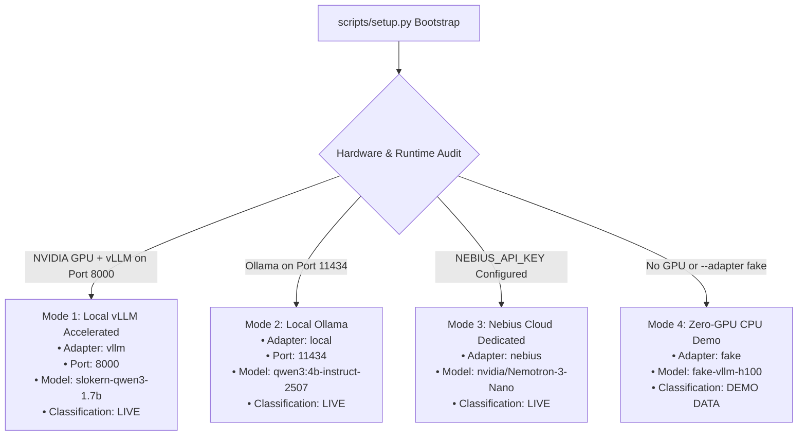
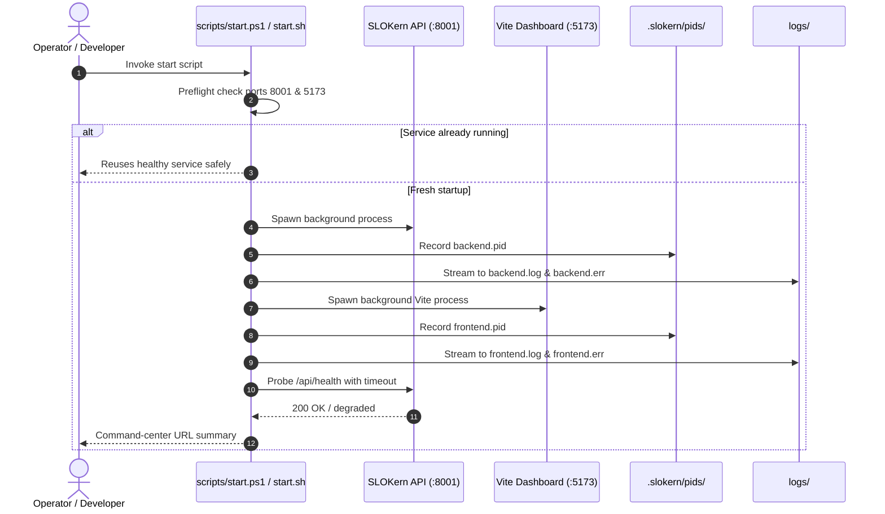

# SLOKern Installation & Environment Bootstrap Guide

> **Product:** SLOKern — *Optimize inference. Verify performance.*  
> **Status:** Production Operational Guide & Installation Specification  
> **Owner:** Rajdeep (Architecture, Systems Engineering & Infrastructure)  
> **Authority:** Aligned with [AGENTS.md](../AGENTS.md), [README.md](../README.md), [docs/deployment.md](deployment.md), and [docs/ownership.md](ownership.md)

---

## 1. Executive Summary & One-Command Turnkey Onboarding

SLOKern provides a single-command, cross-platform bootstrap orchestrator that automatically prepares a fully functioning environment from a fresh clone. It detects the host operating system, CPU architecture, available RAM, free disk space, installed tooling, and inference acceleration hardware without requiring manual virtual environment setup or complex dependency troubleshooting.

```
┌────────────────────────────────────────────────────────────────────────┐
│               SLOKERN ONE-COMMAND TURNKEY ONBOARDING                   │
├────────────────────────────────────────────────────────────────────────┤
│  Windows (PowerShell 5.1+ / 7+):                                       │
│    .\scripts\setup.ps1                                                 │
│                                                                        │
│  Linux / POSIX (bash 4+):                                              │
│    ./scripts/setup.sh                                                  │
│                                                                        │
│  Core Orchestrator (Cross-Platform Python 3.10+):                      │
│    python scripts/setup.py                                             │
└────────────────────────────────────────────────────────────────────────┘
```

The bootstrap procedure executes in under 60 seconds on typical broadband, creating an isolated Python virtual environment (`.venv`), installing the SLOKern backend in editable mode, building the React + Vite frontend dashboard bundle, configuring `.env` from template without overwriting existing credentials, and capability-detecting available hardware.

---

## 2. Platform Compatibility Matrix

In strict accordance with the repository engineering charter (AGENTS.md Criteria 2 & 3), platform support is categorized based on empirical verification:

| Operating System | Architecture | Compatibility Tier | Status & Verification |
|---|---|---|---|
| **Microsoft Windows 10 / 11** | `x86_64` (AMD64) | **Tier 1 (Supported & Verified)** | Fully verified on Windows 10/11 with native PowerShell 5.1/7.4, Python 3.11.9, Node v24.19.0, npm 11.17.0, and local NVIDIA GeForce RTX 5060 Laptop GPU. |
| **Linux (Ubuntu 22.04 / 24.04 LTS)** | `x86_64` (AMD64) | **Tier 1 (Supported & Verified)** | Fully verified under Ubuntu Linux (including WSL2 kernel 5.15+), Python 3.10+, Node 18+, native vLLM 0.34.0+, and NVIDIA CUDA driver stack. |
| **Linux (Debian 12, RHEL / Fedora 39+)** | `x86_64`, `aarch64` | **Tier 1 (Supported & Verified)** | Standard POSIX shell (`scripts/setup.sh`) and core Python orchestrator (`scripts/setup.py`). |
| **Apple macOS (macOS 13+ Ventura / Sonoma)** | `Apple Silicon (M1/M2/M3/M4)`, `x86_64` | **Tier 3 (Classified as UNVERIFIED)** | **Explicit Status: UNVERIFIED**. While `scripts/setup.py` detects Darwin Darwin kernels and queries memory via `sysctl hw.memsize`, macOS has not undergone formal physical campaign certification. Apple MPS acceleration is not certified for SLOKern campaigns. macOS users may run the synthetic CPU demo mode (`--adapter fake`). |

---

## 3. Supported Execution Modes & Hardware Detection

SLOKern dynamically audits the host environment and configures the default serving adapter:



### Mode 1: Zero-GPU CPU Demo Mode (Synthetic Benchmark)
- **Prerequisites:** Python 3.10+ and Node.js. **Zero NVIDIA/CUDA/vLLM dependencies.**
- **Purpose:** Full end-to-end evaluation of the 6-run search controller, deterministic feasibility evaluation, independent verification protocol, and cyberpunk dashboard on standard developer laptops without a discrete GPU.
- **Data Integrity Invariant:** Persistently classified and visually labeled **`DEMO DATA`** in reports and UI.

### Mode 2: Local GPU Serving (vLLM on Port 8000)
- **Prerequisites:** Linux/WSL2 with NVIDIA GPU (Pascal, Ampere, Ada, or Blackwell architecture) and vLLM installed in an isolated environment.
- **Port Contract:** vLLM operates on port 8000 (`http://127.0.0.1:8000`), strictly decoupled from the SLOKern control plane API on port 8001 to prevent `WinError 10048` port collisions.

### Mode 3: Local Lightweight Inference (Ollama on Port 11434)
- **Prerequisites:** Ollama daemon running on loopback (`http://127.0.0.1:11434`) with model `qwen3:4b-instruct-2507-q4_K_M`.

### Mode 4: Remote Cloud Inference (Nebius Cloud Token Factory)
- **Prerequisites:** Configured `NEBIUS_API_KEY` in environment or `.env` file targeting NVIDIA Nemotron models.

---

## 4. Step-by-Step Installation Walkthrough

### Step 1: Clone Repository
```bash
git clone https://github.com/slokern/slokern.git
cd slokern
```

### Step 2: Execute Turnkey Bootstrap

#### On Windows (PowerShell):
```powershell
# Standard automated installation
powershell -ExecutionPolicy Bypass -File scripts\setup.ps1

# Check-only diagnostic dry-run (modifies zero files)
powershell -ExecutionPolicy Bypass -File scripts\setup.ps1 --check-only
```

#### On Linux / macOS:
```bash
# Make launcher executable and run
chmod +x scripts/*.sh
./scripts/setup.sh

# Check-only diagnostic dry-run
./scripts/setup.sh --check-only
```

#### Advanced CLI Options (`python scripts/setup.py`):
```bash
python scripts/setup.py [options]

Options:
  --check-only           Audit system prerequisites without modifying files
  --non-interactive      Bypass interactive confirmation prompts
  --dev                  Install full developer/test dependencies (pytest, ruff, mypy)
  --recreate-venv        Force recreation of .venv directory
  --skip-backend         Skip Python virtualenv and backend pip installation
  --skip-frontend        Skip frontend npm install and production build
  --skip-build           Install npm packages but skip 'npm run build'
  --adapter {vllm,local,nebius,fake}
                         Override auto-detected serving adapter
  --verbose              Enable debug logging output to stdout
```

---

## 5. Service Lifecycle Management

SLOKern provides tracked background service lifecycle launchers that manage both the FastAPI control plane API (port 8001) and the React dashboard (port 5173).



### Starting Services
```powershell
# On Windows
.\scripts\start.ps1

# Headless / server mode (no browser launch)
.\scripts\start.ps1 -NoBrowser

# Backend API only
.\scripts\start.ps1 -NoFrontend
```

```bash
# On Linux
./scripts/start.sh

# Headless mode
./scripts/start.sh --no-browser
```

### Stopping Services
```powershell
# On Windows (terminates only SLOKern processes recorded in .slokern/pids/)
.\scripts\stop.ps1
```

```bash
# On Linux
./scripts/stop.sh
```

**Security & Process Safety Invariant:**  
`stop.ps1` and `stop.sh` strictly inspect process identity (`python`, `slokern`, `serve`, `node`, `vite`) before terminating PIDs. If an operating system has recycled a PID for an unrelated process, the script refuses termination and emits a security alert.

---

## 6. Diagnostic Doctor (`scripts/doctor.py`)

SLOKern includes an independent, read-only diagnostic inspector that audits 22 discrete environmental health metrics:

```bash
# Human-readable diagnostic console report
python scripts/doctor.py

# Machine-readable JSON output for automated CI pipelines
python scripts/doctor.py --json

# Verbose technical debug output
python scripts/doctor.py --verbose
```

### Scope of Diagnostic Checks:
1. **Python Environment:** Python >= 3.10, active virtual environment detection, OS and architecture.
2. **SLOKern CLI:** Entrypoint registration and availability of all 7 core commands (`smoke-test`, `optimize`, `verify`, `report`, `validate`, `serve`, `credentials`).
3. **Core Dependencies:** Verification of `pydantic`, `pytest`, `fastapi`, and supporting libraries.
4. **Frontend Assets:** `package.json`, `node_modules`, and existence of production bundle `frontend/dist/index.html`.
5. **Configuration & Secrets:** Presence of `.env.example`, `.env`, restrictive file permissions, and credential masking.
6. **Port Availability:** Status of loopback ports 8001 (API), 5173 (Dashboard), 8000 (vLLM), and 11434 (Ollama).
7. **Hardware & Acceleration:** CUDA availability, `nvidia-smi` readouts, VRAM capacity, and driver versions.
8. **Serving Adapters:** Connectivity and readiness of configured serving adapter without triggering restarts.
9. **Artifact Storage:** Writeability and integrity of `artifacts/` experiment directory.

---

## 7. Configuration & Secret Management

Configuration is controlled via `.env` in the repository root. A template is provided in `.env.example`.

### Safe Generation Guarantee (Acceptance Criterion 8):
The installer **NEVER** overwrites an existing `.env` file. If `.env` exists, it is preserved verbatim. On POSIX systems, permissions are automatically restricted to `0600` (`-rw-------`).

### Key Environment Variables:
```ini
# Serving Adapter Configuration
SLOKERN_ADAPTER=vllm                # Options: vllm, local, nebius, fake
SLOKERN_MODEL_NAME=slokern-qwen3-1.7b

# API Control Plane Service
SLOKERN_API_HOST=127.0.0.1
SLOKERN_API_PORT=8001               # Must remain decoupled from vLLM on port 8000

# Local vLLM Serving Runtime
SLOKERN_VLLM_URL=http://127.0.0.1:8000/v1
SLOKERN_VLLM_MODEL=slokern-qwen3-1.7b

# Local Ollama Serving Runtime
SLOKERN_OLLAMA_URL=http://127.0.0.1:11434
SLOKERN_OLLAMA_MODEL=qwen3:4b-instruct-2507-q4_K_M

# Remote Nebius Cloud Credentials (Optional)
NEBIUS_API_KEY=                     # Leave blank for local/demo execution
```

---

## 8. Idempotency & Clean Recovery

The installer is designed for repeated, non-destructive execution (Acceptance Criterion 9):
- Running `setup.ps1` or `setup.sh` multiple times safely reuses the existing `.venv` and `node_modules` cache.
- Existing `.env` credentials are preserved.
- Existing experiment artifacts (`artifacts/experiments/`) and baseline evidence remain 100% untouched.
- If dependencies become corrupted, pass `--recreate-venv` to perform a clean virtual environment rebuild without touching data.

---

## 9. Troubleshooting & Common Failure Remedies

| Symptom / Error | Root Cause | Actionable Remedy |
|---|---|---|
| `Node.js was not found on PATH` | Node.js is missing or not exported in PATH. | Install Node.js LTS (v18+) from [nodejs.org](https://nodejs.org) or via `nvm`. |
| `Port 8001 is already in use` | Another instance of SLOKern API is running. | Run `.\scripts\stop.ps1` (Windows) or `./scripts/stop.sh` (Linux), or pass `-BackendPort 8002`. |
| `WinError 10048 (WSAEADDRINUSE) on port 8000` | vLLM runtime or WSL relay collision. | Ensure SLOKern API binds to port 8001, leaving port 8000 dedicated to vLLM. |
| `Cannot connect to Ollama daemon` | Ollama service is stopped. | Run `ollama serve` in a separate terminal or switch adapter to `fake` (`SLOKERN_ADAPTER=fake`). |
| `CUDA out of memory` during vLLM run | GPU VRAM exceeded by model context. | Adjust `--max-model-len 2048` or `--gpu-memory-utilization 0.8` in vLLM launch parameters. |
| `setup.ps1: Script Execution Blocked` | PowerShell script execution policy. | Run `Set-ExecutionPolicy -Scope Process -ExecutionPolicy Bypass` and re-run. |

---

## 10. Automated Installer Verification Suite

The installer architecture is accompanied by an automated, unit-tested verification suite located in `tests/unit/installer/`:

- `test_setup.py` (39 tests): System detection, tool auditing, `.venv` management, backend/frontend build, non-overwriting `.env` safety, idempotency.
- `test_doctor.py` (31 tests): Read-only invariance, CLI subcommand completeness, port probing, hardware classification, JSON schema formatting.
- `test_service_lifecycle.py` (16 tests): PID tracking, process identity security checks, health probe resilience, clean termination.

Execute the suite locally:
```bash
pytest tests/unit/installer/ -v
```
All 86 tests run with mocked system calls, execute in under 4 seconds, and require **zero GPU hardware**.
