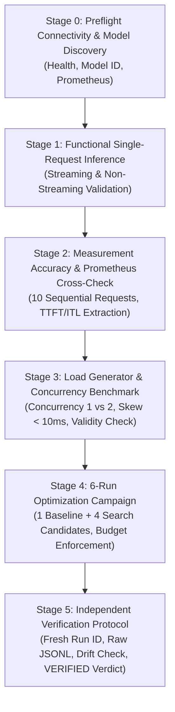
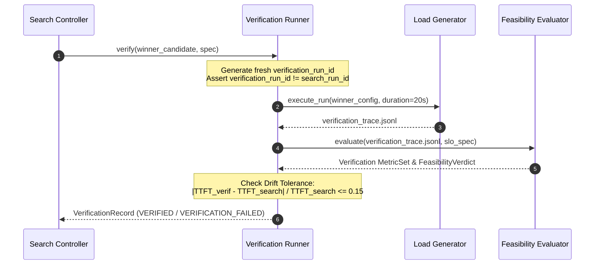

# Local Benchmark Protocol — Live vLLM on RTX 5060

> **Product:** SLOKern — *Optimize inference. Verify performance.*  
> **Subsystem:** Benchmark Engine, Load Generator & Verification Runner  
> **Document Type:** Operational Benchmark Protocol & Verification Ladder  
> **Status:** APPROVED PLANNING SPECIFICATION (Execution Mode: PLANNING ONLY)  
> **Date:** November 18, 2026  
> **Authority:** Aligned with AGENTS.md Section 12, `docs/experiment-methodology.md`, and DEC-0014

---

## 1. Objective & Hardware Constraints

This protocol defines the formal, progressive benchmark verification procedure for SLOKern against the live local vLLM serving environment.

### 1.1 Hardware & Runtime Safety Limits

To guarantee operational stability on the NVIDIA RTX 5060 Laptop GPU (8 GB GDDR7 VRAM) and avoid out-of-memory crashes or thrashing:

| Parameter | Safety Envelope | Technical Justification |
|---|---|---|
| **Max Concurrency** | **2 parallel requests** | Matches vLLM startup parameter `--max-num-seqs 2`. Concurrency $> 2$ queues in the vLLM scheduler, inflating TTFT. |
| **Max Context Window** | **1,024 tokens** | Well within `--max-model-len 4096`; avoids deep KV-cache allocation spikes. |
| **Max Output Tokens** | **128 tokens** | Prevents excessive decode latency on mobile GPU memory bus. |
| **Warm-Up Duration** | **5 – 10 seconds** | Primes CUDA kernels, PyTorch eager execution graph, and KV-cache allocators. |
| **Active Window** | **15 – 30 seconds** | Captures statistically stable distribution without overheating mobile GPU thermal envelope. |
| **Inter-Run Cooldown** | **5 seconds** | Allows vLLM scheduler to drain completed requests and reclaim KV cache blocks. |

---

## 2. Five-Stage Benchmark Ladder

The local benchmark protocol executes in five progressive stages. Each stage is an explicit quality gate that must pass before advancing to the next.



---

### Stage 0: Preflight Connectivity & Discovery

**Goal:** Verify server readiness and model identity without placing compute load on the GPU.

- **Actions:**
  1. `GET http://localhost:8000/health` $\rightarrow$ Assert HTTP 200.
  2. `GET http://localhost:8000/v1/models` $\rightarrow$ Assert model `slokern-qwen3-1.7b` is present with `max_model_len >= 4096`.
  3. `GET http://localhost:8000/metrics` $\rightarrow$ Assert Prometheus exporter is active and metric `vllm:num_requests_running` equals 0.
- **Pass Criteria:** Zero network errors; model identity confirmed.

---

### Stage 1: Functional Single-Request Inference

**Goal:** Verify end-to-end inference execution, token generation, and streaming chunk mechanics.

- **Actions:**
  1. Send 1 non-streaming request:
     ```json
     {"model": "slokern-qwen3-1.7b", "messages": [{"role": "user", "content": "Explain KV cache in 20 words."}], "max_tokens": 32, "temperature": 0.0}
     ```
     Assert HTTP 200, valid response string, token usage reported.
  2. Send 1 streaming request (`"stream": true`):
     Assert SSE stream starts with HTTP 200 headers, content chunks arrive, and stream terminates with `[DONE]`.
  3. Verify handling of `<think>` reasoning tokens generated by Qwen3.
- **Pass Criteria:** Both requests succeed; streaming chunks yield non-empty text.

---

### Stage 2: Measurement Accuracy & Prometheus Cross-Check

**Goal:** Validate monotonic timestamp extraction, client TTFT/ITL derivation, and cross-validate against vLLM internal metrics.

- **Protocol:**
  - Execute 10 sequential streaming requests (fixed prompt, `max_tokens = 64`, `temperature = 0.0`).
  - Capture client-side `time.perf_counter()` timestamps for:
    - $t_{\text{sent}}$
    - $t_{\text{first\_token}}$
    - $t_{\text{chunk\_}i}$
    - $t_{\text{completed}}$
  - Scrape `GET /metrics` before Request 1 and after Request 10.
- **Formulas & Reconciliation:**
  - Client TTFT: $\text{TTFT}_k = (t_{\text{first\_token}} - t_{\text{sent}}) \times 1000\text{ ms}$
  - Client Chunk ITL: $\text{ITL}_{k,i} = (t_{\text{chunk\_}i} - t_{\text{chunk\_}(i-1)}) \times 1000\text{ ms}$
  - Server TTFT: Delta in `vllm:time_to_first_token_seconds_bucket` histogram.
- **Pass Criteria:**
  - All 10 requests succeed.
  - Mean client TTFT within $\pm 25\text{ ms}$ of Prometheus server-reported TTFT.
  - Zero negative or NaN latencies.

---

### Stage 3: Load Generator & Concurrency Benchmark

**Goal:** Stress test traffic injection, open-loop arrival mechanics, and client saturation detection.

- **Protocol:**
  - Test 3A (Concurrency = 1): Target rate $\lambda = 1.0\text{ req/s}$, Poisson arrival, duration = 15s.
  - Test 3B (Concurrency = 2): Target rate $\lambda = 2.0\text{ req/s}$, Constant rate, duration = 15s.
- **Saturation & Contamination Gates:**
  - Mean dispatch lag $\Delta t_{\text{skew}} = \frac{1}{N} \sum |t_{\text{dispatch\_actual}} - t_{\text{dispatch\_scheduled}}| \le 10.0\text{ ms}$.
  - Delivered offered load ratio: $\frac{\text{Achieved Offered Rate}}{\text{Target Offered Rate}} \ge 0.90$.
- **Pass Criteria:**
  - Load generator completes without unhandled queue stalls.
  - Evidence marked `EvidenceValidity.VALID` (or `CONTAMINATED` if dispatch lag $> 10\text{ ms}$).

---

### Stage 4: 6-Run Optimization Campaign

**Goal:** Execute the complete candidate search pipeline under the strict 6-run budget.

- **Search Space (2×2 Matrix):**
  - Baseline: `concurrency = 1, max_tokens = 64` (Run 1)
  - Candidate 1: `concurrency = 1, max_tokens = 32` (Run 2)
  - Candidate 2: `concurrency = 1, max_tokens = 128` (Run 3)
  - Candidate 3: `concurrency = 2, max_tokens = 32` (Run 4)
  - Candidate 4: `concurrency = 2, max_tokens = 64` (Run 5)
- **Hard Constraints Declared (SLO):**
  - TTFT p95 $\le 2500.0\text{ ms}$
  - ITL p95 $\le 30.0\text{ ms}$
  - Error rate $\le 0.05$
- **Deterministic Ranker:**
  - Selects feasible candidate maximizing output token throughput.
- **Pass Criteria:**
  - Exactly 5 search runs execute; budget limiter halts further exploration.
  - Winning candidate selected deterministically with explicit rationale.

---

### Stage 5: Independent Verification Protocol

**Goal:** Independently verify the winning candidate using a fresh run ID and unaggregated evidence.



- **Verification Invariants:**
  1. `verification_run_id != search_run_id` (enforced by contract).
  2. Independent raw JSONL trace recorded at `runs/{campaign_id}/verification_{run_id}.jsonl`.
  3. Metrics recomputed from scratch; zero reuse of search metrics.
  4. Feasibility evaluated against original hard constraints.
  5. Latency drift check: $\frac{|\text{TTFT}_{\text{verif}} - \text{TTFT}_{\text{search}}|}{\text{TTFT}_{\text{search}}} \le 0.15$ ($15\%$ tolerance).
- **Pass Criteria:**
  - Verification run completes with fresh run ID.
  - Hard SLOs pass.
  - Drift tolerance $\le 15\%$.
  - Final verdict: **`VERIFIED`**.

---

## 3. Raw Request JSONL Schema Specification

Every request executed during active measurement must be preserved in a line-delimited JSONL trace with the following schema:

```json
{
  "request_id": "req-9b8a21f4-001",
  "run_id": "run-local-vllm-01",
  "candidate_id": "cand-local-01",
  "scheduled_at": 1731904800.1205,
  "sent_at": 1731904800.1221,
  "first_token_at": 1731904800.2991,
  "completed_at": 1731904801.4162,
  "ttft_ms": 177.0,
  "e2e_ms": 1294.1,
  "itl_observations_ms": [15.2, 15.6, 15.4, 15.8, 16.1],
  "prompt_tokens": 23,
  "completion_tokens": 73,
  "is_warmup": false,
  "is_valid": true,
  "error_type": null,
  "http_status": 200
}
```

### 3.1 Trace Integrity Validation Gates

Before derived metrics are accepted by the evaluator:
1. `sent_at >= scheduled_at` (non-negative dispatch lag).
2. `first_token_at >= sent_at` (causality invariant).
3. `completed_at >= first_token_at` (causality invariant).
4. `prompt_tokens > 0` and `completion_tokens > 0`.
5. Warmup records (`is_warmup: true`) are segregated and excluded from percentile aggregations.

---

## 4. Execution Command Reference

```powershell
# 1. Stage 0 & 1: Quick Preflight Connectivity Probe
python -c "import urllib.request, json; print('Health:', urllib.request.urlopen('http://localhost:8000/health').getcode()); print('Models:', json.loads(urllib.request.urlopen('http://localhost:8000/v1/models').read())['data'][0]['id'])"

# 2. Stage 2: Scrape Prometheus Baseline
python -c "import urllib.request; resp = urllib.request.urlopen('http://localhost:8000/metrics').read().decode('utf-8'); print('Prometheus metric lines:', len(resp.splitlines()))"

# 3. Full Campaign Run (Once Adapter is Wired)
slokern optimize --adapter vllm --endpoint http://localhost:8000 --model slokern-qwen3-1.7b --verify
```
