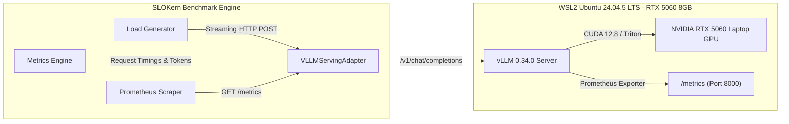
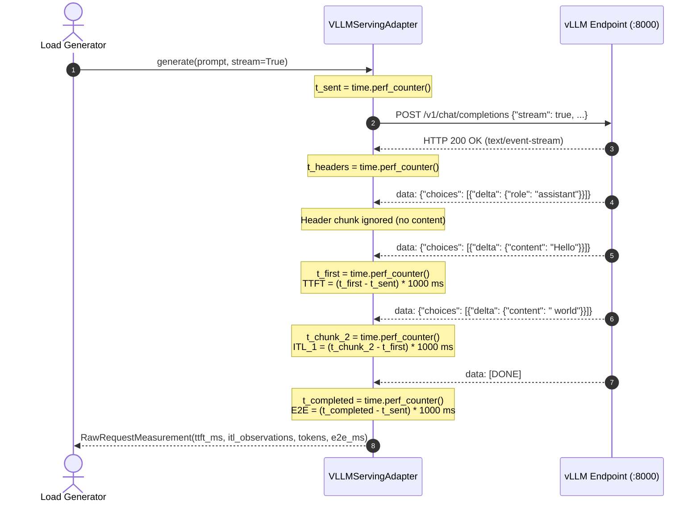

# Local vLLM Serving Adapter & Integration Plan

> **Product:** SLOKern — *Optimize inference. Verify performance.*  
> **Subsystem:** Serving Engine & Local Inference Runtime  
> **Document Type:** Technical Architecture & Adapter Specification  
> **Status:** APPROVED PLANNING SPECIFICATION (Execution Mode: PLANNING ONLY)  
> **Date:** November 18, 2026  
> **Authority:** Aligned with AGENTS.md Section 12, ROADMAP.md, and DEC-0014

---

## 1. Executive Summary & Hardware Context

This document defines the architectural specification for integrating a dedicated **Local vLLM Serving Adapter** (`VLLMServingAdapter`) into SLOKern. The adapter interfaces with an existing, running local vLLM 0.34.0 instance deployed on WSL2 Ubuntu with direct GPU passthrough to an NVIDIA RTX 5060 Laptop GPU.



### 1.1 Verified Physical Runtime Environment

The local vLLM serving environment has been verified via live empirical probe:

| Runtime Attribute | Verified Physical Configuration |
|---|---|
| **Host OS** | Windows 11 Enterprise (Build 26100) |
| **Guest OS** | WSL2 Ubuntu 24.04.5 LTS (`6.18.33.2-microsoft-standard-WSL2`) |
| **Python Runtime** | Python 3.12.3 |
| **Serving Framework** | vLLM 0.34.0 (`vllm.entrypoints.openai.api_server`) |
| **Deep Learning Stack** | PyTorch 2.15.0+cu132 · Triton 3.9.0 · CUDA 12.8 Driver Passthrough |
| **Accelerator** | NVIDIA GeForce RTX 5060 Laptop GPU (8,188 MiB GDDR7 VRAM) |
| **Attention Backend** | FlashAttention 2 (`--enforce-eager` execution) |
| **Base Model** | `Qwen/Qwen3-1.7B` (`Qwen3ForCausalLM`, BF16 Safetensors) |
| **Served Model Name** | `slokern-qwen3-1.7b` |
| **Serving Endpoint** | `http://localhost:8000` (or `http://127.0.0.1:8000`) |
| **Max Model Length** | 4,096 tokens |
| **Max Concurrent Sequences** | 2 sequences (`--max-num-seqs 2`) |
| **GPU Memory Utilization** | 0.80 (6,550 MiB reserved for weights + KV cache) |

---

## 2. Serving Adapter Assessment & Architecture

### 2.1 Why Existing Adapters Cannot Be Repurposed

A thorough architectural audit of [src/slokern/engine/serving/](file:///c:/Users/paulr/OneDrive/DevArena/slokern/src/slokern/engine/serving) reveals why existing adapters cannot be cleanly repurposed for local vLLM:

1. **`ollama.py` Incompatibility:**
   - **Endpoint Mismatch:** Ollama exposes native endpoints (`/api/tags`, `/api/chat`, `/api/generate`), not OpenAI-standard `/v1/` routes.
   - **Schema Mismatch:** Ollama wraps configuration in an `options` dict with specific keys (`num_batch`, `num_ctx`, `temperature`), which are incompatible with vLLM's standard OpenAI payload format.
   - **Health & Metrics:** Ollama lacks native Prometheus `/metrics` exposition on the inference port.

2. **`nebius.py` Incompatibility:**
   - **Hardcoded Remote URL:** Nebius adapter hardcodes `https://api.tokenfactory.nebius.com/v1` and mandates a remote `NEBIUS_API_KEY`.
   - **No Local Metrics Scraping:** Nebius Token Factory does not expose a public `/metrics` Prometheus endpoint for scrape-based hardware instrumentation.
   - **Model Identity Differences:** Nebius serves hosted models (`nvidia/NVIDIA-Nemotron-3-Nano-30B-A3B`), lacking local model catalog discovery or physical GPU memory read-backs.

### 2.2 Dedicated `VLLMServingAdapter` Design

A dedicated adapter class `VLLMServingAdapter` will be created at `src/slokern/engine/serving/vllm.py`, subclassing `BaseServingAdapter` from [src/slokern/engine/serving/base.py](file:///c:/Users/paulr/OneDrive/DevArena/slokern/src/slokern/engine/serving/base.py).

```python
# Conceptual Architecture (src/slokern/engine/serving/vllm.py)
class VLLMServingAdapter(BaseServingAdapter):
    """Serving adapter for local or self-hosted vLLM inference engines.
    
    Exposes OpenAI-compatible completions with monotonic streaming token
    instrumentation, native model catalog validation, and Prometheus scraping.
    """
    
    def __init__(
        self,
        base_url: str = "http://localhost:8000",
        model: str = "slokern-qwen3-1.7b",
        timeout_seconds: float = 60.0,
        scrape_prometheus: bool = True,
    ) -> None:
        ...
```

### 2.3 Endpoint Interaction Contract

The adapter implements four core HTTP contracts against the vLLM server:

| Endpoint | HTTP Method | Contract Purpose | Expected Response |
|---|---|---|---|
| `/health` | `GET` | Instant connectivity & server readiness probe | HTTP 200 `OK` (empty body) |
| `/v1/models` | `GET` | Model identity and context length discovery | HTTP 200 JSON (`{"data": [{"id": "slokern-qwen3-1.7b", "max_model_len": 4096}]}`) |
| `/v1/chat/completions` | `POST` | Primary inference generation (streaming & non-streaming) | HTTP 200 SSE stream or JSON completion |
| `/metrics` | `GET` | Prometheus scraping for cross-validation | HTTP 200 text/plain Prometheus exposition format |

---

## 3. High-Resolution Streaming Token Measurement

Precise TTFT and ITL calculation requires monotonic timestamping and Server-Sent Events (SSE) stream parsing directly in the adapter or load-generator worker.



### 3.1 Measurement Rules & Timestamps

1. **Clock Source:** All timestamps use `time.perf_counter()` (monotonic, nanosecond resolution, unaffected by system clock adjustments).
2. **TTFT (Time to First Token):**
   - Measured as `(t_first_content_token - t_sent) * 1000.0` in milliseconds.
   - **Crucial Rule:** The initial chunk from vLLM often contains only `{"role": "assistant"}` without a `content` field. TTFT **must** record the timestamp of the first chunk containing a non-empty `content` or `reasoning_content` string.
3. **ITL (Inter-Token Latency):**
   - Recorded as the delta array between successive content chunks: $\Delta t_i = (t_{i} - t_{i-1}) \times 1000.0\text{ ms}$.
   - The average ITL for the request is the mean of the delta array.
4. **Token Accounting:**
   - Output tokens = Count of emitted chunks + any usage block provided in the final chunk.
   - For `Qwen/Qwen3-1.7B`, `<think>...</think>` tokens emitted during reasoning are counted as generated tokens contributing to decoded output bandwidth.

---

## 4. Prometheus Scraping & Ground-Truth Cross-Check

vLLM exposes rich Prometheus metrics on `GET /metrics`. The adapter captures snapshot deltas between the start and completion of each benchmark run.

### 4.1 Key Prometheus Metrics Discovered on Local vLLM

| Metric Identifier | Prometheus Type | Description |
|---|---|---|
| `vllm:time_to_first_token_seconds` | Histogram | Server-side TTFT distribution across requests |
| `vllm:inter_token_latency_seconds` | Histogram | Server-side chunk generation intervals |
| `vllm:e2e_request_latency_seconds` | Histogram | Server-side end-to-end execution latency |
| `vllm:prompt_tokens_total` | Counter | Cumulative prompt tokens processed |
| `vllm:generation_tokens_total` | Counter | Cumulative generation tokens decoded |
| `vllm:num_requests_running` | Gauge | Active requests currently in batch execution |
| `vllm:num_requests_waiting` | Gauge | Requests waiting in scheduler queue |
| `vllm:kv_cache_usage_perc` | Gauge | Fractional GPU KV cache block allocation |

### 4.2 Cross-Validation & Reconciliation Methodology

Client measurements and server metrics are reconciled as follows:

$$\text{TTFT}_{\text{client}} = \text{TTFT}_{\text{vllm}} + \Delta t_{\text{transport}} + \Delta t_{\text{client\_dispatch}}$$

$$\text{E2E}_{\text{client}} = \text{E2E}_{\text{vllm}} + \Delta t_{\text{network\_rtt}} + \Delta t_{\text{sse\_framing}}$$

- **Tolerance Bound:** Under local loopback (`http://localhost:8000`), client-observed TTFT and server-reported TTFT should match within $\pm 15\text{ ms}$.
- If $\text{TTFT}_{\text{client}} - \text{TTFT}_{\text{vllm}} > 30\text{ ms}$, the system flags potential client-side CPU starvation or dispatch latency.

---

## 5. Parameter Capability Envelope & Search Space

### 5.1 Immutable Startup Parameters vs Dynamic Request Parameters

The configuration centre strictly differentiates between parameters that require process restarts and parameters modifiable per request.

```mermaid
graph TD
    subgraph StartupParams[Immutable Startup Parameters (Process Restart Required)]
        S1["--max-num-seqs: 2"]
        S2["--gpu-memory-utilization: 0.80"]
        S3["--max-model-len: 4096"]
        S4["--dtype: bfloat16"]
        S5["--enforce-eager"]
    end

    subgraph DynamicParams[Dynamic Request Parameters (Per-Benchmark Controllable)]
        D1["max_tokens: [32, 64, 128, 256]"]
        D2["temperature: [0.0, 0.7, 1.0]"]
        D3["concurrency: [1, 2]"]
        D4["stream: True"]
    end
```

### 5.2 Safe Local Optimization Search Space (2×2 Matrix)

Given the hardware constraints of the 8 GB RTX 5060 Laptop GPU and the existing server configuration (`--max-num-seqs 2`), the safe local optimization search space explores:

- **Dimension 1 (Concurrency):** `concurrency = 1` vs `concurrency = 2`
- **Dimension 2 (Max Output Envelope):** `max_tokens = 64` vs `max_tokens = 128`

This produces a clean 2×2 optimization matrix runnable **without killing or restarting the running vLLM process**:

| Candidate ID | Concurrency | Max Tokens | Target Rate | Optimization Hypothesis |
|---|---|---|---|---|
| **`cand-local-01`** | 1 | 64 | 1.0 req/s | Minimum latency, zero queue contention |
| **`cand-local-02`** | 1 | 128 | 1.0 req/s | Longer decode window, single sequence |
| **`cand-local-03`** | 2 | 64 | 2.0 req/s | Batched prefill/decode overlap |
| **`cand-local-04`** | 2 | 128 | 2.0 req/s | Maximum GPU memory & compute saturation |

---

## 6. Error Taxonomy & Failure Handling

The adapter maps low-level network and HTTP errors into SLOKern's structured exception taxonomy:

| Error Condition | Source Indicator | Adapter Handling | Feasibility Classification |
|---|---|---|---|
| **Context Length Overflow** | HTTP 400 (`max_model_len` exceeded) | Catches error; records `REQUEST_INVALID` | Request-level failure; does not abort run |
| **GPU Out of Memory** | HTTP 500 / PyTorch CUDA OOM | Catches error; records `CUDA_OOM` | Aborts benchmark candidate; marks `EXECUTION_ERROR` |
| **Server Overloaded** | HTTP 503 / Connection refused | Catches error; records `SERVER_OVERLOADED` | Counts as error; if $> 5\%$, marks `INFEASIBLE` |
| **Premature Stream Termination** | Incomplete SSE chunks before `[DONE]` | Records `STREAM_TRUNCATED` | Marks request invalid; calculates achieved tokens |
| **Request Timeout** | Exceeds `timeout_seconds = 30.0s` | Cancels client socket; records `TIMEOUT` | Increments `failed_requests` |

---

## 7. Implementation Roadmap & Milestones

1. **Step 1:** Implement `src/slokern/engine/serving/vllm.py` with `VLLMServingAdapter`.
2. **Step 2:** Add contract tests in `tests/unit/engine/serving/test_vllm.py` verifying `/health`, `/v1/models`, and streaming SSE chunk parsing with mock HTTP servers.
3. **Step 3:** Register `"vllm"` in `ServingAdapterFactory` and frontend adapter catalog.
4. **Step 4:** Execute the live 5-stage benchmark ladder described in `docs/local-benchmark-protocol.md`.
